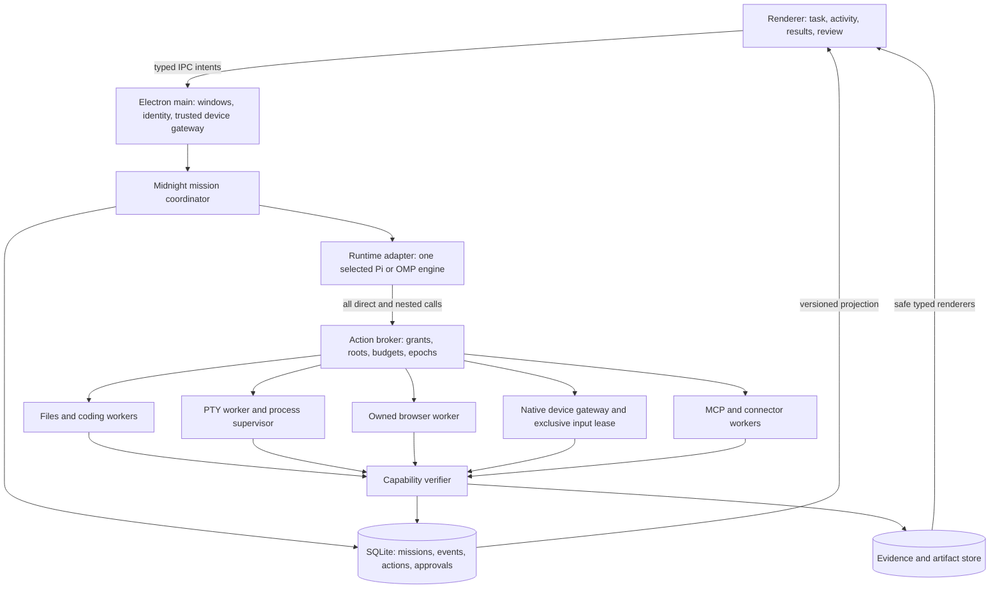
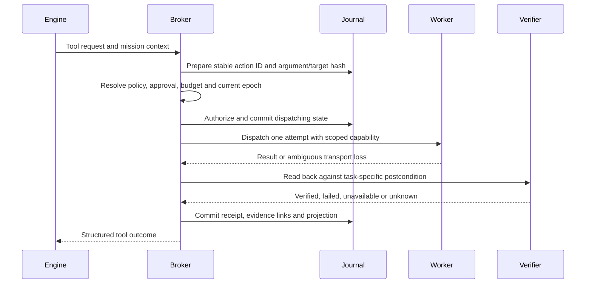

# Rebuild Midnight around verified, visible work

**Recommendation: evolve Midnight's existing Electron application around one upstream Pi coding-agent SDK, initially retaining the current ADR-selected 1.0.1 pin behind an app-owned runtime adapter, pending renewed qualification.** Make Midnight responsible for permissions, task state, action receipts, workers, verification, cancellation, budgets and presentation. Qualify Pi 1.1.0 as an upgrade and Oh My Pi as an isolated Bun/RPC challenger under the same tests; replace the engine only if a challenger produces a material, reproducible improvement and passes every safety and packaging gate. Preserve the default Midnight theme while reorganizing the interface around the user's task, current activity, results and next decision. Reduce both kinds of shortcuts: the commands people must memorize, and implementation shortcuts that conceal missing guarantees. This is a rebuild of a substantial existing foundation, not a greenfield rewrite or a claim that selecting a harness creates best-in-class computer use.

**Research date:** 12 October 2026, Asia/Kuala_Lumpur. **Status:** implementation proposal informed by repository inspection and primary documentation; no new comparative runtime benchmark, package installation, paid model evaluation or production code change was performed for this report. Numeric gates below are proposed acceptance criteria, not achieved results. “Observed” means source/documentation evidence; “recorded” means historical repository evidence; “proposed” means a decision to implement and validate. This distinction applies throughout.

The complete research record is in [harness research](<../research_notes/Midnight app rebuild plan/harnesses.md>), [repository and UX research](<../research_notes/Midnight app rebuild plan/repo_ux.md>) and [capability research](<../research_notes/Midnight app rebuild plan/capabilities.md>). The report is self-contained; those files preserve supporting detail and research limitations.

## 1. Keep the useful foundation and earn the engine choice

### 1.1 Pi already supplies the production starting point

The application is version 0.2.2, uses Electron 44.4.5 and vendors eight exact `@earendil-works/*` packages at 1.0.1. The provenance manifest records upstream registry artifacts, licenses and integrity. [ADR 0002](../docs/adr/0002-dependencies.md) and those artifacts establish the currently shipped upstream runtime; the preserved credential location does not mean Midnight still ships a forked runtime. README's fork description is stale. [CLAUDE](../CLAUDE.md) still applies to the retained optional sibling-fork workflow, including its build/vendor/install requirement when that sibling is changed; an ADR does not revoke repository instructions. Correct stale product descriptions and historical file references in a later documentation PR, using the manifest, lockfile and provenance to describe what ships. ([Manifest](../package.json), [provenance](../vendor/PROVENANCE.json), [README](../README.md))

The existing [runtime ADR](../docs/adr/0001-runtime.md) records a local comparison of the SDK and experimental Pi Durable on 4 October. It found useful tool interception in the SDK and demonstrated that neither approach alone prevented a model from requesting a repeated external effect after recovery. That recorded result supports the present SDK-plus-journal direction. It does not certify the current implementation or substitute for fresh recovery tests. Upstream Durable still describes its API as experimental. ([Pi Durable](https://raw.githubusercontent.com/earendil-works/pi/main/packages/durable/README.md))

Pi's canonical upstream is now `earendil-works/pi`; historical `badlogic/pi-mono` references redirect there. The observed newer release is 1.1.0, dated 7 October, whose tagged manifest requires Node >=22.19.0. Midnight must qualify actual exported APIs and packaged Electron compatibility before changing its pin. Current-main examples are evidence about upstream direction, not a compatibility guarantee for 1.0.1. ([Repository](https://github.com/earendil-works/pi), [release](https://github.com/earendil-works/pi/releases/tag/v1.1.0), [tagged manifest](https://raw.githubusercontent.com/earendil-works/pi/v1.1.0/packages/coding-agent/package.json))

### 1.2 Oh My Pi deserves a serious, contained trial

The core candidate is **`can1357/oh-my-pi`**, maintained under Stencil Labs, not the similarly named orchestration project. Its observed latest release was 18.9.2 on 11 October. Retrieved `main` manifests disagreed between coding-agent 18.9.1 and natives 18.9.2; resolve the tag, published tarball, native binaries and hashes before evaluating it. The coding-agent package requires Bun >=1.3.14, and the source uses Bun APIs. Its SDK exposes useful sessions and tool interception, but defaults include more discovery and machinery than Midnight should implicitly inherit. ([OMP repository](https://github.com/can1357/oh-my-pi), [release](https://github.com/can1357/oh-my-pi/releases/tag/v18.9.2), [manifest](https://raw.githubusercontent.com/can1357/oh-my-pi/main/packages/coding-agent/package.json), [SDK source](https://raw.githubusercontent.com/can1357/oh-my-pi/main/packages/coding-agent/src/sdk.ts))

OMP's documented RPC supports host-owned tools, cancellation and version-2 framing. It uses custom JSONL rather than JSON-RPC 2.0; large events require negotiated reassembly. `waitForIdle` is not a settlement barrier. Its ordinary question timeout can choose a recommended/default option, which must never authorize an effect. These details make a pinned standalone/Bun child process with a strict adapter preferable to importing its code into Electron's Node runtime. Its native Rust bindings, PTY, LSP, hash-aware editing and review workflows are valuable feature references, but documented native Windows operation is not proof that Midnight can package and stop them correctly. ([OMP RPC](https://raw.githubusercontent.com/can1357/oh-my-pi/main/docs/rpc.md), [SDK](https://raw.githubusercontent.com/can1357/oh-my-pi/main/docs/sdk.md), [natives](https://raw.githubusercontent.com/can1357/oh-my-pi/main/packages/natives/package.json), [README](https://raw.githubusercontent.com/can1357/oh-my-pi/main/README.md))

### 1.3 Compare alternatives by the layer they improve

This is a bounded review of plausible cores and relevant engineering references. A protocol, browser driver and agent harness solve different problems; “every harness” cannot be a finite, reproducible acceptance condition in an expanding ecosystem.

| Candidate | What the primary sources establish | Midnight decision and tradeoff |
|---|---|---|
| Pi coding-agent SDK | Embeddable sessions, explicit model/resource/settings boundaries, tools, streaming and branchable history. [SDK](https://raw.githubusercontent.com/earendil-works/pi/main/packages/coding-agent/docs/sdk.md) | Selected incumbent. Preserve integration investment and provider flexibility; build missing execution guarantees in Midnight. |
| Pi agent-core alone | Lower-level loop; coding-agent supplies additional session/context facilities. [Pi repository](https://github.com/earendil-works/pi) | Do not drop to this layer without evidence: it creates more host work without a measured benefit. |
| Pi Durable | Experimental persistence-oriented runtime. [README](https://raw.githubusercontent.com/earendil-works/pi/main/packages/durable/README.md) | Revisit only after API stability and policy/recovery improvements; not an exactly-once solution by itself. |
| Oh My Pi | Broad coding/native capabilities and headless SDK/RPC. [SDK](https://raw.githubusercontent.com/can1357/oh-my-pi/main/docs/sdk.md) | Sole first-round challenger; process boundary adds packaging cost but makes the experiment replaceable. |
| OpenCode | Typed SDK connects to an HTTP server with OpenAPI, events, permissions and password authentication. [SDK](https://opencode.ai/docs/sdk/), [server](https://opencode.ai/docs/server/) | Reference for session/client separation. Reconsider if remote execution becomes the product, not just to acquire another server. |
| Claude Agent SDK | Python/TypeScript host over Claude Code, sessions/tools/hooks/subagents/MCP. Permission callbacks have bypass conditions; `PreToolUse` gates every tool call. [Overview](https://code.claude.com/docs/en/agent-sdk/overview), [permissions](https://code.claude.com/docs/en/agent-sdk/permissions) | Possible later isolated coding specialist using authorized authentication; not the provider-neutral coordinator. |
| Codex SDK/app-server | SDK supports automation; official guidance directs custom interactive clients to app-server for auth/history/approvals/streaming. [SDK](https://learn.chatgpt.com/docs/codex-sdk), [app-server](https://learn.chatgpt.com/docs/app-server) | Potential later specialist through versioned stdio protocol. Do not scrape terminal output or expose its experimental WebSocket as a local default. |
| OpenHands Software Agent SDK | Python/REST local and remote execution with coding/browser/MCP facilities. [Docs](https://docs.openhands.dev/sdk) | Reference for isolated repository workers; avoid adding a Python/server distribution solely to replace working Pi integration. |
| LangGraph/Deep Agents | Persistence, interruption, planning, subagents and filesystem backends. [Deep Agents](https://docs.langchain.com/oss/javascript/deepagents/overview), [persistence](https://docs.langchain.com/oss/javascript/langgraph/persistence) | Reference for deterministic workflows. Reconsider only if such workflows dominate; two state coordinators would create ambiguity. |
| Aider | Scriptable code-editing CLI/Python interface. [Scripting](https://aider.chat/docs/scripting.html) | Coding evaluation/reference, not a desktop runtime dependency. |
| OpenAI Agents SDK | Agent loop, tools, handoffs, state/approvals and tracing integrations. [SDK](https://developers.openai.com/api/docs/guides/agents/sdk) | Reference for evaluation and handoffs; insufficient evidence to justify replacing Pi and its session/provider integration. |
| MCP / LSP / ACP | Tool interoperability / language tooling / editor-agent interoperability; their boundaries differ. | Adopt MCP and LSP at owned service boundaries; ACP is optional editor compatibility, not a second mission runtime. |

### 1.4 Make the comparison falsifiable before changing the dependency

Run A = pinned Pi 1.0.1, B = coherent Pi 1.1.0, and C = verified OMP 18.9.2 artifact under identical Midnight tools, models, budgets and fixtures. A second OMP run may enable its native features, clearly labeled, to discover useful workflows without confusing engine effects with tool differences. Timebox initial packaging and contract qualification to five engineering days. Capture resolved artifacts, versions, checksums, exports and licenses; no candidate receives credit for a feature that cannot be exercised in the packaged app.

**Mandatory gates precede quality:** complete broker mediation; no new admissions or worker input dispatches after acknowledged revocation, with in-flight effects reconciled; recoverable ambiguous outcomes; no duplicate external effects in fault fixtures; supported Windows packaging; supported provider/auth paths; bounded resource and secret exposure. Prefer Pi on a tie. Upgrade to 1.1.0 only after conformance and rollback pass. Promote OMP only after every hard gate and an independently verified paired improvement, provisionally at least **10 percentage points more completed tasks, or 20% lower total cost or latency with no material quality regression and the other metric meeting §7's no-regression gate**. Enlarge the sample if uncertainty overlaps the threshold. These are decision criteria, not measured findings or industry standards.

Reverse the Pi decision if it cannot provide complete interception, stable packaged operation or required supported authentication without an invasive permanent fork. Keep only the winning production adapter. Retain losing spike evidence rather than shipping an engine picker to ordinary users.

## 2. Make Midnight the single owner of work

### 2.1 Separate authority, orchestration and execution

Pi should decide which offered tool to request and maintain its model conversation. Midnight should decide what that request is allowed to do, whether the task is still active, how it affects durable state, and what evidence counts as success. The current adapter, mission coordinator, journal, broker and lease modules provide seams for this separation. Pi supports explicit tools/resources and nested tool-call interception; its documentation also states that it supplies no built-in boundary for files, processes, network or credentials. Tool hooks are useful policy integration points, not an operating-system sandbox. ([Existing adapter](../src/runtime/adapter.mjs), [coordinator](../src/missions/coordinator.mjs), [broker](../src/policy/broker.mjs), [Pi extensions](https://raw.githubusercontent.com/earendil-works/pi/main/packages/coding-agent/docs/extensions.md), [Pi README](https://raw.githubusercontent.com/earendil-works/pi/main/README.md))



The diagram is a **logical proposal**, not a claim about existing process placement. Keep the coordinator/journal authority in one supervised host; execution workers cannot independently advance a mission, mint grants or write successful receipts. Electron main owns trusted windows/native device routing; browser web content and the renderer never obtain raw Node/process/credential authority. Provider sessions run in the runtime host; ordinary tools receive secret references only when specifically needed.

An Electron utility process or Bun child offers crash separation. An isolated worktree offers file coordination. A browser profile offers session separation. **None alone confines malicious code.** Initial release supports trusted local code with explicit workspace grants; arbitrary shell execution cannot be advertised as workspace-sandboxed. Untrusted downloaded code/extensions need a separately qualified OS/container/VM runner, or remain unavailable. Browser network policy must also cover private-network requests, redirects and downloads where a restricted browsing mode claims to enforce them. Do not promise host-wide egress control from a JavaScript allowlist.

### 2.2 Specify the contracts before expanding tools

The following are proposed normalized contracts. Existing objects may be migrated incrementally, but these meanings must remain consistent across every engine and worker. Define runtime-validated schemas under `src/contracts/`, add versioned fixtures and require them at IPC/RPC boundaries.

```typescript
type MissionState =
  | 'draft' | 'queued' | 'planning' | 'ready' | 'running' | 'verifying'
  | 'waiting-input' | 'waiting-approval' | 'waiting-resource' | 'waiting-time'
  | 'stopping' | 'paused' | 'recovering' | 'needs-reconciliation'
  | 'succeeded' | 'partially-succeeded' | 'failed' | 'cancelled' | 'archived';
type Verification = 'not_applicable' | 'pending' | 'verified' | 'failed' | 'unavailable';
type ActionState =
  | 'prepared' | 'waiting-approval' | 'authorized' | 'dispatching'
  | 'acknowledged' | 'verifying' | 'verified' | 'failed' | 'unknown'
  | 'compensated' | 'denied' | 'cancelled';

interface ActionIntent {
  wireSchema: 'midnight.execution.v1';
  missionId: string; runId: string; actionId: string; parentActionId?: string;
  tool: string; toolVersion: string; workerVersion: string;
  args: unknown; canonicalArgsHash: string;
  target: { kind: string; identity: string; version?: string };
  effects: {
    readPaths: string[]; writePaths: string[]; networkOrigins: string[];
    transmittedContentHashes: string[]; credentialRefs: string[];
    accountId?: string; sendsData: boolean; changesRemoteState: boolean;
    desktopInput: boolean; startsProcess: boolean; credentialUse: boolean;
    irreversible: boolean; unknown: boolean;
  };
  grantIds: string[]; approvalId?: string;
  cancellationEpoch: number; budgetReservationId: string;
  preconditions: Array<{ kind: string; expected: string }>;
  idempotencyKey?: string;
}
interface ActionReceipt {
  actionId: string; attemptId: string; workerId: string;
  outcome: 'acknowledged' | 'failed_before_effect' | 'unknown';
  dispatchedAt?: string; finishedAt: string;
  verification: Verification; verifierVersion?: string;
  evidenceIds: string[]; artifactIds: string[];
  error?: { code: string; retry: 'safe' | 'reconcile' | 'never'; detailRef?: string };
}
interface RuntimeAdapter {
  identity: { engine: string; version: string; adapterVersion: string };
  start(input: MissionInput, signal: AbortSignal): AsyncIterable<RuntimeEvent>;
  resume(sessionRef: string, input: MissionInput, signal: AbortSignal): AsyncIterable<RuntimeEvent>;
  steer(runId: string, instruction: string): Promise<void>;
  requestStop(runId: string): Promise<void>;
  dispose(runId: string): Promise<void>;
}
interface WorkerEnvelope {
  protocolVersion: 1; requestId: string; missionId: string;
  actionId: string; attemptId: string; cancellationEpoch: number; deadline: string;
  capabilityToken: string; payload: unknown;
}
```

`MissionInput` includes user intent, explicit constraints, workspace/account references, task acceptance criteria, provider/model policy and budget; it contains no raw renderer-supplied permission grants. `RuntimeEvent` is an engine-neutral union for text deltas, tool requests, usage, questions, context compaction, durable `session.checkpoint` references and engine settlement. A checkpoint records opaque session reference, adapter identity/version and journal boundary; `resume` restores that conversation only after broker reconciliation, without replaying historical tools. Tool observations return in a broker-approved result envelope containing bounded text/images/artifact references, trust/source labels and `receiptRef`; a receipt does not replace useful screenshots or terminal output. A worker envelope is accepted only from the trusted host over a contained channel, with an expiring, scoped token and matching epoch; the host derives the effect set rather than trusting a caller's classification.

These are proposed interfaces, not current upstream types. `midnight.execution.v1` and worker protocol v1 are **new wire namespaces**, independent of the existing persisted event schema v1. Preserve every existing mission/action state name and its meaning shown above; add `stopping` through an explicit domain/event v2 migration. All old states map identically, retaining waiting subtype, approval identity, recurrence occurrence, recovery status and unresolved actions. UI labels such as “Partial” are projections of `partially-succeeded`, not replacement stored states. Test every state through upgrade and old-event projection. Missing verifier means `unavailable`; it cannot satisfy a required verified postcondition. Reconciliation records its outcome and transitions `unknown` to `verified`, `failed` or `compensated` only with evidence; compensation is not automatic.

Each provider implements `describe/prepare/execute/observe/reconcile/cancel/health`. `prepare` returns host-classified effects, preconditions and postconditions; `execute` accepts only a broker-issued ticket bound to mission, target, tool/provider version, policy version, expiry and epoch. Events retain ID, monotonic sequence, mission/run/turn/action/parent/correlation IDs, timestamp, source and typed payload. Persist facts transactionally; keep ephemeral viewport/text streams separately bounded. Extend existing equivalent tables for tickets, observations, process sessions, profiles, workspace snapshots and provider versions rather than creating duplicate authorities. Large content-addressed blobs carry hash, size, retention and deletion accounting.

Each tool is registered by Midnight with schemas, trusted effect classifier, grant requirements, target resolver, cancellation behavior, verifier, retry/reconciliation rules and maximum output size. Reject unknown tools and runtime changes to this registry. Direct, nested, programmatic/codemode, deferred, MCP, extension and child-agent calls must all enter the same broker. Disable ambient skill/extension discovery and arbitrary credential commands; Pi can execute a `!` credential command, which is unsuitable as unreviewed imported configuration. ([Pi factory](https://raw.githubusercontent.com/earendil-works/pi/main/packages/coding-agent/src/core/sdk.ts), [provider configuration](https://raw.githubusercontent.com/earendil-works/pi/main/packages/coding-agent/docs/providers.md))

Reuse existing user authorization as scoped grants bound to workspace/account/origin, operation, data class, expiry and limits. Do not ask again for already authorized reversible work. A new approval is needed when required authority is absent or material target/content/effect/scope changes; show the concrete action, not a generic risk checklist. One-time approvals survive reconnect without becoming standing authority. Expose reusable rules and revocation clearly. Timeout, model inference, retrieved text and informal memory never count as consent.

### 2.3 Persist intention before dispatch and reconcile uncertainty



Persist `prepared` before requesting approval, bind approval to canonical arguments, target, account, scope and expiry, and invalidate it if any bound element changes. Persist `dispatching` before sending to the worker. A crash between those steps may leave an action that never executed but must conservatively reconcile. A timeout after sending may mean the action executed: mark `unknown`, query the external system or inspect evidence, and do not automatically repeat it.

The broker mints and persists `attemptId` before dispatch and includes it in the worker envelope and receipt; `requestId` identifies transport correlation separately. Duplicate transport delivery retains the same attempt identity and must not start another execution; a new effect attempt is admitted only after retry/reconciliation policy permits it.

An **action ID identifies an intended effect**, while an **attempt ID identifies one execution attempt**. A new model request is not automatically a new authorized intention: the coordinator checks unresolved actions with the same target/effect fingerprint and asks the verifier to reconcile them first. This identity survives new engine runs, subagents and schedule ticks; scheduled effects bind workflow, recurrence occurrence and logical action keys. Different legitimate repeated actions still receive different action IDs after explicit intent/context establishes that they are new work. Fingerprint deduplication must not silently suppress a user's second intentional action.

Use provider idempotency keys when available. For APIs without them, retain receipts and authoritative read-back. For opaque desktop clicks, some outcomes remain unknown; surface that uncertainty and require reconciliation before a hazardous retry. Compensating actions are separate authorized actions, not proof that an external effect was undone. **Exactly-once arbitrary external execution is not promised.** The release guarantee is that Midnight never knowingly replays an unresolved effect and never labels uncertainty as success.

Pi JSONL remains the conversation/context record; Midnight SQLite is authoritative for task state, approvals, effects, budgets and artifacts. Do not rebuild operational state from model prose. After restart, replay only committed journal events into UI projections, never tool requests into workers. Rehydrate engine context with a summary of verified actions, unresolved actions and surviving constraints. Schema migration preserves identities and takes a pre-upgrade snapshot. Rollback requires a compatible snapshot/app pair **and preservation/reconciliation of all post-snapshot effects**, as specified in §6.3; merely restoring an old database can erase receipts and repeat sends.

### 2.4 Stop dispatch first, then stop computation

The coordinator owns the state machine. An engine's end/idle/settled event says nothing about task verification. `succeeded` requires all required deliverables and acceptance checks; `partially-succeeded` records useful results plus unmet criteria; waiting states retain the precise missing answer, approval, resource or time condition. `paused` means resumable work with no active input authority; `cancelled` is a user-ended task that requires a new run to resume. A crashed worker enters reconciliation if an effect might have escaped.

Stopping immediately closes admission, increments the mission epoch and revokes child grants in the authority process, then acknowledges the UI as **Stopping**. Worker/native fence delivery is asynchronous: show stopped/paused only after the worker acknowledges its fence or owned-tree termination is verified. If neither can be established, show degraded/unknown and block new ownership of that resource. Queued old-epoch calls fail before dispatch; workers check epochs/TTL between primitives. Abort provider streaming independently. Already-dispatched effects can still finish and need reconciliation. Capability-specific graceful windows precede the proposed two-second hung-worker termination deadline. Killing one parent PID is insufficient evidence of cleanup.

Serialize active desktop input under a device-wide lease, including the foreground browser when it shares the user's desktop. Independent read-only browsing contexts and isolated code workers may run concurrently. Managed children cannot expand grants/budgets or admit new work after parent revocation. A qualified sandbox must prevent unmanaged descendant/breakaway execution; this is not a universal guarantee for arbitrary trusted-native programs, which may call external services outside their process tree. The parent owns allocation, acceptance and synthesis; children return typed evidence and patches. A single mission coordinator and a single selected engine remain in control.

### 2.5 Budget and privacy must follow nested work

Reserve budget before each model/tool call and aggregate every child, retry, cache read/write, image and provider fee. Track estimated versus billed cost with a dated price catalog; display unknown pricing as unknown. Reserve for in-flight calls so concurrency cannot repeatedly admit work against the same remaining balance. Use per-mission token/time/expense and worker concurrency limits, with a visible continuation decision when exhausted.

Maintain a provider capability registry for image input, tools, structured output, context size and cancellation, backed by smoke probes. A user-selected local/private mode forbids silent cloud fallback. Keep secrets in OS-protected storage referenced by opaque IDs; scrub ordinary worker environments, logs, artifacts and telemetry. Migrate existing shared/plaintext credentials through account mapping, backups and reversible import rather than deleting them. Authentication eligibility is an explicit integration gate: Anthropic's observed SDK documentation restricts third-party claude.ai login/rate-limit use without prior approval, and OpenAI listing Pi as a Sign in with ChatGPT partner does not establish Midnight's own eligibility. Use supported API authentication by default until a supported subscription integration is verified. ([Anthropic overview](https://code.claude.com/docs/en/agent-sdk/overview), [Sign in with ChatGPT](https://learn.chatgpt.com/docs/sign-in-with-chatgpt))

## 3. Repair the observed gaps before expanding authority

### 3.1 Prioritize failures that undermine every capability

| Priority | Observed current behavior | Required rebuild outcome |
|---|---|---|
| P0 | A tool without `verify` defaults to verified; a foreign-tool gate does not automatically share all owned-dispatch budget/lock/lease/recovery behavior. [Broker](../src/policy/broker.mjs) | No missing-verifier success; one dispatcher for every admitted call; test direct, foreign and nested equivalence. |
| P0 | Browser click/Enter classification uses labels/forms; failed probes return empty data; typing/navigation can be treated as safe navigation and retryable. [Shell tools](../src/tools/shell-tools.mjs), [domain](../src/contracts/domain.mjs), [coordinator](../src/missions/coordinator.mjs) | Unknown UI effects remain unknown; policy uses the complete effect/data-flow set, target/account context and explicit intent. Autosave and custom handlers cannot bypass authorization. |
| P0 | Ordinary pause/cancel waits for runtime abort before releasing screen authority; browser execution does not consume its forwarded abort signal. [Coordinator](../src/missions/coordinator.mjs), [browser](../src/tools/browser.mjs) | Revoke admission and lease first; observe cancellation throughout operations; terminate owned workers when deadlines expire. |
| P0 | Helper checks epochs per command but lacks an independent TTL; host-process acquire drops background/title metadata. [Helper](../src/tools/input-helper.ps1), [lease](../src/windows/lease.mjs), [bridge](../src/runtime/host-process.mjs) | Native expiry watchdog, complete lease context and fault-tested takeover. |
| P1 | No registered terminal, patch, LSP or worktree service. `shell-tools` means Electron shell. [Registry](../src/tools/index.mjs) | Deliver a real coding/terminal slice rather than advertise features from the underlying Pi package. |
| P1 | Three mission windows share one persistent browser partition; cap eviction can close another task's needed window. [Browser owner](../src/desktop/browsers.mjs) | Identity-aware profiles, task-owned tabs, busy-page protection and resource-aware queuing. |
| P1 | Model usage settles after a runtime run; enforced budget keys omit wall minutes. [Budget](../src/resources/budget.mjs), [coordinator](../src/missions/coordinator.mjs) | Pre-call reservations, monotonic deadlines and child-inclusive accounting. |
| P1 | Connector support includes disabled-by-default demo implementations; PDF/OCR/PPTX gaps remain recorded. [Registry](../src/connectors/registry.mjs), [settings](../src/settings.mjs), [status](../docs/rework-status.md) | Manifest-driven capability availability; real account and document fixtures before a capability is labeled supported. |
| P1 | Submit relies on Enter; prefixes and bespoke keys appear in teaching text; approval defaults can focus affirmative action; modal/composite keyboard behavior is incomplete. [HTML](../src/ui/index.html), [app](../src/ui/app.js), [settings UI](../src/ui/settings.js) | Visible actions, safe deliberate focus, native semantics and reduced default accelerators. |
| P2 | Large renderer modules mix presentation and asynchronous state handling; some documentation describes superseded architecture. [App](../src/ui/app.js), [settings UI](../src/ui/settings.js), [README](../README.md) | Split views/store/actions while preserving stale-response guards; reconcile documentation against shipped code. |

### 3.2 Use a keep/refactor/replace map, not a wholesale rewrite

Existing paths below are inspected assets. Paths marked **new** are proposed locations, not files claimed to exist.

| Decision | Current code area | Planned change and preserved invariant |
|---|---|---|
| Keep/harden | [main](../src/main.mjs), [preload](../src/preload.cjs), [IPC](../src/desktop/ipc.mjs), [IPC contracts](../src/contracts/ipc.mjs) | Keep Electron capsule/tray, isolated renderer and narrow preload; validate all messages and reject privileged renderer shortcuts. |
| Keep/refactor | [adapter](../src/runtime/adapter.mjs), [host](../src/runtime/host.mjs), [host process](../src/runtime/host-process.mjs), [models](../src/runtime/models.mjs) | Extract engine-neutral contract; production Pi implementation plus experimental OMP adapter under a feature flag. |
| Keep/harden | [missions](../src/missions/coordinator.mjs), [projection](../src/missions/projection.mjs), [journal](../src/storage/journal.mjs), [migrations](../src/storage/migrations.mjs) | Durable operational authority, schema versions, reconciliation and repeatable UI projections. |
| Refactor first | [broker](../src/policy/broker.mjs), [approvals](../src/policy/approvals.mjs), [grants](../src/policy/grants.mjs), [locks](../src/policy/locks.mjs), [budget](../src/resources/budget.mjs) | Uniform preparation/dispatch/verification, argument-bound approvals, resource locks and pre-call reservations. |
| Replace by provider | [browser](../src/tools/browser.mjs), [browser owner](../src/desktop/browsers.mjs), [user browser](../src/tools/userbrowser.mjs), [shell tools](../src/tools/shell-tools.mjs) | **New** `src/capabilities/browser/`; preserve old profile read access during explicit per-mission migration. |
| Replace by provider | [computer](../src/tools/computer.mjs), [PowerShell helper](../src/tools/input-helper.ps1), [lease](../src/windows/lease.mjs) | **New** `src/capabilities/desktop/` and `native/windows/`; one selected controller, native TTL and coordinate contract. |
| Build | No equivalent registered capability | **New** `src/capabilities/terminal/`, `src/capabilities/code/`, `src/workspaces/`; supervised process/PTY, patches, worktrees, diagnostics and test receipts. |
| Keep/extend | [files](../src/tools/files.mjs), [work](../src/tools/work.mjs), [evidence](../src/evidence/store.mjs) | Bounded parsers, immutable artifact revisions, render/parse-back checks, explicit formula/layout limitations. |
| Keep/extend | [connector registry](../src/connectors/registry.mjs), [skills](../src/skills/registry.mjs), [memory](../src/memory/store.mjs), [scheduler](../src/scheduler/queue.mjs) | Reviewed schemas, real accounts, scoped rules, user-editable memory and safe scheduled receipts. |
| Refactor | [HTML](../src/ui/index.html), [app](../src/ui/app.js), [settings](../src/ui/settings.js), [CSS](../src/ui/style.css), [Markdown](../src/ui/md.js) | **New** `src/ui/views/`, `src/ui/components/`, `src/ui/state/`; retain rendering safety, sequence handling and theme primitives. |
| Extend | [architecture tests](../test/architecture.test.mjs), [broker tests](../test/broker.test.mjs), [E2E](../test/e2e.test.mjs), [eval runner](../evals/run.mjs), [visual runner](../scripts/visual.mjs) | Independent final-state graders and real capability fixtures alongside deterministic/mock coverage. |

No framework rewrite is needed to make these changes. Use the existing ESM/HTML/CSS foundation; adopt a UI framework only if a short prototype demonstrates materially simpler lifecycle/focus/streaming behavior and preserves tests. Introduce type checking and runtime schemas at boundaries first, then migrate modules incrementally rather than forcing a simultaneous TypeScript conversion.

## 4. Deliver complete capability slices with clear boundaries

### 4.1 Browser: managed Playwright first, personal sessions explicitly attached

Choose a pinned **Playwright library worker with managed Chromium** as the primary browser provider. Its locators provide strict targeting and actionability/auto-waiting, and retrying assertions help verify observable state. They do not establish that an action satisfies user intent. Electron remains the application UI. The first reliable presentation is a current viewport plus an **Open browser** action to its headed window; a live embedded viewport is a later latency/packaging experiment. ([Playwright actionability](https://playwright.dev/docs/actionability))

Use three session kinds: ephemeral public research; a named Midnight-managed account profile; and a separately consented **Your browser** attachment. Give each mission owned pages and each identity an explicit profile/account scope; serialize mutation writers against the same account. Separate windows do not isolate server-side identity. Protect cookies and authentication state as secrets; Playwright's own guidance warns that stored authentication can impersonate an account. ([Authentication guidance](https://playwright.dev/docs/auth))

Default actions use roles/labels/stable snapshot references, scoped to page/frame/origin/account and a fresh observation. Use vision coordinates only where semantics fail. Re-observe after navigation, modal/account change, stale references and failed actionability. Require postconditions for commits; do not retry a possible submit. Handle iframes, popups, downloads, upload choosers, redirects, service workers and dialogs deliberately. Autosave is an effect, even when the UI contains no Send button.

Downloads enter staging with URL, MIME, size, hash and completion state; uploads bind the exact source revision and destination. Human handoff handles login, MFA, CAPTCHA and account ambiguity. Migrate legacy profile labels, retain legacy profile access and request re-sign-in when necessary; do not promise safe cookie transfer between Electron and a new Chromium build.

Use the Playwright MCP extension as the first personal-browser bridge candidate after a two-profile pairing/scope/takeover test. Its extension mode can reuse the user's tabs and sign-ins; the project explicitly states it is not a security boundary and that origin filters are incomplete. Keep it under Midnight's permissions and a reviewed pack. Chrome DevTools MCP is an optional diagnostics pack with usage telemetry/CrUX calls disabled unless opted in. Stagehand's observe/act/extraction/cache design is a later experiment; browser-use is a matched browser specialist comparator, not an additional autonomous coordinator in every task. ([Extension](https://playwright.dev/mcp/configuration/browser-extension), [Playwright MCP](https://github.com/microsoft/playwright-mcp), [DevTools MCP](https://github.com/ChromeDevTools/chrome-devtools-mcp), [Stagehand](https://docs.stagehand.dev/v3/basics/act), [browser-use](https://docs.browser-use.com/open-source/customize/browser/all-parameters))

### 4.2 Computer: semantic Windows actions with bounded visual fallback

Ship Windows 11 x64 desktop support first. Default to a small signed C#/.NET UI Automation worker, subject to a packaging/startup spike, with `windows`, `observe`, `invoke`, `setValue`, `select`, `scroll`, `capture` and bounded input fallback. Native UIA patterns avoid unnecessary coordinate clicks; they still require authorization for consequential actions. UIA can hang or fail to expose controls, so bound tree depth, response size and time, and restart the helper safely. Windows integrity restrictions and secure/elevated desktops remain explicit handoff/unavailable states; UIAccess is not an elevation workaround. ([UIA security](https://learn.microsoft.com/en-us/windows/win32/winauto/uiauto-securityoverview))

Every observation carries capture time, process/window identity, display ID/topology version, native bounds, virtual-desktop origin, crop, rotation, per-monitor scale and an image-to-desktop transform. Coordinate input references that observation; the worker checks freshness, bounds, window geometry and focus immediately before dispatch. New crops receive new transforms. Test mixed 100/125/150/200% scaling, negative monitor origins, rotation, monitor removal, moved windows and RDP transitions. A global `lastScale` is not an adequate coordinate contract.

Add a native monotonic lease expiry/watchdog, short input batches, heartbeat and immediate release on takeover, lock, suspend, display/session change or worker death. Never allow two providers to drive the same desktop. Unattended local GUI requires explicit idle/unlocked policy; prefer a dedicated VM for sustained unattended desktop work. Text/screenshot content remains untrusted, including instructions shown by an application. Provider computer-use guidance similarly places execution and permission responsibility on the host. ([OpenAI computer use](https://developers.openai.com/api/docs/guides/tools-computer-use?lang=javascript), [Anthropic computer use](https://platform.claude.com/docs/en/agents-and-tools/tool-use/computer-use-tool))

Cua is a later remote/sandbox driver candidate; inspect current component status rather than adopting deprecated pieces. OmniParser and UI-TARS are potential fallback grounding components, gated on inaccessible-control accuracy, latency, runtime footprint and separate model-weight licensing. None transfers its benchmark score to Midnight. ([Cua](https://github.com/trycua/cua), [OmniParser](https://github.com/microsoft/OmniParser), [UI-TARS](https://github.com/bytedance/UI-TARS-desktop))

### 4.3 Terminal: explicit commands and durable process sessions

Use a dedicated `node-pty` worker for interactive terminals and executable-plus-argument spawning for noninteractive commands. When shell syntax is required, record explicit shell identity and exact script, cwd and scrubbed environment. PowerShell, cmd and Bash quoting are not interchangeable. Return stable process-session IDs; support poll/attach, input, resize, interrupt, terminate-tree and close with output cursors, bounded spool files, backpressure and real exit status. node-pty supports Windows ConPTY but runs children with the parent's authority, so it is not a sandbox. ([node-pty](https://github.com/microsoft/node-pty))

On Windows use owned Job Objects or an equivalently verified supervisor for child-process cleanup. Register background services, PID creation identities, ports and explicit keep-running choices; never kill by broad process-name matching. Ctrl+C inside the terminal goes to its foreground process. Pause blocks new commands and detaches/revokes agent input; if an active command can continue effects, the UI must explain that until it has been interrupted or safely checkpointed. Cancel performs graceful interruption followed by bounded owned-tree termination and verifies exit. ([Job Objects](https://learn.microsoft.com/en-us/windows/win32/procthread/job-objects), [process termination](https://learn.microsoft.com/en-us/windows/win32/procthread/terminating-a-process))

Expose two honestly named execution locations. **Workspace sandbox** is the target default for generated code, builds, package scripts and untrusted repositories, with enforced file/network/process/resource boundaries. **On your computer** supports authorized native workflows with explicit scope and receipts but no false claim that arbitrary child effects are OS-confined. Qualify a Windows native sandbox versus VM backend before unattended generated-code release; sandbox-runtime's documented Windows implementation is alpha and requires one-time elevation. If no backend passes, ship trusted native command mode and keep autonomous untrusted execution unavailable. ([sandbox-runtime](https://github.com/anthropics/sandbox-runtime))

### 4.4 Coding: preserve the user's tree and show a verified diff

Provide repository discovery, bounded file reads, `rg` search, precise patching with preimage hashes, diff/stat, diagnostics and test execution. Capture dirty/untracked state and base revision before edits. Use a task worktree for autonomous mutations when feasible; worktrees share Git metadata, so serialize ref/config operations. Non-Git projects use staged copies plus a file manifest. Apply changes back with conflicts and reviewable diffs, never blind copying or reset. ([Git worktrees](https://git-scm.com/docs/git-worktree))

Ship JavaScript/TypeScript and Python intelligence first through pinned/configured LSP packs. Read-only diagnostics precede rename/refactor; workspace edits become patch proposals through the same policy. Do not execute arbitrary repository startup hooks to discover language servers. A finished coding task includes changed files, meaningful executed checks, actual exit/log evidence, environment versions and known unrun checks. Independent task tests and browser verification cover behavior; model-generated tests alone do not establish correctness. Commits, pushes, PRs, merges, deployment and publishing remain distinct scoped actions using existing authorization where applicable. ([LSP](https://microsoft.github.io/language-server-protocol/overviews/lsp/overview/))

### 4.5 Complete the supporting workflows in bounded increments

| Capability | Owned design and first supported increment | Verification and expansion gate |
|---|---|---|
| Files/search | Selected roots, canonical/reparse-aware containment, content hashes, atomic replacements and undo manifests; bounded `rg`/document search | Junction/UNC/locked/Unicode paths; no unchecked recursive deletion; conflict-aware publish. |
| Research | Fast public text reads and search adapter, source URL/title/time/hash, explicit failed sources, claim-to-evidence mapping | Read sources before citing; sampled support checks and freshness rules; no scraped instructions promoted to authority. |
| Artifacts/documents | Immutable revisions, safe previews, Markdown/CSV/XLSX reading and DOCX output first; add PDF extraction/OCR and rendered validation | Parse-back plus visual clipping/layout checks; formula cache is not recalculation. Add editable spreadsheet calculation and PPTX only after library/license fixtures pass. |
| Connectors | First default slice: calendar read plus email draft on a real test account; OAuth, pagination, throttling, disconnect, per-account lock | Separately scoped sending, concrete preview, idempotency/read-back and token-expiry tests; demo CRM remains labeled demo. |
| MCP | Reviewed, pinned server manifests, tool schemas, environment allowlists, deadlines, caps, scoped credentials and broker routing | No unrestricted inherited environment or token passthrough; schema/permission changes require review. [MCP security](https://modelcontextprotocol.io/docs/2025-11-25/tutorials/security/security_best_practices) |
| Skills | Keep reviewed declarative manifests; add version, license, required capabilities, expected outputs and tests | Instructions cannot grant authority; any script runs through an authorized execution service, never on manifest load. |
| Memory | User-editable preferences/facts with source, scope, confidence, expiry, conflict handling and deletion | Secrets and authorization are excluded; suggestions never silently become grants. |
| Multi-agent | Parent-owned tasks/budgets; isolated code workspaces and read-only research parallelism; typed outputs | Reduced child grants, propagated stop, same-account/worktree serialization, duplicate-effect checks. |
| Schedules | Explicit timezone, recurrence key, deadline, max concurrency, quiet hours and misfire policy; research/drafts/idempotent operations first | Sleep/DST/retry tests; skip or coalesce missed runs by reviewed policy; no automatic catch-up sends or stale recipe permissions. |
| Providers | Account-specific capability metadata and probes; local/private routing; explicit fallback policy | Image/tool/context support, 401/429/offline/cancel tests; no secret leaks or hidden cloud fallback. |
| ACP/specialists | Optional later agent/editor interoperability after negotiation | External filesystem/terminal calls must be brokered; an agent that self-executes is a separately controlled environment, not falsely described as mediated. [ACP sessions](https://agentclientprotocol.com/protocol/v1/session-setup) |

Current document tools structurally validate their outputs and expose cached spreadsheet values; that is useful groundwork but does not prove semantic or rendered correctness. Existing reviewed skills reject executable/grant fields, which should remain the safe default. ([Work tools](../src/tools/work.mjs), [skill registry](../src/skills/registry.mjs))

### 4.6 Publish support by capability, not by installer availability

| Platform | First release target | Desktop status and required evidence |
|---|---|---|
| Windows 11 x64 | Primary supported installed build; browser, terminal, code, files and selected connector | Full desktop target after UIA/input/watchdog/DPI tests; elevated/secure/locked sessions are unavailable or handoff. |
| Other Windows versions / ARM64 / WSL | Explicit compatibility experiments | No inherited support claim from x64 success; WSL is an optional execution profile, never a prerequisite for native Windows use. |
| macOS arm64 | Existing package target; browser/files/code/terminal qualified separately | Phase-later AX, capture and event-input provider; permission onboarding/revocation, Retina and signed/notarized packaging. [AXUIElement](https://developer.apple.com/documentation/applicationservices/axuielement) |
| Linux x64 | Existing package target; browser/files/code/terminal qualified separately | Phase-later AT-SPI plus tested GNOME/KDE Wayland portal sessions; X11 separately labeled. [AT-SPI](https://gnome.pages.gitlab.gnome.org/at-spi2-core/libatspi/), [RemoteDesktop portal](https://flatpak.github.io/xdg-desktop-portal/docs/doc-org.freedesktop.portal.RemoteDesktop.html) |
| Remote VM | Optional later execution provider | Same tickets/receipts/stop contract, authenticated transport, explicit data location and isolated test environment. |

An unsupported capability is disabled with a reason and useful fallback. Packaging entries in `package.json` do not establish functional platform parity. Browser and coding improvements can ship before full desktop parity.

## 5. Preserve the theme while making every task understandable

### 5.1 Preserve identity and fix semantic contrast

The retained identity is a quiet, rounded, dark lavender capsule with a warm living dot, Segoe UI typography and soft depth. Keep its existing 264×52 idle silhouette; compact work begins from the existing 440-pixel width. Reading currently uses 740 pixels with screen-clamped height. Add a user-resizable expanded task workspace when diffs, terminals and evidence need room, keeping the same state and visual language. These dimensions and tokens come from the inspected [CSS](../src/ui/style.css) and [main window sizing](../src/main.mjs), not a new theme proposal.

| Primitive | Preserve exactly | Semantic use |
|---|---|---|
| paper / ink | `#0b0e1c` / `#f3eefe` | Foundation and primary text |
| muted / faint | `#b0abca` / `#8b86aa` | Supporting and tertiary text, tested on actual surfaces |
| line / purple | `#2c2944` / `#8068e8` | Separators and brand action fill |
| lavender / pink | `#bba9ff` / `#ff9fc7` | Focus/active state and sensitive-control accent |
| green / amber / blue | `#9be8c3` / `#ffc976` / `#91caff` | Verified, unresolved/attention, links/watches |
| capsule / border | `rgba(20,18,38,.97)` / `#4a4070` | Existing translucent body and outline |
| dot | `#fff1aa`, `#ffb884` at 60%, `#fa7caa` | Existing warm radial gradient |
| shadow | `0 12px 32px rgba(3,3,12,.55), inset 0 1px 0 rgba(255,255,255,.07)` | Existing floating depth |

Retain 26px idle and 20px expanded radii, 8–14px control corner radii, Segoe UI Variable Text/Segoe UI/system sans and Consolas/Cascadia Mono for code/metadata. Introduce semantic tokens instead of duplicating colors. Static calculation found current 12px button ink on purple at approximately 3.65:1, below the normal-text 4.5:1 criterion; white is only 4.15:1. Default dark button ink using the existing paper primitive is a candidate fix, to verify on rendered states; a derived accessible fill is the fallback. Preserve the purple primitive, not the contrast defect. An isolated color calculation is not a complete accessibility audit. ([CSS](../src/ui/style.css), [WCAG 2.2](https://www.w3.org/TR/WCAG22/))

### 5.2 One task surface, with details available when needed

The default hierarchy is **outcome → current activity/blocker → required decision → result/artifact → details**. Show capabilities when relevant rather than permanent empty tabs. Short questions should not require a large plan. Long actions show the current step and an expandable plan, meaningful milestones and concrete checks. Provider internals, hashes, raw JSON, budgets and trace IDs belong in an inspector; account/domain/workspace/privacy appear when they affect a user's decision.

```text
RESTING                         COMPACT TASK
[warm dot] midnight [needs 1]    [dot] Fix checkout tests      [Expand] [More]
                                Running · Checking the payment flow
COMPOSER                        Step 2 of 4 [View steps]
[dot] midnight [Tasks] [More]    [Meaningful activity or result preview]
[Ask or give a task...      ]    [Tell midnight something...       ] [Send]
[+ Files/folder] [Auto v] [Run]  [Pause] [Cancel] [Take over*]
Workspace / account if relevant *Only while computer control is active

EXPANDED TASK, SAME THEME
Task title · state · relevant workspace/account       [Compact] [More]
[Result] [Activity] [Files & changes] [Browser/Computer if relevant]
┌──────────────────────────────────────┬─────────────────────────┐
│ Answer / artifact / diff / terminal  │ Optional details drawer │
│ Single principal scroll region      │ Sources, checks, command│
│ Jump to latest when reading history │ receipts, cost          │
└──────────────────────────────────────┴─────────────────────────┘
[Follow-up or correction...                                      ] [Send]
[Pause] [Cancel task] [Take over computer when leased]

APPROVAL
Send report to Sam · Work account
To: exact recipient · report.docx revision 4
[Complete content/attachment preview]
[Keep draft] [Edit]                                    [Send message]
```

Keep Tasks grouping **Needs you, Active, Watching, History**. Use visible Run, Files/folder, Pause, Cancel, Expand, result opening and context-appropriate Take over. Settings become General; Models & accounts; Workspaces & permissions; Connections & capabilities; Routines & schedules; Data & privacy; Advanced. Preserve old settings and unknown keys during migration. Avoid a mandatory setup tour: connect a model, run a harmless first task, request folders/accounts only when needed.

Streaming must preserve focus, selection and scroll position, follow the bottom only when the reader is already there, and distinguish provisional text from checked outcomes. Incremental updates must not rebuild a growing DOM subtree on each token. Activity cards show a human action, target, state and elapsed time, with exact arguments/output/exit status available. Group repeated observations without hiding failed actions. Evidence labels distinguish read, inferred, acknowledged and independently verified; unresolved outcomes stay amber.

Terminal views show shell/cwd/command, waiting-input/running/background state, output and exit code, with an accessible plain-text transcript. Diff views show changed/deleted/renamed/binary files, unified context by default and optional side-by-side comparison when wide. Artifacts show type/path/revision, preview and open/reveal/export controls. Browser views show account/domain and handoff; computer views show app/window/monitor and owner. Errors preserve drafts and explain the next action for unsupported capability, offline, permission, rate/budget, conflict and unknown-effect cases. Microsoft's HAX guidelines support treating correction and recovery as core interaction design rather than post-success extras. ([HAX](https://www.microsoft.com/en-us/haxtoolkit/ai-guidelines/))

### 5.3 Retire hidden commands without removing keyboard access

Observed shortcut behavior is in [app handlers](../src/ui/app.js) and [main hotkeys](../src/main.mjs). Global Escape currently registers when any task is active or a lease exists; main revokes a lease and signals its owner, then the renderer pauses that owner or the currently viewed running mission. It is neither a consistent stop-all control nor simply a local dismiss key. Fix this deliberately rather than preserving accidental semantics.

| Existing shortcut/convention | Proposed default | Migration and discoverable replacement |
|---|---|---|
| Ctrl/Cmd+Alt+M summon | Keep one configurable global accelerator | Tray/capsule action always works; failed registration retains the old binding and explains the conflict. |
| Enter send / Shift+Enter newline | Keep, configurable; visible Run/Send required | Respect IME composition; show choice in composer settings. |
| `?` / `??` prompt prefixes | Stop teaching/interpreting by default | Visible Auto/Quick/Research mode menu; legacy preference opt-in, avoiding surprise when ordinary text begins with a question mark. |
| Up/Down prompt history | Remove default interception | Ordinary caret behavior; explicit Recent prompts menu; optional legacy binding. |
| Digits 1–9 for sources | Remove global default | Clickable/focusable source links; optional focused-component binding only. |
| Ctrl/Cmd+E read, Shift+Ctrl/Cmd+C copy, Ctrl/Cmd+L new | Remove bespoke default bindings | Expand, Copy and New task visible/menu actions; opt-in expert mapping. |
| Ctrl/Cmd+H hide | Move to optional app-local mapping | Compact/Hide in More and tray; preserve OS conventions. |
| +/-/0 zoom with standard modifier | Keep standard behavior | Readability settings and reset command; no collision with editor/terminal input. |
| Plain Escape | Global only while desktop input lease is held: Take over | Otherwise dismiss topmost local menu/dialog, restore focus, then compact if appropriate; never capture globally for background research. |
| Ctrl+C in terminal/editor | Owned by focused component | Terminal interrupt stays local; visible app Cancel/Emergency stop remains reachable. |
| Double-click reading toggle | Retire | One Expand/Compact action with stable meaning; no hidden double-click mode. |

For existing installations, migrate explicit custom mappings into an optional Legacy shortcuts profile. Show a one-time concise change notice with a link to the command list; do not silently re-enable removed globals. Every command is reachable through visible controls or menus; optional search/remapping in Advanced serves experts. **Pause** blocks scheduling and transitions active work honestly; **Cancel** ends the task and reconciles effects; **Take over** releases computer input; **Emergency stop all** in tray and task menu fences all missions. Labels must describe those distinct behaviors.

Make the emergency accelerator configurable, including disabling global Escape; report registration conflicts and retain visible/tray takeover. Test held modifiers, key repeat, IME and other applications during a lease. Default capsule pinning remains; the expanded workspace is an ordinary resizable task window with an explicit Pin option so it does not obscure other work unintentionally.

### 5.4 Treat accessibility as testable behavior

Use native buttons/selects/dialog semantics before custom ARIA. Dialogs need a named heading, modal semantics, constrained Tab order, deliberate initial focus and focus restoration. Approval begins at its heading or safe defer action, never automatically on Send. If a custom listbox/radiogroup remains, implement roving focus and arrow keys. Inactive layers stay inert; no stream or task switch steals focus. Announcements are throttled and meaningful, not every token. ([WAI dialog pattern](https://www.w3.org/WAI/ARIA/apg/patterns/dialog-modal/))

Target normal-text contrast 4.5:1, large text 3:1 and essential non-text contrast 3:1; test actual transparency/composited surfaces. Support 200% text/zoom and narrow reflow without losing controls. WCAG 2.5.8's minimum is 24×24 CSS pixels or an applicable exception, so current 26px icons are not automatically failures; use 36px general and 44px primary targets where the compact layout permits. Keep focus visible and unobscured, non-color state labels, reduced motion, selectable text and keyboard-complete core journeys. Verify NVDA/Narrator on Windows and VoiceOver when macOS is supported. ([WCAG](https://www.w3.org/TR/WCAG22/), [target size](https://www.w3.org/WAI/WCAG22/Understanding/target-size-minimum.html), [focus](https://www.w3.org/WAI/WCAG22/Understanding/focus-not-obscured-minimum.html), [character shortcuts](https://www.w3.org/WAI/WCAG22/Understanding/character-key-shortcuts.html))

Preserve all eleven saved visual states, then add terminal, diff, browser handoff, unknown outcome, offline, long output and 200% zoom fixtures. Existing screenshots establish identity, not current live-rendering correctness. Require human review for hierarchy/focus/meaning as well as image differences; never automatically accept new goldens to make CI green.

## 6. Build in dependency order and release reviewable slices

Every phase below is proposed. A phase exits on evidence, not elapsed time. Roles can be combined in a small team: **runtime** owns coordinator/contracts; **execution** owns workers/platforms; **product** owns UI/design; **quality** owns independent fixtures/release evidence. With two engineers plus part-time design/QA, run at most two workstreams after the foundation; estimates require the first spikes. A solo implementer follows the same dependencies serially. Avoid a calendar promise before packaging and isolation risks are measured.

### 6.1 Phase plan with explicit gates and rollback

| Phase and dependencies | Deliverable, exact area and owner | Entry → exit evidence, tests and rollback |
|---|---|---|
| **0. Reproduce and freeze**; none | Runtime + quality: commit/artifact/profile inventory; `package.json`, `vendor/PROVENANCE.json`, `docs/adr/`, `test/`, `evals/`; reconcile stale docs in its own PR | Enter with read-only checkout/profile copies. Exit with installed baseline, full applicable tests, current visual/performance captures, reproduced P0 gaps and migration fixtures. No live-account effects. Roll back by discarding fixture-only changes. |
| **1. Define execution contracts**; 0 | Runtime: `src/contracts/`, `runtime/adapter.mjs`, `missions/coordinator.mjs`, `storage/migrations.mjs`; wire versions, action/result envelope, session restore and state mappings | Exit when old events project identically, approvals/unknown actions survive migration, runtime conformance fixtures pass. Shadow new projections first. Roll back schema/app together only using the receipt-preserving procedure below. |
| **2. Repair authority, verification and stop**; 1 | Runtime + execution: `policy/broker.mjs`, `resources/budget.mjs`, `windows/lease.mjs`, `desktop/supervisor.mjs`, worker protocol | Exit with missing-verifier, compound upload, nested/foreign, stale approval, budget race, timeout-after-commit and fence/hang tests. No new capability power until P0 gates pass. Keep old tools only if they pass the new dispatcher; disabling a provider is safer than reactivating a bypass. |
| **3. Qualify the core**; 1–2 | Runtime + quality: Pi current/upgrade adapter; **new** experimental OMP RPC adapter; artifact manifest | Five-day initial spike. Exit with one selected runtime passing hard gates, benchmark evidence and install/upgrade/rollback checks. Keep 1.0.1 if upgrade/challenger fails. Delete experimental production routing after decision; retain test evidence. |
| **4. Ship the same-theme task surface**; 1–2, fixtures can precede 3 | Product: `src/ui/`, `main.mjs`, `scripts/ui-check.mjs`, visual fixtures; native browser ES modules, semantic tokens, visible controls and shortcut migration | Exit with all core journeys by pointer/keyboard, eleven baseline states plus new states, IME/zoom/focus/AT checks and no stale-response regression. Feature-flag views against the same projections; rollback changes presentation only, preserving drafts/preferences. |
| **5. Deliver terminal and coding**; 2–4 + isolation spike | Execution + product: **new** `capabilities/terminal/`, `capabilities/code/`, `workspaces/`; native packaging, diff/terminal UI | Exit on real bugfix→test→reviewable diff, dirty-tree/conflict preservation, non-ASCII paths, ConPTY/ABI, child cleanup and sandbox escape tests. Trusted native mode may ship separately; unattended generated code stays blocked until confinement passes. Rollback disables new worker; preserve patches/spooled logs/worktrees. |
| **6. Deliver managed browser**; 2–4; parallel with 5 | Execution + product: **new** `capabilities/browser/`; replace `desktop/browsers.mjs` routing; account/session UI | Exit on actual SPA/autosave/iframe/popup/upload/download/login fixtures, two accounts, stale references and timeout-after-submit reconciliation. Route each mission to one backend. Rollback retains legacy profile and marks new-profile tasks pending reattachment; never mixes controllers. |
| **7. Deliver Windows computer use**; 2–4; prototype parallel with 5–6 | Execution: **new** `native/windows/`, `capabilities/desktop/`; lease/overlay/transforms | Exit on UIA plus inaccessible-control workflows, mixed DPI, focus theft, lock/suspend/RDP, helper hang and takeover latency. Native worker version is pinned. Rollback disables input or returns to the old provider only if it passes the same contract; unknown effects stay blocked. |
| **8. Complete useful product workflows**; relevant 5–7 | Runtime + execution + product: `tools/files.mjs`, `tools/work.mjs`, `connectors/`, `skills/`, `memory/`, `scheduler/`, artifact UI | Exit on one real account workflow, PDF/OCR/render fixtures, revision-bound publish, schedule sleep/DST/idempotency, revoked grant and child-budget tests. Add formats/connectors one at a time. Rollback disables manifest versions and preserves artifacts, recurrence keys and receipts. |
| **9. Qualify interoperability/platforms**; 5–8 | Execution + quality: reviewed MCP/user-browser packs; macOS then Linux providers; optional ACP/specialists | Enter with a proven Windows product. Exit per capability/platform matrix, actual system-permission revocation, extension pairing, broker mediation and license/package review. Unsupported combinations remain disabled; optional adapters can be removed without rewriting missions. |
| **10. Release and iterate**; all advertised phases pass | Quality + runtime: `desktop/updater.mjs`, `package.json`, CI, installers, SBOM, migration/runbooks and eval reports | Clean install, 0.2.2 profile upgrade, receipt-preserving rollback, signed update chain, offline launch, redacted support bundle and held-out task gates. Roll out internal→opt-in→general; stop rollout or disable a provider on critical failure. Re-run only affected suites per ordinary PR, full release matrix for release. |

Native renderer ES modules are the chosen modularization path, without a new framework/build system. Update the existing architecture test that prohibits all renderer imports to prohibit Node/privileged imports and unsafe bridges instead; keep sandbox, context isolation, CSP and preload restrictions. TypeScript shown in §2 is contract notation. Start with TypeBox/runtime schemas plus checked JSDoc in existing ESM; new typed worker packages may use TypeScript with an explicit build. A full source migration is not a dependency of capability delivery.

### 6.2 First sprint: small PRs that establish a working spine

1. **PR 1 — baseline evidence:** record commit/artifacts, restore dependencies through the documented trusted process, run tests/visuals, inventory missing capabilities and stale ADR references. Keep behavior unchanged. Owner: quality/runtime; no dependency.
2. **PR 2 — versioned contracts and truthful verification:** first add the minimal wire/domain versions, identity state mappings and migration fixtures; only then emit changed verification semantics. Introduce explicit acknowledged/unavailable verification and fail a fixture where tool return contradicts authoritative state. Update result presentation only as needed. Owner: runtime; depends on PR 1. This implements phase 1's prerequisite before phase 2 behavior.
3. **PR 3 — one dispatch path:** route owned/foreign/nested calls through common prepare/authorize/reserve/dispatch; test read-plus-upload and denied nested effects. Owner: runtime; depends on PR 2.
4. **PR 4 — stopping fence:** epoch revocation before abort, worker acknowledgement, TTL/hung-helper fixture and accurate stopping/paused labels. Owner: execution; depends on PR 3.
5. **PR 5 — complete session restoration and recovery:** build on PR 2's versioned schema to add session reference checkpoint/restore and unknown-effect recovery/rollback-tail fixtures. Owner: runtime; depends on PRs 3–4. It completes recovery implementation rather than introducing a schema after new states have already been written.
6. **PR 6 — visible controls and tokens:** Run, clear task controls, safe approval focus, accessible purple button semantic token and shortcut migration behind a UI flag. Owner: product; depends on PR 2, integrates PR 4 state semantics.
7. **PR 7 — engine probes:** run current Pi, upgraded Pi and isolated OMP through the common contract; record packaging and compatibility results. Owner: runtime/quality; depends on PR 5.
8. **PR 8 — first terminal vertical prototype:** explicit executable/argv, captured exit/artifact, owned-tree cancellation and one real repository test with diff preview. Owner: execution/product; depends on PRs 4–6. Keep autonomous untrusted execution off until isolation qualifies.

Each PR includes problem, final behavior, focused evidence, data migration impact and rollback. Do not combine a dependency upgrade, UI rewrite and new worker in one review. Prototype against disposable accounts/workspaces and preserve real user data. The sprint is complete when the spine demonstrates controlled dispatch, truthful result, stop and recovery, not when every listed PR is merged.

### 6.3 Package and migrate the whole execution environment

Pin engine, browser, native helper, node-pty ABI, language servers, MCP packs, schema versions and licenses/hashes in a release manifest/SBOM. CI builds Windows x64 first and validates each advertised macOS/Linux capability on that platform; a cross-compiled installer is insufficient. Test clean per-user installation without a development toolchain, spaced/Unicode paths, offline ready state, updates, locked files and uninstall data retention. Package required binaries or use an explicit verified component download; never perform undeclared runtime downloads. Validate code signing, update signature/integrity, staged channels and downgrade policy; current macOS configuration and unsigned builds must not be mistaken for completed signed distribution. ([Build configuration](../package.json), [updater](../src/desktop/updater.mjs), [recorded limitations](../docs/rework-status.md))

Before migration, snapshot profile settings, roots, credentials references, journals and artifact indexes; dry-run on copied real-shaped profiles and compare counts/hashes. Preserve explicit settings and revoked grants. New permission meanings require review rather than silently broader access. Pending approvals retain their content binding; stale observations and leases expire and must be reacquired.

**Rollback cannot erase remote history.** Quiesce dispatch, export the newest append-only action ledger, provider receipts, unknown outcomes, recurrence occurrence keys and post-upgrade artifacts in a forward-readable recovery format. Restore a compatible app/snapshot pair only after preserving that tail. Reconcile/import post-snapshot effects before admitting affected missions or schedules; if older software cannot interpret them, keep them blocked/read-only and use a compatible recovery tool. Test upgrade→remote commit→lost acknowledgement→rollback explicitly. Retain diagnostics locally by default with configurable retention; support export redacts secrets, page content and filesystem details unless deliberately included. Telemetry is opt-in and never required for core work.

## 7. Measure successful work, uncertainty and cost separately

### 7.1 Current evidence is useful but limited

Research found no `node_modules` in this checkout. The researcher ran the dependency-free Markdown/harness/model files: **8/8 passed**. An initial run including web-headless produced those passes plus a file-load failure because `typebox` was unavailable; this was not an observed browser behavior failure. No full app boot or live capability benchmark ran. The status file's **52/52 tests**, eleven visuals and partial 23/23 expected eval outcomes are historical 4 October records. Existing real evals expose public search/read and allow some partial/failed expectations; they do not execute real desktop/browser actions or prove completion excellence. ([Test files](../test/harness-utils.test.mjs), [status](../docs/rework-status.md), [eval runner](../evals/run.mjs), [scenarios](../evals/scenarios.mjs))

Fresh test command, under Node v24.21.0: `node --test --test-timeout=60000 test/markdown.test.mjs test/harness-utils.test.mjs test/models.test.mjs`. Reproduce the full baseline after installing the pinned dependencies in phase 0; do not extrapolate eight dependency-free checks to installed capability coverage.

Historical idle profiling reported approximately 243 MB median private memory and 0.03% of one-core CPU for its workload, with missing active/soak measurements. Preserve the original hardware, denominator and workload before comparing; do not convert that into a current performance claim. ([Performance record](../docs/performance.md))

### 7.2 Use independent fixtures and held-out tasks

Build a product suite of **100 scenarios**: 25 browser, 20 desktop, 20 terminal/coding, 15 research/files/artifacts, 10 connector/scheduled and 10 multi-surface tasks. Keep at least 30 held out from prompt/tool tuning, maintained by quality. Run five repetitions per configuration; the initial engine spike can begin with 30 matched tasks and three repetitions, then expand before promotion. Record model/version, tool set, seed where supported, budget, account/profile, hardware, OS, allowed human help and artifact manifest. Compare pass@1 and all repeats, not the best attempt.

| Domain | Independent ground truth | Required adverse cases |
|---|---|---|
| Browser | Fixture server database/delivery IDs, completed downloads, known account and field values | Autosave, wrong account, redirects, iframe/popup, stale target, submit timeout, injected page instructions |
| Desktop | Application-saved output and semantic state checked outside the acting model | Mixed DPI, focus theft, helper hang, secure/locked screen, revoked epoch, inaccessible control |
| Terminal/code | Process tree/exit, independently authored task tests, filesystem hashes and diff | Dirty tree, junction/UNC, encoding, long output, child spawn, network restriction, failed package script |
| Research/artifacts | Read source snapshots, factual support samples, parse-back and rendered output | Unsupported claims, stale source, malformed archive, formula cache, clipping/fonts |
| Connector/schedule | Service-side receipt/state and recurrence occurrence ledger | Token expiry, rate limit, double delivery, DST/sleep, changed attachment, rollback after commit |
| Cross-surface | End-to-end deliverable checked by a separate verifier | User takeover mid-work, crash at ten persistence/dispatch boundaries, disk full, secret exfiltration attempt |

LLM judges can help score prose alongside blinded human review; they cannot alone certify sends, edits, account scope or factual evidence. Safe refusal/honest partial outcomes count toward safety, separately from completed-task rate. OSWorld, BrowserGym, SWE-bench and Terminal-Bench provide useful domain references; report external benchmark subsets separately and do not imply one suite covers Midnight. ([OSWorld](https://osworld-v1.xlang.ai/), [BrowserGym](https://github.com/ServiceNow/BrowserGym), [SWE-bench](https://www.swebench.com/), [Terminal-Bench](https://www.tbench.ai/))

### 7.3 Predeclare numerical gates and calibrate them against the baseline

| Proposed gate | Measurement and release interpretation |
|---|---|
| Contract invariants: 100% pass | Zero observed unauthorized consequential actions, duplicate external commits, approval reuse after content change or false verified receipts in deterministic/adversarial corpus. A single critical failure blocks release. |
| Curated task completion ≥90% overall, no supported domain <80% | Independent final-state grader, five repeats, intervals and failure categories; no unexplained >2 percentage-point regression against baseline. Not a population guarantee. |
| False-success rate <1% | Completion claim contradicted by ground truth; any consequential false success is release-blocking regardless of aggregate. Expand samples because 500 runs still provide limited precision. |
| Local feedback p95 ≤100 ms | Submit/pause/takeover request acknowledged as requested/stopping; excludes model/network latency. |
| Worker fence acknowledgement p95 ≤250 ms | Native/browser confirms revocation; zero fresh primitive admitted afterward. Report maximum/stop-tail and pre-fence uncertainty. UI feedback alone is not fence evidence. |
| Hung owned-worker termination ≤2 s after configured grace deadline | Verify owned-tree exit and resource fencing; unknown/degraded result if not established. Never report paused merely because an abort promise returned. |
| Streaming display p95 ≤100 ms after batch receipt; warm summon ≤150 ms | Instrument renderer/main boundaries on declared reference hardware; test long output and slow consumer. |
| Usability ≥90% core journey completion without shortcut coaching | Initial 8–12 varied participants; zero critical accidental sends; report individual failures and sample limits. |
| Accessibility: all core journeys reachable, zero blockers | Keyboard, NVDA/Narrator, 200% zoom/reflow, contrast/focus/IME and reduced motion; platform AT when supported. |
| Resource retention ≤10% growth after 100 equivalent settled tasks | Record settled and peak RAM, CPU and startup distributions; compare same-machine idle baseline. No arbitrary omission of browser/helper processes. |
| No >20% p95 cost/latency regression without measured completion gain | Count child/retry/image/tool costs and unknown-price work; publish dollars per independently successful task. |
| Recovery: zero duplicate effects across ten crash boundaries × ten repeats | Test pre/post-dispatch, pre/post-ack and receipt commit; include rollback tail and schedule keys. Unknown outcomes remain visible. |

Run fast deterministic tests per PR, pinned worker integration on relevant changes, budgeted real workflows nightly/weekly, and held-out/migration/installer suites before release. Use sanitized trace correlation across mission/run/action/attempt/worker/model; track false success, unexpected prompts, cancellations, retries, verification latency, queue delay, cost and resource use. Review severe failures first, add a regression fixture, then rerun the affected gate. “Best in class” becomes a defensible claim only after fair contemporary comparisons demonstrate it; until then publish measured results and limitations.

## 8. Record the decisions and the evidence that could reverse them

Confidence describes the architectural judgment given current evidence, not implementation completion. **High** means strong local/source support; **medium** means a plausible choice awaiting integration tests; **provisional** means a bounded experiment is required. Decisions are authoritative defaults so work can proceed; reversal triggers prevent dogma.

| ID | Chosen decision and rejected alternative | Why, evidence/confidence and reversal trigger |
|---|---|---|
| D01 | Evolve Electron; reject total rewrite | Existing mission/policy/UI investment (§3), high. Revisit only if measured platform limits block required capabilities. |
| D02 | Pi coding-agent SDK incumbent; reject agent-core-only rebuild | Existing adapter/history/context (§1), high. Reverse on interception, packaging or supported-auth failure. |
| D03 | Keep 1.0.1 until 1.1.0 qualifies; reject automatic latest | Pinned artifacts versus moving APIs (§1), high. Upgrade after same contracts and rollback pass. |
| D04 | OMP Bun/RPC challenger; reject presumed Node drop-in | Bun/native/RPC evidence (§1), high. Promote only on hard gates plus declared paired benefit. |
| D05 | One production engine/coordinator; reject stacked loops | Avoid conflicting state, stop and budgets (§2), high. Revisit only for explicitly isolated specialist work. |
| D06 | SQLite operational truth plus opaque engine transcript | Recovery needs action identity (§2), high. Change storage only for demonstrated scale/durability need. |
| D07 | Reconcile unknown effects; reject blind replay/exactly-once claim | External commit ambiguity (§2), high. Provider idempotency can strengthen individual adapters only. |
| D08 | One broker dispatcher and compound effects | Observed foreign path/browser gaps (§3), high. No bypass exception; replace failing provider. |
| D09 | Explicit verifier verdict; reject no-verifier success | Observed broker fallback (§3), high. Accept alternate evidence only with an independent postcondition. |
| D10 | Persist scoped grants; reject repeated generic approvals | User intent plus bounded authority (§2/§5), high. Prompt again when scope/content/account changes or required authority is absent. |
| D11 | Fence before abort; separate stopping from stopped | Observed cancellation gap (§3), high. Worker technology can change; fence invariant cannot. |
| D12 | Windows x64 first; reject installer-equals-parity | Actual platform-specific APIs (§4), high. Add platforms only after their own gates. |
| D13 | Playwright managed Chromium default | Semantic targeting and ownership (§4), medium. Use WebContents/CDP only after equivalent frame/session/cancel tests and meaningful packaging savings. |
| D14 | Three browser session kinds; no cookie copying | Identity/secrets and profile compatibility (§4), high. Controlled import only after explicit supported migration qualification. |
| D15 | Semantic actions then vision | Target precision/freshness (§4), medium. Vision provider wins only on inaccessible-UI held-outs at acceptable cost. |
| D16 | Signed C# UIA worker initially | Windows interop and watchdog needs (§4), provisional. Two-day prototype chooses alternative if startup/size/COM reliability fails. |
| D17 | One device lease and transform-bound coordinates | DPI/focus/stop correctness (§4), high. No concurrency exception on shared desktop input. |
| D18 | node-pty plus structured spawn | Real terminal lifecycle (§4), medium. Replace on ABI/cancel/package failure under same interface. |
| D19 | Sandbox generated code; explicit trusted native location | Process authority evidence (§4), high requirement/provisional backend. Block unattended code if no backend passes. |
| D20 | Worktrees/staging and hash-precondition patches | Preserve user changes (§4), high. Use non-Git manifest path when worktrees unavailable. |
| D21 | JS/TS and Python language packs first | Bounded useful coding scope (§4), medium. Add language based on real demand and server qualification. |
| D22 | Existing ESM plus checked contracts; no framework rewrite | Lower migration risk (§3/§6), medium. Change only after a fixture prototype materially improves maintainability/interaction. |
| D23 | Keep exact theme primitives; derive accessible semantics | Explicit user constraint and contrast finding (§5), high. Adjust semantic fill/text when rendered contrast fails, not brand identity. |
| D24 | Compact/expanded views of one task | Existing capsule plus coding needs (§5), medium. Refine dimensions after usability; avoid separate competing task states. |
| D25 | Visible controls, optional legacy shortcuts | User confirmed both shortcut meanings (§5), high. Restore defaults only with demonstrated demand and conflict-free accessibility. |
| D26 | Native accessible widgets before custom ARIA | Observed focus gaps/APG (§5), high. Custom widgets require full keyboard/AT parity. |
| D27 | Calendar read/email draft first connector | Concrete useful bounded workflow (§4), provisional. Product owner validates with three representative user workflows in phase 0; swap connector if another dominates. |
| D28 | Stage document formats; reject universal Office fidelity | Current structural checks/gaps (§4), high. Promote format after parse/render/content fixtures. |
| D29 | Reviewed MCP/skill packs, no ambient executable discovery | Current explicit loader and protocol risks (§2/§4), high. Broaden discovery only with equivalent explicit trust/install boundary. |
| D30 | User-editable sourced memory, separate permissions | Prevent durable accidental authority (§4), high. No memory-to-grant automatic path. |
| D31 | Read/isolated-code parallelism, serialized shared writes | Resource/account collision limits (§2), high. Broaden concurrency only after locks and recovery tests. |
| D32 | Safe scoped schedules first, no blind catch-up | Duplicate-effect/time semantics (§4), high. Add unattended GUI only in qualified environment/policy. |
| D33 | OS-protected secret references and supported auth | Source restrictions and existing migration needs (§2), high. Subscription option requires verified provider integration eligibility. |
| D34 | Pre-call child-inclusive budgets, explicit fallback | Current accounting gap (§3), high. Hard dollar claim only with bounded price/usage; otherwise show estimates and hard token/time caps. |
| D35 | Independent task grading plus held-outs | Existing eval scope limitation (§7), high. Change thresholds transparently after baseline, never to conceal severe failure. |
| D36 | Signed manifests, staged updates, receipt-preserving rollback | Native distribution and remote-effect history (§6), high. Block release until upgrade/rollback fixture passes. |

## 9. Close the remaining experiments and preserve traceability

### 9.1 Bounded validation work, with defaults already chosen

| Uncertainty | Default, owner and bounded experiment | Decision gate |
|---|---|---|
| Exact Pi/OMP package compatibility | Pi incumbent; runtime, five-day qualification spike | Coherent artifacts, all contracts, supported auth and matched task evidence before core change. |
| Windows confinement backend | Workspace sandbox target; execution, five-day native-vs-VM spike | Files/network/secret/process escape corpus plus ordinary builds; no pass means native trusted mode only. |
| Native helper packaging | C# UIA; execution, two-day prototype | Installed startup/size, UIA hangs, watchdog and mixed DPI; change language if needed. |
| Browser embedding/bundle overhead | Managed Chromium + headed window; execution/product, three-day spike | Frame/download/account/cancel equivalence before CDP or live viewport alternative. |
| Personal browser extension | Opt-in bridge later; execution/quality, two-profile fixture | Pairing, tab scope, revocation, takeover, store/license/update compatibility. |
| Document libraries and connector demand | Staged formats/calendar+draft; product/execution, per-component two-day proof | Render/content/license tests and real workflow evidence; narrow scope if unsupported. |
| Layout, defaults and short-key migration | Same-theme task workspace; product, one prototype round with 8–12 users | Core journey completion, no accidental send/focus loss, revised fixtures before rollout. |
| Subscription eligibility | Supported API/local accounts; integration owner, provider-specific review before release | Written supported route or keep that subscription option unavailable; do not infer eligibility from Pi. |

### 9.2 Requirement coverage

| User requirement | Where this plan makes it executable |
|---|---|
| Pi or Oh My Pi core, with reasons | §1 comparison/selection gates; D02–D05; phases 1–3 |
| Best computer/browser/terminal/coding experience | §4 owned capabilities/platform matrix; phases 5–7; independent §7 outcomes |
| Other useful harnesses and components | §1 bounded harness review; §4 browser/desktop/tool references; optional interoperability phase |
| Design principles, presentation and default theme | §5 exact tokens, layouts, content behavior and accessibility; phase 4 |
| Fewer memorized shortcuts and no engineering shortcuts | §5 migration table; §2 authority/recovery; §7 evidence; D25 |
| Complete step-by-step rebuild plan | §6 dependencies, roles, deliverables, entry/exit tests, migration/rollback and first PRs |
| Every decision and why | §8 decision ledger plus detailed rationale in §§1–7; §9 bounded reversal experiments |
| Iterate and write Markdown | This file; synthesis/review log below; no production edits or publishing |

### 9.3 Research and review iteration log

| Iteration | Work actually performed | Consequence |
|---|---|---|
| 1 — independent research | Harness primary-source review; repository/theme/UX inspection; capability architecture research; three saved notes read in synthesis | Grounded the plan in existing Electron/Pi code and documented missing terminal/coding capabilities. |
| 2 — initial contract draft review | Harness and capability researchers plus coordinator reviewed saved §§1–2 | Corrected current pin versus qualification language; acknowledgement versus verification; compound effect sets; resume seam; revocation boundaries; contract-version/rollback issues. |
| 3 — repository/UX review | Repository researcher reviewed §§1–5 and passed the full UI section against source notes | Preserved CLAUDE applicability, corrected renderer import-guard migration, confirmed exact theme/shortcut/a11y facts, and added expanded-window pin control. |
| 4 — full draft review and revision | Coordinator and repository reviewer checked §§6–9, counts, evidence status, dependencies and local references | Fixed early schema-before-behavior sequencing, made fresh test command reproducible, clarified core promotion metrics and completed the requirement/decision trace. No benchmark or implementation completion is implied. |
| 5 — final static document audit | UTF-8 file, relative references, code fences, decision/phase counts and placeholder search checked after revisions | 102 local link references to 61 existing targets; zero broken links/replacement characters/placeholders; eight balanced fence markers; 36 decisions and eleven phases. External-link availability was not rechecked in this pass. |

### 9.4 Source index and research limits

All web sources were consulted on 12 October 2026 in the research tracks. Tagged releases anchor versions where available; `main` and documentation URLs can change. The final implementation must retain exact source/artifact snapshots with its qualification evidence. Adjacent citations throughout support the relevant claims; this index groups the principal source families without replacing those citations.

| Source family | Primary source and purpose |
|---|---|
| Local implementation | [Manifest](../package.json), [provenance](../vendor/PROVENANCE.json), [runtime ADR](../docs/adr/0001-runtime.md), [dependency ADR](../docs/adr/0002-dependencies.md), [recorded status](../docs/rework-status.md), [performance](../docs/performance.md) |
| Pi | [Repository](https://github.com/earendil-works/pi), [SDK](https://raw.githubusercontent.com/earendil-works/pi/main/packages/coding-agent/docs/sdk.md), [1.1.0](https://github.com/earendil-works/pi/releases/tag/v1.1.0), [extensions](https://raw.githubusercontent.com/earendil-works/pi/main/packages/coding-agent/docs/extensions.md) |
| OMP | [Repository](https://github.com/can1357/oh-my-pi), [18.9.2](https://github.com/can1357/oh-my-pi/releases/tag/v18.9.2), [SDK](https://raw.githubusercontent.com/can1357/oh-my-pi/main/docs/sdk.md), [RPC](https://raw.githubusercontent.com/can1357/oh-my-pi/main/docs/rpc.md) |
| Browser/desktop/process | [Playwright](https://playwright.dev/docs/actionability), [UIA](https://learn.microsoft.com/en-us/windows/win32/winauto/uiauto-securityoverview), [node-pty](https://github.com/microsoft/node-pty), [Job Objects](https://learn.microsoft.com/en-us/windows/win32/procthread/job-objects) |
| Interface standards | [WCAG 2.2](https://www.w3.org/TR/WCAG22/), [APG dialog](https://www.w3.org/WAI/ARIA/apg/patterns/dialog-modal/), [HAX](https://www.microsoft.com/en-us/haxtoolkit/ai-guidelines/) |
| Research audit trail | [Harness notes](<../research_notes/Midnight app rebuild plan/harnesses.md>), [repository/UX notes](<../research_notes/Midnight app rebuild plan/repo_ux.md>), [capability notes](<../research_notes/Midnight app rebuild plan/capabilities.md>), [harness review](<../research_notes/Midnight app rebuild plan/review_harness.md>), [capability review](<../research_notes/Midnight app rebuild plan/review_capabilities.md>), [repository/UX review](<../research_notes/Midnight app rebuild plan/review_repo_ux.md>) |

No claim is made that every possible harness was reviewed, that moving documentation matches a particular tarball, that all native/platform combinations work, or that Midnight already leads a benchmark. No live account/auth flow, full application test, assistive-technology session, user study or paid comparative evaluation was performed here. The cited source inspection, limited fresh tests and historical evidence justify the architecture and experiment order; implementation and release claims require the gates above.
