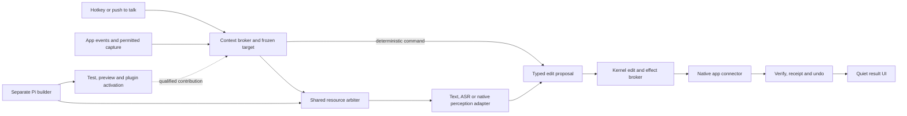
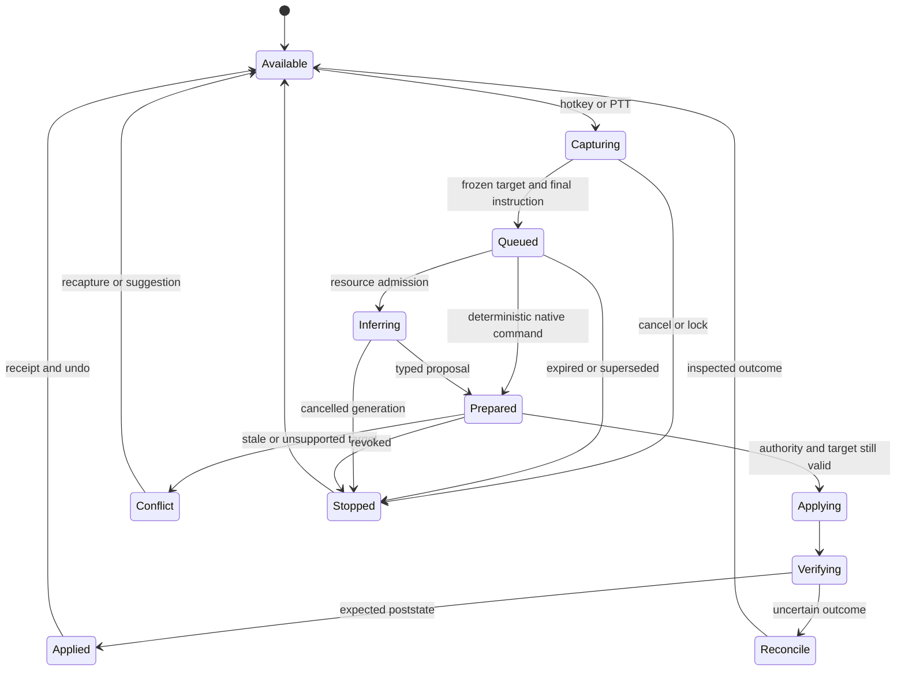

# Build Midnight For Realtime Assistance

**Use the configured cloud model for reasoning, writing and builder tasks, with the existing Gemma embeddings kept local for retrieval. Gemma 4 is optional and is not a delivery dependency.** Build an event-driven assistant that captures the selected paragraph or chart when prompted, sends only the necessary target context, and applies a verified change through the app’s native API. Start with hotkey and push-to-talk; offer ambient listening separately when explicitly enabled. Keep document access, target handles, precise edits, undo, resource control and raw-buffer lifecycle local. Reuse Whisper for command transcription; qualify a separate cloud perception adapter for native audio and video where the chosen provider supports them. Keep Midnight plugin-first with a dependable kernel and a separate builder, supporting both private customization and official improvements from the first prototype. **Realtime means immediately available, promptly acknowledged, cancellable assistance with small context and measured completion times; continuous audiovisual reasoning needs separate qualification.**

Plan dated 13 October 2026, reconciled with the v0.6.0 checkout (`8d7b2e8`, version/release notes in `b05d911`). The [implementation tracker](../docs/realtime-implementation.md) is the current-state entry point. Proposed numerical objectives remain unpassed until measured; saved results identify their historical fixture/build scope. Repository links navigate to current files without stale line offsets. Machine-local evidence and sibling-checkout references are labeled plain-text locations, not portable repository links.

**Confirmed rollout choice: local Whisper now; native cloud media later.** The first usable path is held-chord microphone capture → local transcript → configured cloud text model → preview of the selected paragraph → precise native apply and conditional undo. Keep the existing Gemma embeddings for local retrieval, with no Gemma 4 executor requirement. Native cloud hearing/seeing belongs to a later phase and requires no new media account for this rollout.

The current checkout has a bounded cloud paragraph-edit path, a Windows no-focus push-to-talk pilot, a qualified reuse route for existing GGUF Gemma embeddings, a separate builder for chart and declarative launcher-color contributions with both private and official destinations, and a development-only app-source proposal lane. Settings → General → Help with the selection now exposes shortcut/Office/model status, speech preparation and held-shortcut listener controls; do not treat that setup UI as unimplemented. Native WPS plain/mixed-format paragraph and inline/floating single-series bar/column-to-pie fixtures pass on the installed provider/build. Four synthetic requests through the actual configured cloud writer passed at 3.7–6.5 seconds. A synthetic microphone → actual Whisper → scripted-cloud paragraph preview kept the foreground typing fixture focused. Native media adapters have loopback and policy checks but no real media-account qualification. Physical Word/PTT timing, personal microphone/language quality, broader writing/chart compatibility, core repair, native media, ambient mode and installed recovery remain unqualified. See [implementation status](../docs/realtime-implementation.md) for evidence and remaining scope. Native chart conversion uses COM/XML; the chart-builder preview produces an SVG artifact, and the color builder freezes a validated preset.

### Cloud reasoning and local retrieval are independent

The user’s updated default is cloud generation plus local Gemma embeddings. Do not install or start a Gemma 4 server or download its projector to deliver the first assistance milestone. Use Midnight’s configured provider, account and privacy policy; a supported cloud route can rewrite the selected paragraph, while an exact chart conversion can bypass generation entirely. Local/offline policies remain explicit alternatives and must never silently use cloud when a local executor is unavailable.

Local embeddings support search, preferences and deliberately requested context expansion. They do not generate prose, provide a generative audio/video interpretation, or authorize edits. A quick selected-paragraph request normally needs no retrieval at all: send just the instruction and selected text, without embedding the entire document. The current reuse route verifies the cached GGUF embedding pair and CPU runtime, loads text/image/audio encoders, preserves the legacy cache/marker and assigns a distinct vector fingerprint. Selected folders must be reindexed before semantic comparisons with the new backend. Existing prepared ONNX is retained, and a missing/unqualified cache never triggers an implicit model download. Keeping vectors local does not keep a cloud rewrite local; the target text that is submitted still crosses the provider boundary.

Cloud generation removes executor weights and KV caches from the laptop’s ordinary workload. It does not remove capture, local ASR, embedding, transport or cancellation costs. Bound request concurrency, input/output tokens, media duration, timeouts and retries separately from local CPU admission. Retry a failed read or generation only while the target is valid; never retry an uncertain native edit blindly. The builder follows the same configured generation route, with a separate session and tools.

Native audio and video are provider capabilities, not properties inherited from the text model. Record tested raw-audio, image, ordered-frame and streaming support per adapter. When a provider lacks a modality, use local ASR or bounded target frames with a qualified model and label that route accurately. The cached Gemma 4 files remain an optional future offline experiment; their inventory and prior measurements below are evidence about that option, not prerequisites or cloud latency estimates.

## Existing models provide a useful starting point

### The laptop favors short local requests

The observed host has an **Intel i7-8650U with four physical cores and eight logical cores, 15.88 GiB RAM, and Intel UHD Graphics 620**. No discrete NVIDIA GPU was observed. The integrated GPU shares system resources; its reported adapter memory does not establish a dedicated accelerator. This is enough to justify experimenting with the existing quantized small models, but it argues against keeping every executor, speech model, embedding encoder, and audiovisual projector resident together. Model file sizes also exclude runtime overhead, decoded media, and context caches. (Saved hardware profile (machine-local evidence: `%LOCALAPPDATA%/midnight/hardware-profile.json`; not included in this repository), Hardware probe (external checkout: `../midnight/packages/inference/src/probe.ts`; relative to the repository root, not included here))

The original inventory covered this **`midnight.app` checkout** and the external **`../midnight` sibling checkout** (relative to this repository root). The sibling's signed catalog and cached components now support this app's verified native embedding reuse path; its generative executor remains an optional, separate integration. Installed settings selected a cloud model with local generation disabled at the time of that research; they were not re-read for this reconciliation. A configured vision flag and found local files cannot establish that a running model can receive screenshots, audio, or video. (Installed settings (machine-local evidence: `%APPDATA%/midnight/settings.json`; not included in this repository), [App model registration](../src/runtime/models.mjs), Sibling manifest verification (external checkout: `../midnight/packages/runtime-host/src/local-runtime.ts`; relative to the repository root, not included here))

| Asset | Current evidence and location | Proposed role |
|---|---|---|
| Gemma 4 E2B Q4_K_M | 3,106,738,272-byte GGUF present in `%LOCALAPPDATA%/midnight/components`; pinned Unsloth revision `0314792d7f1f7e229411f620751375812bb9faf2` | Optional offline executor; not needed for cloud assistance |
| Gemma 4 E4B Q4_K_M | 4,977,171,584-byte GGUF present in the sibling component store; revision `bfc15c382204943c3a8fff0c750b94ae2364d7a3` | Optional offline writing experiment |
| llama.cpp b11560 CPU and Vulkan | Component directories contain launchers, implementation DLLs, `mtmd.dll`, and verification markers | Optional local backend, including a possible embedding route after index qualification |
| Whisper-base q8 ONNX | Prepared app voice cache under `%APPDATA%/midnight/missions/voice-runtime/models` | Initial local speech-to-text command path |
| EmbeddingGemma 2 Q8_0 GGUF and projector | Fresh signed-catalog digest checks passed; native text/image/audio load and synthetic search/context fixtures passed using b11560 CPU | Reuse as the local embedding backend, with index fingerprint/rebuild and owned process cancellation |
| EmbeddingGemma 2 app search cache | Older Python/CPU/float32 cache preserved; current setup can reuse native assets or retain an already prepared ONNX cache | Explicit setup records the qualified backend; reindex selected folders after a backend change |

The GGUF asset declarations and revisions are in the sibling component manifest (external checkout: `../midnight/runtime-manifest/manifest.json`; relative to the repository root, not included here). The app’s [voice file catalog](../src/voice/model-files.mjs), installed search manifest (machine-local evidence: `%APPDATA%/midnight/missions/search-runtime/prepared.json`; not included in this repository), and [current search availability check](../src/search/runtime.mjs) explain the ONNX/Python difference. Presence and matching observed size are weaker evidence than a fresh digest check, successful load, and representative inference.

The inventory registry now verifies exact cached artifacts through an owned runtime interface. Preserve old caches while selecting one search backend. Each vector index records model revision, quantization, dimensions, preprocessing and, for the native route, runtime/transport identity. A Python-to-ONNX or GGUF migration requires validated parity or reindexing before semantic comparisons; the implemented route uses reindexing. The native embedding process shares the app's inference arbiter and is stopped before another role is admitted after preemption. Owned speech and embedding models now share memory admission and idle pressure eviction; broader process accounting and long-running qualification remain. The underlying native server's embedding transport is documented in the [pinned b11560 server reference](https://raw.githubusercontent.com/ggml-org/llama.cpp/b11560/tools/server/README.md); dimension truncation and normalization follow the [EmbeddingGemma 2 model card](https://huggingface.co/google/embeddinggemma-2).

### Native hearing and seeing need separate qualification

The primary perception lane is a separately qualified cloud adapter. Start with bounded push-to-talk audio and explicitly requested target crops or short ordered clips; use true streaming transport only when its tested capability record supports it. The following Gemma details describe an optional offline lane. Missing local projectors do not block cloud perception, text assistance, Word changes or the builder.

For the later native-media phase, the provider transport must be selected independently from the writing model. OpenAI Realtime accepts raw PCM audio and images; ordered screenshots remain image inputs rather than native video. The implemented manual-turn adapter disables VAD-triggered responses and tools, verifies the session acknowledgement, commits one utterance and requests bounded text output. Gemini's GenerateContent adapter accepts bounded inline audio, images and native video with streamed output; that HTTP transport does not establish live input streaming. Both prototypes currently send a completed captured utterance after release. ([OpenAI Realtime conversations](https://developers.openai.com/api/docs/guides/realtime-conversations), [Gemini GenerateContent API](https://ai.google.dev/api/generate-content), [Gemini 3.8 Flash modalities](https://ai.google.dev/gemini-api/docs/models/gemini-3.8-flash))

The preview requires separate explicit raw-media consent and a direct provider API key, and stores only synthetic test outcomes. Existing text-model OAuth is not a native-media API credential. Five small fixed checks cover an English request, negation, silence, image counting and frame order. Qualification binds the account key privately, model, transport/contract bytes and fixture bytes, expires after seven days, and is revoked if a repeated check fails. Native video and combined audio/visual alignment remain gated because those fixtures are not implemented yet. Passing this small set would establish those synthetic cases, not personal microphone, multilingual, noisy-room or continuous audiovisual quality. The user's selected initial route remains local Whisper; the native-media preview defaults off.

Gemma 4 E2B and E4B document raw-audio speech recognition and translation with clips up to **30 seconds**, and video represented as ordered frames up to **60 seconds at one frame per second**. These bounded inputs do not demonstrate a persistent synchronized audiovisual session, general environmental-sound explanation, prosody understanding, speaker identity, or full-duplex speech. Gemma produces text; future spoken responses would require a separate synthesis route. ([Gemma E2B model card](https://huggingface.co/google/gemma-4-E2B-it), [Gemma E4B model card](https://huggingface.co/google/gemma-4-E4B-it))

The pinned llama.cpp build documents mixed audio and vision support for these models and accepts image, audio, and video content through its native server implementation. A matching multimodal projector and compatible request transport are required. The installed executors presently lack their own projectors; the sibling direct adapter also drops images and waits for complete responses. Upstream support therefore establishes a candidate implementation path, rather than a working Midnight capability. ([b11560 multimodal documentation](https://raw.githubusercontent.com/ggml-org/llama.cpp/b11560/docs/multimodal.md), [b11560 server transport](https://raw.githubusercontent.com/ggml-org/llama.cpp/b11560/tools/server/README.md), Executor startup (external checkout: `../midnight/packages/runtime-host/src/local-agent.ts`; relative to the repository root, not included here), Direct adapter (external checkout: `../midnight/packages/agent-adapter/src/direct.ts`; relative to the repository root, not included here))

If an offline native-perception experiment is later requested, the existing E2B base needs its matching **`mmproj-F16.gguf`, 985,654,080 bytes**, at revision `0314792d7f1f7e229411f620751375812bb9faf2`, with SHA256 `140be8d7849741f88c50757d529b84373ee8e27052cc2236855b537f4a8215fa`. Register it as an optional verified component with explicit model pairing. This plan does not download it. EmbeddingGemma’s existing projector cannot substitute for the Gemma executor projector. ([Pinned E2B artifact inventory](https://huggingface.co/api/models/unsloth/gemma-4-E2B-it-GGUF/tree/0314792d7f1f7e229411f620751375812bb9faf2), [Projector architecture](https://raw.githubusercontent.com/ggml-org/llama.cpp/b11560/tools/mtmd/README.md))

| Product capability | Initial route | Native route and release condition |
|---|---|---|
| Understand a spoken editing command | Whisper transcription, then constrained text intent | A qualified cloud audio model receives the utterance directly after language, numbers, noise, and exact-target tests |
| Interpret the selected paragraph or chart | Native text or chart metadata | Vision only when appearance is necessary and crop tests pass |
| Explain a visible region | Accessibility or OCR plus text model | Configured cloud vision adapter after target-crop and transport qualification |
| Understand an event over time | Explicit short sequence with timestamps | Ordered frame input after temporal-order and audio-alignment tests |
| Match an acoustic event | Embedding similarity where qualified | A retrieval result remains distinct from generated interpretation or an instruction |
| Continuously reason over live audio and video | No initial shipping promise | Requires demonstrated state reuse, synchronization, latency, power, and cancellation behavior |

Create a **perception adapter separate from Pi’s ordinary text/tool bridge**, with cloud and optional local implementations. It handles bounded native media requests and returns observations with timestamps, source, and uncertainty to the serving agent. A joint raw-audio-plus-selection request is optional only if the exact provider transport supports it. An OpenAI-compatible text endpoint or a `vision: true` setting does not guarantee audio/video transport. Record tested modalities, clip limits, languages, provider/model identity, optional local artifact digests, privacy route and measured latency in the adapter registry.

Current voice includes launcher dictation and an opt-in held-chord PTT pilot. The latter captures bounded mono PCM in a hidden renderer, performs local final ASR on release, and submits the transcript against its captured target without opening Ask. It defaults to English; language selection and automatic detection are wired, while multilingual, accent, noise and code-switching quality still need qualification. The actual English synthetic-microphone fixture passed; this does not prove personal-microphone or physical Word timing. Keep ASR-to-text as the fallback; raw native audio is a distinct path because transcription discards acoustic information. EmbeddingGemma outputs representations for search, rather than edits or tool decisions. ([Whisper documentation](https://github.com/openai/whisper), [PTT controller](../src/voice/ptt.mjs), [Voice language setting](../src/voice/runtime.mjs), [EmbeddingGemma model card](https://huggingface.co/google/embeddinggemma-2))

## Precise app operations preserve the user’s work

### A small context capsule connects invocation to action

The dependable path is **capture the target, interpret the request, prepare a typed change, recheck the target, apply, verify, and offer undo**. Semantic app APIs are the first source of context. Pixels supplement meaning when native structure is insufficient. Neither paragraph rewriting nor changing a native chart type requires continuous video understanding.

The kernel owns grants, IPC validation, secrets, stop, resource admission, receipts, and activation. The serving engine owns task coordination and typed proposals. Sensors expose permitted foreground and selection events; they do not authorize edits. Connectors own native handles behind narrow RPC. The builder has separate maintenance tools, workspace, and preview profile. Supervised workers provide crash containment; they are not automatically a malicious-code sandbox.

A context capsule records request ID, original process/window/document instance, target kind, an opaque native handle, selected-text and structure hashes, capture time, expiry, source timestamps, allowed operations, privacy route, connector artifact, and activation generation. Native handles and rich fidelity snapshots remain local. All modalities use a common monotonic clock, with wall-clock time for receipts, so “this chart” remains tied to the moment of invocation even if selection changes while the user speaks.

Use a `selectedTarget` context profile alongside ordinary conversation and research profiles. It bypasses broad history, file retrieval, and recalled tasks. Initial paragraph input contains only instruction, selection, minimal style metadata, and preservation constraints, with a proposed **1,500-token default budget**; explicit bounded expansion can allow one neighbor on each side, up to approximately 2,500 tokens. A caret command can resolve the enclosing paragraph and show that scope. A partial selection remains partial. If the target or referent is unclear, request a selection instead of reading the document. Existing ordinary preflight retrieves broad context, so this must be an enforced execution path, rather than a prompt hint. ([Current context service](../src/context/service.mjs), [Mission preflight](../src/missions/coordinator.mjs))

Progressive context expansion should name the specific missing information: one neighboring paragraph, chart series metadata, a referenced table, or an explicit writing preference. The broker enforces the read boundary. A rewrite model returns only target text or a patch; it cannot broaden its own write scope. Request-local screen/audio buffers expire separately from intentionally submitted target text and action records. Durable undo and reconciliation can require retaining the small before/after target under clear user-owned retention settings; ephemeral capture does not imply that every edit record contains no document content.

### Word needs a native connector rather than file regeneration

For this Windows-first product, implement **Word COM in a dedicated signed-in user-session STA broker**. Word exposes selected ranges, inline and floating chart objects, and a read/write chart-type property. These support the exact requested actions against unsaved live state. Use a small C# helper with a message pump, serialized commands, bounded busy-call retries, and verified attachment to the captured Word window/document. Office object models are not thread-safe and can reject calls while busy. This is interactive desktop integration; it must not become unattended Word automation inside a Windows service. Actual Word installation, edition, build, and restrictions are implementation discovery gates. ([Word chart type](https://learn.microsoft.com/en-us/office/vba/api/word.chart.charttype), [Selected inline objects](https://learn.microsoft.com/en-us/office/vba/api/word.selection.inlineshapes), [Selected floating objects](https://learn.microsoft.com/en-us/office/vba/api/word.selection.shaperange), [Office threading](https://learn.microsoft.com/en-us/visualstudio/vsto/threading-support-in-office?view=vs-2022), [Unattended automation limitations](https://learn.microsoft.com/en-us/office/client-developer/integration/considerations-unattended-automation-office-microsoft-365-for-unattended-rpa))

Expose `capabilities`, `captureTarget`, `readTargetPart`, `prepareEdit`, `applyEdit`, `verifyEdit`, `reconcileEdit`, `undoEdit`, and `releaseTarget`. Advertise granular tested capabilities such as plain-paragraph patching, rich-run patching, native chart conversion, tracked changes, and undo grouping. Generated plugins may call these typed operations under grants; they must not gain arbitrary COM expressions, VBA execution, or shell access simply because they implement a connector.

Implementation discovery on this host: `Word.Application` is registered to **WPS Office**, whose compatibility API reports version 12.0/build 12.1.0.28485. A COM registration does not prove Microsoft Word or its chart surface. Disposable native WPS paragraph fixtures pass narrow replacement, repeated-target isolation, reversal, text/format-only stale refusal, Unicode and no focus change. Ordinary mixed-format gap rewrites also preserve exact bold/italic/color/underline/highlight anchors and paragraph indent/spacing, including conditional reversal and leading/trailing plain-text removal/reinsertion. Changed or ambiguous styled phrases and unqualified inline structure remain unsupported. The earlier chart access error was narrowed to the denied `Series.Name` property: values, categories, formulas and native `ChartType` work. A bounded read-only XML adapter now resolves the selected chart's name source through its exact relationship, additionally binding floating charts by drawing ID/name. Actual inline/floating single-series bar and column conversion/reversal fixtures pass on this build, preserving tested data/title/geometry/anchor/position and unrelated chart/text/focus. Native dispatch checks the qualified WPS provider/build. Linked sources and other Office builds remain separate qualification. Current code and verification are recorded in the [implementation tracker](../docs/realtime-implementation.md) and [native chart report](checks/word-native-chart.json).

| Integration | Appropriate use | Boundary |
|---|---|---|
| User-session Word COM | First Windows paragraph and native Word chart implementation | Qualify attachment, protection, fidelity, and undo on supported Word builds |
| Office.js Word add-in | Later portable selection/text assistance | Runtime requirement checks; no currently established Word JavaScript chart API |
| Office.js Excel add-in | Portable Excel range/chart actions | `Excel.Chart.chartType` is an Excel capability |
| UI Automation | General-app selection/caret and accessibility reads | Provider-dependent fidelity; no general rich-text or chart conversion guarantee |
| ROI image, OCR, visual model | Supporting interpretation when semantic APIs are insufficient | Suggestion or specifically tested UI recipe if native write capability is missing |
| DOCX reader/writer | Offline copies and new artifacts | Never overwrite an open live DOCX to simulate a targeted edit |

Word Office.js provides `getSelection`, scoped range operations and requirement sets; optional tracking features depend on host support. Its package catalog currently lacks the chart surface exposed by Excel. Treat Office.js as a separately deployed connector path, with authenticated origin-validated local communication. The connector tools available to Codex during development do not automatically ship inside Midnight. ([Word Document API](https://learn.microsoft.com/en-us/javascript/api/word/word.document?view=word-js-preview), [Word range API](https://learn.microsoft.com/en-us/javascript/api/word/word.range?view=word-js-preview), [Word requirement sets](https://learn.microsoft.com/en-us/javascript/api/requirement-sets/word/word-api-requirement-sets?view=word-js-preview), [Word API catalog](https://learn.microsoft.com/en-us/javascript/api/word?view=word-js-preview), [Excel chart API](https://learn.microsoft.com/en-us/javascript/api/excel/excel.chart?view=excel-js-preview))

The generic desktop helper reads `DocumentRange`, emitting up to 30,000 characters, while generic `set_value` can fall back to Ctrl+A and typing. Neither operation is an appropriate selected-paragraph contract; the implemented quick-assist path instead uses the separate native target broker. UIA `GetSelection` is a useful read adjunct where exposed. The existing DOCX writer creates a new package and cannot preserve a live document’s unsaved state or all rich structures. The original launcher summon path begins foreground capture without awaiting it, then focuses Midnight. Quick assistance now has its own capture-before-focus path in `src/desktop/quick-assist.mjs`; this is no longer missing implementation. ([Current desktop read](../src/tools/computer.mjs), [Input helper](../src/tools/input-helper.ps1), [UIA selection](https://learn.microsoft.com/en-us/dotnet/api/system.windows.automation.textpattern.getselection?view=windowsdesktop-9.0), [DOCX tools](../src/tools/documents/docx.mjs), [Summon sequence](../src/main.mjs))

### Paragraph and chart commands follow different paths

For “make this paragraph clearer,” freeze the selected range at hotkey or PTT-down before opening any command UI. Send the permitted text and style constraints to the configured cloud model under the selected privacy policy. Preserve numbers, names, dates, citations, and structural delimiters unless instructed otherwise. Deterministic validation checks the invariants it can establish and computes a minimal patch; it cannot prove every factual claim or name was preserved. Offer a compact diff without opening full chat; direct application can be an established user preference for narrow explicit requests, with no redundant confirmation. Unsolicited suggestions remain proposals.

Immediately before commit, resolve the original document and target, reread its hashes and structure, confirm authority and expiry, and verify protection. The cited Word APIs provide no documented universal atomic compare-and-swap for a range; precheck/mutate/postcheck is conflict detection with a narrow race window. A moving handle is not a complete document revision. Never locate a repeated paragraph by replacing the first matching string. If the target changed, present the conflict and recapture; if another app now has attention, retain the suggestion until return without forcing Word forward. After mutation, verify only the intended spans and show “Paragraph updated · Undo.”

Begin direct text editing with one plain paragraph. `Range.Text` replaces unformatted text; `FormattedText` provides richer transfer behavior, but neither makes a freeform rewrite preserve every field, link, revision, or mixed run automatically. Preserve paragraph/end-cell marks, lists, and unaffected runs. Mixed formatting, fields, tracked revisions, table boundaries, and embedded objects initially receive suggestions where an exact mapping is unsupported. Respect existing Track Changes settings without accepting unrelated revisions or silently toggling global tracking around inference. ([Word Range.Text](https://learn.microsoft.com/en-us/office/vba/api/word.range.text), [Word Range.FormattedText](https://learn.microsoft.com/en-us/office/vba/api/word.range.formattedtext), [Independent range handles](https://learn.microsoft.com/en-us/office/vba/api/word.range.duplicate))

The implemented next step resolves up to 32 merged character-format runs from local range XML and COM. Non-base styled phrases remain exact ordered anchors; the model rewrites the plain gaps around them, and the connector applies those patches from the end with a copied base font. Reconciliation verifies the base format, styled phrases and paragraph properties, while conditional undo restores the same tested formatting. A final exact text/XML check follows formatting preflight. Actual WPS fixtures cover bold, italic, color, underline, highlight, indent and spacing; they do not establish full Word theme/style/field/revision fidelity. ([Native fixture](checks/word-formatting.json), [Range-scoped XML](https://learn.microsoft.com/en-us/office/vba/api/word.range.wordopenxml), [Font copying](https://learn.microsoft.com/en-us/office/vba/api/word.font.duplicate))

For “change this bar chart to pie,” capture exactly one editable inline or floating native chart. A constrained parser produces `chart.setType` with target ID, expected type, requested enum, and no data-write permission. When intent is exact, skip generative decoding. For a tested single-series 2D chart, the broker changes the existing chart property and checks object identity, categories, values, title, data links where supported, anchor, and geometry. Bar-specific axes and styling cannot all survive a pie conversion; preservation promises must describe tested common properties.

The WPS implementation now passes native inline/floating bar and column fixtures on API 12.0/build 12.1.0.28485. It reads at most 8 MiB of local range/anchor XML with DTD/external resolution disabled, resolves only the captured chart relationship and verifies XML/native series agreement. Floating charts require exact drawing ID/name even when the anchor paragraph contains other charts. Only the native chart-type property is written; XML supplies a missing read field and is never used to replace the live document or chart. Data/title/size/anchor/position and conditional reversal are tested, including unrelated-chart/text/focus preservation and refusal of multi-series, negative, zero-total and stale inputs. ([Native qualification](checks/word-native-chart.json), [Word chart type](https://learn.microsoft.com/en-us/office/vba/api/word.chart.charttype), [Range XML](https://learn.microsoft.com/en-us/office/vba/api/word.range.wordopenxml), [Drawing identity](https://learn.microsoft.com/en-us/office/vba/api/word.shape.id))

Multi-series input requires a targeted choice; Midnight must not silently drop series or invent aggregation. Negative, all-zero, or nonadditive measures need clarification or an intact-chart explanation. Positive values alone do not prove meaningful parts of a whole. Microsoft recommends pie charts for one suitable series and generally few categories; the category guidance is a readability recommendation, not an API limit. A picture of a chart remains a picture: request source data for reconstruction as a separate task. ([Word native chart property](https://learn.microsoft.com/en-us/office/vba/api/word.chart.charttype), [Pie chart suitability](https://support.microsoft.com/en-us/excel/add-a-pie-chart))

### Receipts handle conflicts and uncertain outcomes

Persist an intent before mutation, with idempotency key, exact connector artifact/API/schema/generation, target identity, authorized operation, pre/post hashes, timestamps, and undo snapshot reference. Duplicate keys return the existing receipt. A crash or timeout after an Office call can mean the edit succeeded; reconcile the target against expected pre/poststate before retrying. If neither matches, record `outcome-unknown` and stop writes. This reduces duplicate effects without promising exactly-once transactions across Office.

Native custom undo records cover **all application actions while active**. Keep them around short synchronous commit code, never around model inference or review. Test concurrent typing. Midnight Undo should apply a reverse patch only when the target matches the recorded poststate, otherwise offer a reversal diff. Never call a delayed blind `Application.Undo()` that could undo later user work. Cancellation during `Applying` also requires reconciliation; it is not guaranteed rollback. ([Word UndoRecord](https://learn.microsoft.com/en-us/office/vba/api/word.application.undorecord), [Custom record behavior](https://learn.microsoft.com/en-us/office/vba/api/word.undorecord.startcustomrecord))

## A shared resource budget enables background operation

### Standby stays light and explicit requests take priority

Before this phase, Midnight had tray startup, a supervised engine, power profiles, watches, attention deduplication and an action journal, but speech/embeddings sat outside mission admission, waiting work was uncapped and the resource gate did not enforce lock state. The v0.6.0 checkout now has bounded mission queues, lock/suspend gates, shared inference admission, speech/embedding residency and builder cancellation ownership. Whole-mission preemption for ordinary tasks, complete process-tree accounting and long-running resource qualification remain outstanding. ([Shell startup](../src/main.mjs), [Engine assembly](../src/runtime/host.mjs), [Current queue](../src/scheduler/queue.mjs), [Resource gate](../src/resources/profiles.mjs))

Default standby has a closed microphone, no screen stream, and zero generative calls. Lightweight foreground and supported-app metadata events can update availability without reading every paragraph. Hotkey/PTT captures content only for the request. Use one heavyweight job at a time on this host, with emergency stop and capture closure first, explicit assistance next, other user tasks next, then opted-in observations, indexing, and builder work. Background aging stays within background classes. Start testing two to four active inference threads and one to two background threads rather than adopting the sibling’s seven-thread executor default.

Bound queued quick requests, speculative observations, decoded media, and target handles. Initial caps can be eight explicit quick requests and four background captures, with a latest-only observation per app/target. Supersede obsolete frames, coalesce event bursts, and expire target contexts after a proposed 30–60 seconds unless deliberately held in preview. Reject excess explicit work with a visible status; do not silently lose a spoken command. After restart, rehydrate the task and receipt but recapture transient targets, rather than replaying stale live-window edits.

Cancellation first fences capture, result delivery, and edit dispatch by request generation. Abort cloud requests and stop local workers where supported; terminate a hung exclusively owned worker when necessary without killing the kernel or app broker. Promise rejection alone does not prove local CPU work stopped or a remote request was never billed. The ordinary memory budget must include local ASR, embedding encoders, audio/frame buffers and process overhead, without a resident Gemma 4 executor. The implemented owned-model governor samples OS available memory, reserves up to 4 GiB for foreground work and caps estimated owned-model/scratch allocations at up to 4 GiB, scaled down on smaller hosts. Cold admission, pressure eviction and failed-termination ownership are covered; estimates are not OS-enforced limits. A held PTT gesture protects Whisper for at most 30 seconds, while pressure can cancel preemptible background work. New admission waits for physical owned-process/thread exit and a fresh memory sample. Whisper warms its existing offline model during a valid held gesture, retaining it for 120 seconds on ordinary AC profiles or 30 seconds on battery/Quiet; embeddings retain their 60-second unload. Full process-tree/media-buffer accounting and real-pressure/battery/soak qualification remain. If an offline executor is enabled later, add its weights, KV cache and projector to the same budget. ([Memory governor](../src/inference/residency.mjs), [Voice lifecycle](../src/voice/runtime.mjs), [Search lifecycle](../src/search/runtime.mjs))

| Operating state | Capture and inference policy |
|---|---|
| Available | Metadata and event handling; no heavy inference without work |
| Active request | Scoped capture, bounded cloud requests and one admitted expensive local task, quiet progress, immediate stop |
| Warm standby | ASR/embeddings retained only within TTL and memory budget; no idle generation |
| Battery or constrained | Explicit assistance remains available; suspend speculative AV, indexing, and builds; shorten residency |
| Paused, muted, locked, or suspended | Close capture, clear transient buffers, revoke edit epoch, block new observations and live-target writes |

CPU is the starting backend, with Vulkan measured per workload. The saved embedding probe estimated **235 input tokens/s on CPU versus 19 on Vulkan**; those are embedding-specific fixtures, not generative output speed or an audiovisual comparison. Configure aggregate thread limits and qualify ONNX thread-spinning controls against the actual Node stack. Use Windows CPU-speed-limit signals only where the pinned Electron runtime and host expose them; do not label them temperature measurements. (Saved probe (machine-local evidence: `%LOCALAPPDATA%/midnight/hardware-profile.json`; not included in this repository), Probe measurement definition (external checkout: `../midnight/packages/inference/src/probe.ts`; relative to the repository root, not included here), [ONNX threading](https://onnxruntime.ai/docs/performance/tune-performance/threading.html), [Electron powerMonitor](https://www.electronjs.org/docs/latest/api/power-monitor))

### Voice and seeing use bounded capture

Provide global no-focus PTT, freezing the target on key-down and finalizing on release. Capture timestamped mono PCM in bounded buffers; start with 15-second command defaults and a 30-second native hard limit. A short preroll is available only while the capture mode is enabled. Partial transcript is display-only until final intent; execution must not occur from a changing prefix. Keep longer dictation as a separate mode. If actual ASR is too slow for streaming, ship honest short-clip PTT instead of presenting VAD or token streaming as proof of realtime hearing.

Ambient mode is separately enabled per microphone and app surface, with visible status, quick pause, exclusions, and short RAM buffers. VAD detects speech activity; a separately added and qualified wake-word/intent detector establishes a candidate command. No verified wake-word path currently exists. Neither detector creates authority for arbitrary work changes. Ambient suggestions remain read-only until accepted. Pause during lock, suspend, mute, meeting mode, and excluded sensitive surfaces; suppress suggestions while typing and coalesce repeated observations. These modes capture the selected microphone; system or meeting audio would be a separate future feature. Silero VAD is a plausible small optional component, but its publisher’s latency is not a measurement on this laptop. ([Silero VAD](https://github.com/snakers4/silero-vad))

Seeing starts with one target crop when needed. Temporal requests can use two to four ordered frames over a short interval, initially no more than one frame per second, with matching audio timestamps where qualified. Keep the freshest observation and discard expired media. Capture frame rate, reasoning update rate, token streaming, and native audiovisual understanding are separate measurements. Word semantic edits remain useful when all native media capabilities are unavailable.

### Existing measurements are smaller than the proposed experience

The [13 October local-Whisper warmup fixture](checks/ptt-warmup.json) recorded three clean synthetic English commands through the actual hidden microphone recorder and Whisper, then the real Pi session with a scripted writing provider. The cold load took 1.658 seconds during recording; release-to-preview took 1.418 / 1.177 / 1.186 seconds. All 215 injected typing characters remained in the focused fixture. An actual ASR cancellation reclaimed its worker in 80 ms before the next local role was admitted, with owned PCM cleared. Private memory for the sampled Electron fixture fell from about 935 to 304 MiB after termination. These are small development checks, not cloud latency, physical Word/keyboard, personal microphone, full process-tree or long-running qualification. Cold recorder startup measured 755 ms and needs improvement; warm readiness was 158–159 ms. Keep the latency objectives below as unpassed product gates until their full scope is measured.

The [controlled memory-pressure fixture](checks/memory-residency.json) loaded the existing Whisper and native Gemma models together, then injected a low available-memory signal. Idle embeddings exited in 106 ms while gesture-held Whisper remained resident. Cache bytes and vector fingerprints stayed unchanged, and cancellation released the speech pin. This proves owned-model lifecycle behavior for the controlled signal; it does not establish performance under actual OS exhaustion or replace full process-tree, battery and soak measurements.

The [configured cloud-writer check](checks/cloud-writing.json) sent four synthetic English requests through `openai-codex/gpt-6.1-sol`, with one bounded provider call each and read-only existing OAuth. Negation/name/date, numbers/citation and styled-phrase examples passed, and an unsupported factual change requested context. Latest request-to-proposal times were 4.168 / 5.995 / 3.695 / 6.472 seconds. These are real text-provider observations with a synthetic connector; they are not combined Whisper/Word latency, broad semantic preservation or a statistical benchmark. Native mixed-format capture/apply/undo separately measured 96 / 244 / 266 ms in one hidden WPS fixture. Keep the full product latency gates unpassed until physical workflow measurements cover them.

The [native WPS chart fixture](checks/word-native-chart.json) records latest inline apply/undo samples of 191/153 ms and floating apply/undo of 163/154 ms; the unit suite also ran during that observation. These cover prepared hidden native objects, not physical gesture/capture, foreground typing, all chart styles, linked sources or statistical p95. The same fixture reran mixed paragraph checks under that concurrent load, yielding 183/420/490 ms for capture/apply/undo. Both reports preserve their different sampling conditions; neither proves the full product latency gates.

The saved 12 October text-tool bake-off reports **E2B p50 2.34 seconds and p95 4.40 seconds; E4B p50 4.35 seconds and p95 9.74 seconds**. Both passed the small schema/tool fixtures. These timings exclude Word capture, speech, paragraph rewriting, mutation, and verification; they do not establish writing quality or audiovisual latency. The earlier shell baseline recorded 243 MB median private memory, minimal idle CPU, and zero idle model calls in an isolated no-model profile. Background listening and warm inference need new measurements. (Executor results (external checkout: `../midnight/packages/evals/results/bakeoff-2026-10-12.md`; relative to the repository root, not included here), Fixture timing (external checkout: `../midnight/packages/evals/src/bakeoff.ts`; relative to the repository root, not included here), [Shell baseline](../docs/performance.md))

| Proposed qualification objective | What must be measured |
|---|---|
| Acknowledge/listen within 100–150 ms; warm simple target capture below 300 ms | UI feedback and semantic capture separately; Office cold attachment separately |
| Deterministic chart apply and verify p95 below 1 second | After final intent, on supported warm native chart fixtures |
| Short paragraph preview p95 around 10 seconds initially | Actual text quality and full capture-to-preview path under Office workload |
| Streaming ASR real-time factor at most 0.5, finalization around 1 second | Audio duration versus processing time within shared CPU budget; otherwise report batch timings |
| Cancel feedback within 100 ms; compute release around 1 second | Dispatch fence separately from native worker reclamation |
| Unloaded standby median below 0.5% total-machine CPU and p95 below 2% | Full process tree, no tasks, zero idle generation; warm residency reported separately |

These are gates for tuning, not speed guarantees. Record cloud provider/model, network delay, time to first token, full completion time, context/output budget, local backend/thread count, cold/warm state, RAM/commit/paging, power state and foreground workload on every run. Benchmark the configured cloud model on real paragraph fixtures, numbers, languages and refusal behavior. Existing E2B/E4B timings are optional offline evidence. Measure active typing latency, 30–60-minute AC/battery sessions, an eight-hour work session and a 24-hour idle/watch soak. If latency misses the target, reduce context/output, choose deterministic operations or select a qualified faster cloud route. Local/offline work must never silently escalate to cloud.

## Plugins support private customization and official repair

### A common interface serves both destinations

Use an immutable official app plus namespaced per-user overlays. `midnight/<feature>` identifies official contributions; private derived packages record the source artifact and live under `user:<installation-id>/<feature>`. App connectors, permitted sensors, model adapters, workflows, themes, chart renderers, and UI slots can all use versioned contribution interfaces. Keep authority, secrets, action journal, scheduling, activation, and repair in the kernel. The kernel remains improvable through official source/build/release work. Installed ASAR integrity and packaging make direct archive mutation the wrong extension mechanism. ([Packaging fuses](../scripts/after-pack.cjs), [Packaged files](../package.json), [Earlier architecture](Midnight%20self%20improvement%20architecture.md))

| Change scope | Result | Authority |
|---|---|---|
| My Midnight | Private immutable plugin version, preview, local activation, last-good restore | User’s scoped installation policy |
| Improve Midnight for everyone | Source diff and tested official build candidate | Maintainer review and release lane |

The full common manifest should carry identity/version, host API, contribution schemas, dependencies, requested capabilities, resource estimates, model/runtime pairing, and state compatibility. Declarations request access; the kernel grants it. Preserve exact artifact/API/schema/activation generation in captured targets, missions, and stored actions. The chart pilot now pins each mission's renderer and checks the recorded implementation and canonical request before stored dispatch; older work uses its original artifact after activation, and changed or missing artifacts are refused. Its first manifest supports one stateless contribution with no permissions or dependencies; the wider contract still needs implementation. Drain or release affected native handles when activating future connector changes. ([Ledger fields](../src/policy/ledger.mjs), [Stored dispatch](../src/policy/broker.mjs), [Plugin contract](../src/plugins/manifest.mjs))

Start with host-rendered schemas, themes, and declarative workflows. A generated private connector cannot bypass the broker with privileged COM or arbitrary commands. Owner-trusted backend code is a narrower initial trust promise; accepting hostile executable packages requires actual OS confinement. A worker, separate process, or Git worktree alone cannot restrict same-user filesystem, network, or credential access. Use secretless genuinely restricted environments for shared builds, and isolated sandboxed UI for rich plugin panels. ([Electron utilityProcess](https://www.electronjs.org/docs/latest/api/utility-process), [Node permission limitations](https://nodejs.org/api/permissions.html), [Existing isolated guest views](../src/desktop/app-workspace.mjs))

### The builder produces candidates and independent recovery protects activation

The builder workflow is **prompt → diagnose → isolated patch → targeted checks → preview → private activation or official proposal → health observation → last-good restore when needed**. Run a separate supervised Pi session with explicit maintenance tools, exact source/base hashes, fixed build operations, and a disposable profile. Persist change-job/session identity to resume work. A repair such as “Midnight rewrote too much” should capture connector diagnostics and a synthetic regression fixture, rather than defaulting to the user’s whole document.

Host-controlled conformance and behavior checks stay outside agent-writable validation policy. Record diff, immutable candidate digest, actual test results, capability changes, preview, state compatibility, and prior activation. Persist activation intent before switching, compare the expected generation, back up compatible state, and reconcile crashes by inspecting the active pointer. During probation, suppress unintended external effects; quarantine unhealthy candidates without depending on their cleanup hooks. An official candidate contains no private settings or document content by default and is not published merely because a builder completed.

Add recovery controls that work when chat, renderer, or serving engine fails: disable customizations, restore last-good generation, and launch a minimal repair view without model access. If the official shell cannot launch, an external verified launcher/installer path must restore a cached good package offline. Keep activation metadata outside plugin-owned state and ordinary app migrations. The existing supervisor restarts the engine, but the current updater backup path depends on it, so independent official repair is additional work. ([Supervisor](../src/desktop/supervisor.mjs), [Updater integration](../src/main.mjs))

Code rollback does not reverse document edits, sent messages, or incompatible database migrations. Preserve effect receipts across activation rollback, prefer additive compatible plugin migrations, and require a forward/recovery strategy for incompatible state. Do not restore an entire old database over new live receipts and user work. Keep Pi SDK plus Midnight’s journal initially: Durable is not a prerequisite for any of these features, and a later migration requires fresh qualification of the then-current release against policy, packaging, recovery, and duplicate-effect behavior. Durable replay alone cannot supply deployment or exactly-once Office edits. ([Current runtime decision](../docs/adr/0001-runtime.md), [Pi SDK](https://pi.dev/docs/latest/sdk), [Durable specification](https://raw.githubusercontent.com/earendil-works/pi/v1.2.0/packages/durable/docs/spec.md), [Storage schema handling](../src/storage/db.mjs))

Keep **two distinct chart prototypes**. Use the existing `barChartSvg`/`chart_create` renderer to prove personal and official plugin changes, preview, persistence, and rollback. The Word chart prototype must prove native conversion of an existing live object. Success in one cannot validate the other. ([Existing renderer](../src/tools/work.mjs), [Chart artifact tool](../src/tools/work.mjs))

## Implementation gates make the plan actionable

### Introduce narrow interfaces at existing seams

| Existing seam | Proposed modules or extension | Purpose |
|---|---|---|
| `src/main.mjs`, `desktop/hotkey.mjs`, `contracts/ipc.mjs` | Quick invocation, capture-before-focus, independent status and stop | Preserve foreground target and nonintrusive control |
| `desktop/platform.mjs`, `tools/input-helper.ps1` | `desktop/context-sensors.mjs`, `desktop/app-broker.mjs`, native Word STA helper | Semantic selected-object read and typed mutation |
| `context/service.mjs`, `missions/coordinator.mjs` | `context/active-target.mjs`, `context/capsules.mjs`, `contextProfile` | Enforced small scope, expiry, and progressive context |
| `runtime/models.mjs`, voice/search runtimes | `inference/registry.mjs`, `inference/arbiter.mjs`, owned role adapters | Verified capability, residency, transport, and aggregate admission |
| `voice/runtime.mjs`, `ui/app.js` | `voice/capture.mjs`, `voice/stream.mjs`, PTT IPC | Timestamped capture outside launcher dictation |
| `resources/profiles.mjs`, `scheduler/queue.mjs` | Lock gates, bounded queues, deadlines, reservations, preemption | Keep assistance responsive without stale work |
| `policy/broker.mjs`, `policy/ledger.mjs`, `tools/work.mjs` | Typed app effects, receipt/reconcile/undo, exact artifact dispatch | Reliable narrow changes and update compatibility |
| `desktop/supervisor.mjs`, storage journal | Inference/builder supervision and independent activation log | Fault containment and recovery |
| Current tools, skills, and connectors | `plugins/manifest.mjs`, registry/bindings/activation; `builder/jobs.mjs` | Both customization destinations through one contract |

These are likely implementation seams, not a requirement to extract every existing feature before delivering useful work. Freeze context, connector, adapter, receipt, and change-job semantics first. The assistance and builder lanes can then develop concurrently under the same grants and resource rules.

### Deliver in dependency order

| Stage | Concrete deliverables | Exit evidence |
|---|---|---|
| Foundation | Configured cloud routing; local embedding cache/index migration plan; adapter capability records; shared local arbiter; enforced lock/cancel gate; context/receipt/plugin contracts; supported Word discovery | Bounded cloud packet, privacy enforcement, embedding readiness, every local role counted, no capture after lock, exact target identity; no Gemma 4 load required |
| First assistance milestone | Typed hotkey command, read-only semantic target preview, plain-paragraph cloud rewrite, native single-series chart conversion, quiet diff/result, receipt and undo | Only intended paragraph/object changes; no whole-document model context; stale/closed/wrong-instance targets blocked; native chart remains editable |
| First builder milestone | Existing chart renderer behind a versioned interface; private overlay and official candidate jobs; separate developer builder; disposable preview; last-good activation | Private change survives restart and leaves a second profile unchanged; official diff/tests/preview produced; bad candidate recoverable without AI |
| PTT | No-focus global capture; frozen original target; short local ASR or qualified cloud audio; final intent; language controls; resource and cancellation lifecycle | No execution from partial transcript, measured release-to-result, unchanged focus, declared privacy route, conflict handling while typing |
| Native perception | Qualified cloud raw-media/streaming adapter; requested ROI and ordered clips; capability matrix; optional offline adapter separately | Image/audio/frame-order fixtures, synchronization tests, measured memory/network/latency/cancel; fallback still works when native capability fails |
| Expansion | Run-aware rich text; more native apps; optional Office.js; opt-in ambient; qualified installed-user building and external official repair | Fidelity matrix, false-activation/soak tests, installed ASAR untouched, source/toolchain availability, broken-shell recovery |

The first builder pilot can require a developer checkout and known toolchain. Both user and official scopes must exist in that pilot, but it must not claim every packaged installation can already build code. Later provide exact source capsules/templates and a qualified local toolchain or isolated build service. Missing toolchain is a clear capability state, not a reason to mutate installed archives. Calendar estimates should follow native attachment and model-load experiments, rather than precede them.

### Test scope and recovery as carefully as speed

Use synthetic Word fixtures containing repeated paragraphs, unsaved documents, multiple windows, rich runs, fields, tables, tracked changes, inline/floating charts, linked data, and chart images. Test protected/read-only targets, modal/busy Word, focus changes, target edits during inference, overlapping commands, and lock/suspend. The fixture harness can inspect the complete synthetic document to compare normalized untouched text/structure checksums and chart properties; operational model context stays target-only. A byte hash of a saved DOCX is not proof about unsaved live state.

| Acceptance area | Required result |
|---|---|
| Narrow context | Captured model packets contain only target and permitted bounded additions; unrelated document text and broad memory are absent |
| Paragraph fidelity | Changed spans match the declared scope; untouched normalized content/structure remains equal; unsupported rich structures yield suggestions |
| Chart fidelity | Same native object and source data; supported title/link/anchor/geometry preserved; no silent series loss or workbook regeneration |
| Nonintrusion | PTT/progress/result do not steal focus; typing responsiveness stays within measured limits; no continuous screenshot loop |
| Stale work | Expired targets and obsolete observations cannot dispatch writes; switching windows cannot retarget a request |
| Fault recovery | Crashes before/after native mutation reconcile pre/poststate; duplicate keys do not redispatch known effects; uncertain outcomes stop |
| Undo | Later user work is never blindly undone; reverse patches require current poststate; chart reversal fidelity is explicitly tested |
| Plugin change | Two scopes work; immutable exact-version dispatch survives restart; incompatible/broken candidate quarantined; receipts survive rollback |
| Resource and privacy | All inference roles share admission; idle generation is zero; raw buffers clear on pause/lock; offline route never silently uses cloud |

Fault injection should cover inference hangs, connector crashes at each commit boundary, engine loss, renderer failure, activation interruption, missing old artifacts, and migration rejection. Measure small-model quality independently from tool-schema accuracy. For speech, include English, the user’s actual working languages, code switching, numbers, dates, background noise, and bystander speech. For native video, test temporal ordering and audiovisual alignment rather than merely recognizing an individual frame.

The remaining decisions are bounded: identify the actual Office installation and supported restrictions; confirm work languages and speech conditions; qualify the chosen cloud provider’s native media transport; measure latency while Word and other apps are active; and tune local memory/residency against battery use. The chosen defaults already permit implementation: configured cloud generation, local Gemma embeddings, Windows user-session COM, plain-paragraph direct capability first, a single suitable native chart, one heavy local job, PTT first, ambient opt-in, both private and official builder destinations, and explicit local/offline routes without automatic cloud escalation. Gemma 4 serving and its projector are optional work outside the primary delivery path.

The first useful release should let a user make one small requested change and continue working while Midnight handles it. The matching builder release should let that user improve the feature privately or propose an official repair, with recovery independent of the code being changed. Native audio and video can then extend perception through the same precise target and resource contracts instead of expanding every task into continuous capture or whole-document generation.
