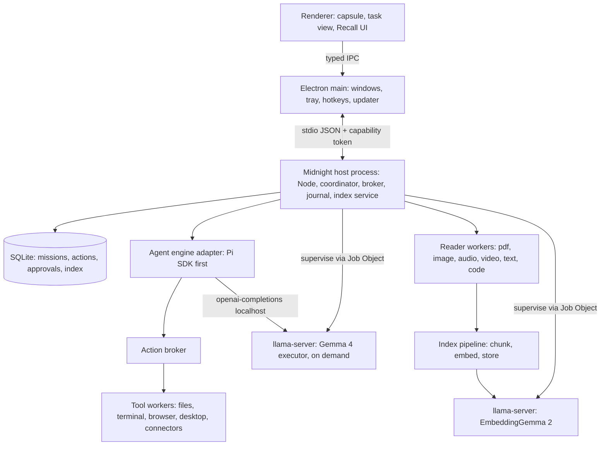
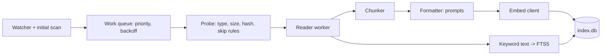

# Midnight Runtime: from-scratch implementation plan

**Date:** 12 October 2026 · **Status:** proposal, ready to execute · **Supersedes nothing:** it builds on [Midnight app rebuild plan](<./Midnight app rebuild plan.md>), whose authority, journal, stop-fence, browser, desktop and UX chapters still apply. This document adds what that report did not cover: the local-model runtime, the DigUp-style content index, and packaging everything as one Windows-first runtime in a new repository.

**Evidence labels.** *Observed* = read in a primary source on 12 Oct 2026. *Reported* = a single third-party report, not independently reproduced. *Proposed* = a decision or number this plan makes and a gate must confirm. Nothing here was benchmarked on your hardware; every number marked proposed is an acceptance criterion, not a result.

---

## 0. What you need to know first

Four findings change the shape of the request. Read these before the rest.

1. **EmbeddingGemma 2 cannot be the executor model.** It is an encoder: it maps text, images, audio and video to a 768-d vector (*observed*, [model card](https://huggingface.co/google/embeddinggemma-2)). It generates no tokens and cannot call tools. The plan therefore ships **two local models with different jobs**: EmbeddingGemma 2 as the *embedder* (retrieval, memory, routing, de-duplication) and a generative Gemma 4 variant as the *local executor*. EmbeddingGemma 2 still "executes" useful work in the sense of embedding-driven decisions (§7.4), but not agent turns.
2. **DigUp is a macOS-only Swift app; its embedding worker is MLX/Python, not llama.cpp.** The README says llama.cpp + Metal; the worker in the fork (`worker/digup_worker.py`, *observed*) imports `mlx`, `mlx-vlm` and `transformers`, and `pyproject.toml` pins an `mlx-vlm` git commit. MLX does not run on Windows. DigUp is a **design reference and a source of tested policy** (chunking, ranking, regression guard, privacy skips), not code we can lift. We port the ideas to a llama.cpp backend, which DigUp's own `scripts/build-llama.sh` shows it also targets (pinned tag `b11461`, `LLAMA_BUILD_MTMD=ON`, a no-logits patch).
3. **llama.cpp supports EmbeddingGemma 2 including vision/audio, since 6 Oct 2026**, via PR #30054 (*observed*), first in tags b11452+; latest release is b11560 with Windows CPU, Vulkan, CUDA 12.4/13.4, SYCL, ROCm and OpenVINO zips (*observed*). The multimodal request shape is nested content parts inside `input` items; a user in issue #30082 reported it working on b11457 (*reported*). This is young: pin a tag and gate it with reference vectors.
4. **Gemma 4 is the natural executor family** (Apache 2.0; E2B/E4B/26B-A4B/31B; 128K context on E4B; native tool calling; image and audio input on E2B/E4B; *observed* on the E4B card). llama.cpp tool calling for it works with `--jinja` on a recent build but has had template fixes (*reported*). A 12B variant appeared in one source only; treat as unverified. A candidate bake-off (§7.2) decides the shipped default, not this paragraph.

**Recommendation in one paragraph.** Build a new monorepo, `midnight`, outside this repo, as a Windows-first Electron desktop app plus a headless **Midnight Runtime** (a supervised Node host and a pinned `llama-server` pair) that is installed and updated as a single versioned bundle with verified, downloadable model components. The agent harness stays behind an adapter (Pi SDK first, per the prior report); local models register as an OpenAI-compatible provider. The DigUp-style index (hybrid vector + exact-match search over files, PDFs, images, audio and video) runs inside the same runtime, using EmbeddingGemma 2 through llama-server. Authority, journal, stop-fence and verification follow the earlier report unchanged.

---

## 1. Research record

### 1.1 DigUp (`soliluqoy/DigUp`, fork of `ARahim3/DigUp`)

| Aspect | What the sources show | Consequence for Midnight |
|---|---|---|
| Product | On-device content search for files: photos, PDFs (page by page, scans), audio/video at timestamps, code (opt-in). Global hotkey, results open at the page/moment. MIT. | Becomes Midnight's **Recall** capability: the agent and the user search the same index. |
| Stack | Swift/SwiftUI, Xcode 26, SQLite, Sparkle, Homebrew cask; Apple Silicon, macOS 14+ | None portable. Replace each platform reader (§6.3). |
| Embedding worker | `worker/digup_worker.py`: newline-delimited JSON on stdin/stdout; ops `info`, `text`, `image`, `audio`, `quit`; vectors returned as base64 little-endian float32 N×768; batch sizes text 16 / image 4 / audio 2; image token budget ∈ {70,140,280,560,1120} default 280; text truncated at 2048 tokens; failed media item gets a zero vector plus an error string; MLX cache capped at 512 MB; text-only mode loads only the 270M text part | Same protocol shape is a good internal contract (§5.5). Copy batch sizes and budgets as starting points. |
| Prompting | Worker does **not** prompt text; caller sends `task: search result \| query: …` for queries, documents arrive pre-formatted | Prompt formatting is the indexer's job; unit-test it (§6.5). |
| Storage | One SQLite file: vectors for each picture, page, passage, frame, 30 s of sound + keyword index; separate code index | Same, with FTS5 and the two-stage vector scheme in §6.4. |
| Ranking | Nearest vectors + exact-word boost; mostly numeric text matched exactly only; formula not published | We define and tune our own (§6.6) against an eval set. |
| Regression guard | Index records the producing model version; a test compares new llama.cpp builds to stored reference vectors before release | Adopted as a hard release gate (§5.7). |
| Pipeline | First 30 PDF pages indexed immediately, rest after the first pass, cap 5,000 pages; audio in overlapping 30 s windows; video a frame every few seconds plus one per shot, soundtrack treated as audio; pause on battery/Low Power; new files searchable "a second or two" after landing | Adopted as defaults (§6.2, §6.7). |
| Privacy | Chosen folders only; skips hidden folders, keys, credentials, app bundles, caches, cloud-only files; read-only; only network use is model download + update check | Adopted, with Windows equivalents (§6.8). |
| Evals | `evals/` holds ranking queries in English, Bengali, Arabic | Build the same, plus Indonesian/Malay given the user's locale (§6.9). |
| Inconsistencies | Text part quoted as ~250 MB in one place and 310 MB in another; the GGUF files explain it: Q4_K_XL 176 MB, Q6_K_XL 249 MB, Q8_0 310 MB | Not a real conflict. |

Not read: Swift sources, `evals/` contents, workflows. The fork's code beyond the worker was not inspected; treat any claim about DigUp internals beyond the table as unknown.

### 1.2 EmbeddingGemma 2 (*observed*, [google/embeddinggemma-2](https://huggingface.co/google/embeddinggemma-2), [unsloth guide](https://unsloth.ai/docs/models/embeddinggemma-2))

- 740M parameters in parts: text backbone 130M + embedder 140M (≈270M text path), vision 170M, audio 300M. Apache 2.0, plus the Gemma Prohibited Use Policy.
- One shared **8,192-token** window across modalities: text 1 token/subword; image 280 tokens default (soft budget 70–1,120); video 140 tokens/frame at 1 fps; audio 25 tokens/s, mono 16 kHz.
- Output 768-d; Matryoshka 768/512/256/128, **re-normalize after truncation**. Text MTEB-multilingual 61.36 (768) → 60.41 (256) → 57.89 (128); multimodal MMEB 59.01 → 56.24 (256) → 45.65 (128). 128-d is unsuitable for multimodal.
- **Never FP16** (silent NaN/degraded vectors); BF16 or FP32, or GGUF quantizations.
- Text prefixes: query `task: search result | query: {q}`; document `title: {title or none} | text: {content}`; code query `task: code retrieval | query: {q}`; code document `title: {filename} | text: {code}`; other task prompts for QA, fact checking, classification, clustering, similarity. **No prefix for image/video/audio**; interleaving placeholders `<|image|>`, `<|video|>`, `<|audio|>`.
- GGUF: `ggml-org/embeddinggemma-2-GGUF` lists BF16 558 MB and Q8_0 310 MB and no projector on its page. `unsloth/embeddinggemma-2-GGUF` lists text quants (Q4_K_XL 176 MB … BF16 558 MB) and `mmproj-Q8_0.gguf` 555 MB, `mmproj-BF16/F16` ~982 MB. DigUp's quoted 865 MB = 310 + 555.
- llama.cpp serve recipe from the Unsloth page: `--embeddings --pooling mean --ctx-size 2048 --batch-size 2048 --ubatch-size 2048 --parallel 1`; each input must fit one physical batch; raise all three toward 8192 for long inputs.

### 1.3 llama.cpp server (*observed*, [server README](https://github.com/ggml-org/llama.cpp/blob/master/tools/server/README.md), releases page)

- `--embedding/--embeddings`, `--pooling`, `--embd-normalize` (default 2), `-mm/--mmproj`, `--mmproj-offload`, `--image-min/max-tokens`, `--api-key/--api-key-file`, `--host` (accepts `.sock` UNIX socket paths), `-np/--parallel`, `--sleep-idle-seconds`, router mode (`--models-dir`, `--models-max`), `--jinja` for function calling, `GET /health` unauthenticated (503 while loading, 200 ok), `/slots`, `/metrics` (opt-in), `/props` (`is_sleeping`).
- Default port 9931 per the README; we always choose our own ephemeral port.
- `--tools` / `--agent` built-in tools exist; **never enable** (broker owns tools).
- Windows release assets per tag: CPU x64/arm64, Vulkan x64/arm64, CUDA 12.4 + 13.4 x64 (+ cudart zips), SYCL, ROCm 10.0, OpenVINO, OpenCL-Adreno arm64.
- Open question from #30082: `POST /embedding` with `image_data` returns a text-only vector without erroring. We must only use `/v1/embeddings` with typed content parts and must assert modality in our client (§5.5).

### 1.4 Windows-specific facts used

Windows 10 22H2 (your dev machine is build 19045) and Windows 11 are both first-class. Vulkan works on both; CUDA needs a compatible NVIDIA driver; DirectML is an ONNX-runtime option only (not used here). AF_UNIX sockets exist since Windows 10 1803, so `--host <path>.sock` is a candidate to avoid TCP entirely (spike S3). Job Objects give kill-on-close child cleanup. `node:sqlite` is available in Electron 44.4.5 / Node 24.21 (measured in ADR 0001).

### 1.5 Unknowns we will resolve by spike, not by assertion

| # | Unknown | Spike | Gate |
|---|---|---|---|
| S1 | Does llama-server at a pinned tag return correct text/image/audio vectors for `ggml-org` or `unsloth` GGUFs on Windows CPU and Vulkan? | §12 M1 | Cosine ≥0.999 vs a float32 reference computed with the `transformers` implementation, on 200 fixtures per modality |
| S2 | Does mmproj-Q8_0 hurt retrieval vs BF16? Does text Q4_K_XL vs Q8_0? | M1 | Recall@10 within 1 point of BF16 on the Midnight eval set |
| S3 | Can `llama-server --host C:\...\x.sock` serve on Windows, and can Node `fetch` reach it? | M1 | Works on Win10 22H2 and Win11, else loopback TCP + API key |
| S4 | Memory/latency of 262k-vocab logits in embedding mode (DigUp patched this out) | M1 | Peak RSS ≤ 1.5 GB for text-only at ubatch 2048, else carry the patch or build our own |
| S5 | Video input route: client-side frame sampling vs server `input_video` (ffmpeg) | M3 | Whichever passes S1 on the video fixtures; default is client-side frames |
| S6 | Executor bake-off: Gemma 4 E4B vs 26B-A4B vs alternates on tool-call validity | M5 | §7.2 thresholds |
| S7 | `node:sqlite` FTS5 availability and `sqlite-vec` loadability | M2 | FTS5 required; sqlite-vec optional |
| S8 | Unsigned `llama-server.exe` under Defender/SmartScreen when launched by a signed parent | M0 | No user-visible prompt; else sign ourselves |

---

## 2. Goals, non-goals, targets

### 2.1 Goals

1. One installable **Midnight Runtime** that contains or fetches, verifies and supervises everything it needs: host, inference servers, index, workers. No Python, no Docker, no separately installed Ollama.
2. **Local-first and private by default:** embeddings always local; executor local when the user or policy says so; no silent cloud fallback (carried from `models.mjs` semantics).
3. **Recall:** a hybrid, multimodal, multilingual index over user-chosen folders, usable by both the user and the agent, with citations that open the file at the page/line/timestamp.
4. **Local executor:** run missions end-to-end on a local Gemma 4 model with honest capability limits, escalating only with consent.
5. **Windows 10 and 11 x64 as the tested baseline**; Windows on ARM64 is later; macOS/Linux are explicitly out of the first release.
6. Reuse the authority, journal, stop-fence, receipt and verification contracts of the rebuild report so local and cloud models are governed identically.

### 2.2 Non-goals (first release)

- No macOS/Linux/ARM64 support claims. No cloud sync. No voice. No training or fine-tuning. No remote-hosted runtime. No generic "plugin marketplace".
- No claim that a 4B-class local model matches a frontier cloud model on computer-use tasks.

### 2.3 Hardware tiers (proposed; measure in M1/M5 before publishing)

| Tier | Typical machine | Embedder | Executor default | Notes |
|---|---|---|---|---|
| T0 | 8 GB RAM, no usable GPU, AVX2 | text Q4_K_XL, mmproj off until idle | none (cloud or Gemma 4 E2B opt-in) | Index text only until user enables media |
| T1 | 16 GB RAM, iGPU Vulkan | text Q8_0 + mmproj Q8_0 on demand | Gemma 4 E4B Q4 | Default consumer target |
| T2 | 32 GB RAM or 8–12 GB VRAM | text Q8_0 + mmproj Q8_0 | Gemma 4 E4B Q8 or 26B-A4B Q4 (A4B = 4B active) | |
| T3 | ≥16 GB VRAM | BF16 optional | 26B-A4B / 31B | |

Tier selection is automatic from a measured probe (§5.2) and always user-overridable. Memory figures for executors are **unmeasured**; the probe records actual RSS/VRAM and the tier table is regenerated from data.

### 2.4 Performance and size budgets (proposed gates)

| Metric | Budget |
|---|---|
| Installer (no models) | ≤ 350 MB, including CPU + Vulkan `llama-server` and ffmpeg |
| First-run required download | embedder text ≤ 320 MB; optional media projector 555 MB; executor ≥ 2 GB, always optional |
| Idle (no indexing, models unloaded) | ≤ 250 MB private memory across all Midnight processes (matches `docs/performance.md`) |
| Query latency, text, 100k chunks, warm embedder | p95 ≤ 250 ms end to end |
| Query latency, cold embedder | ≤ 3 s |
| Indexing | ≥ 20 text chunks/s on T1 CPU; PDF first 30 pages searchable ≤ 60 s after add |
| New file searchable | p50 ≤ 5 s after write quiesces (DigUp quotes "a second or two" on Apple GPU; not assumed here) |
| Crash of any inference server | auto-restart ≤ 5 s, no data loss, no duplicate effect |

---

## 3. Architecture

### 3.1 Process model



- **Electron main** owns windows/tray/hotkeys/updater only. No model code, no file indexing.
- **Host** is one long-lived Node process (Electron `utilityProcess` in the app; plain Node in the headless/CLI mode). It owns the coordinator, broker, journal, index service and supervises everything else. This is the same authority placement as the rebuild report §2.1.
- **Inference servers** are separate OS processes so a native crash, OOM or driver reset cannot take the host down, and so they can be killed on stop.
- **Reader workers** are short-lived child processes (Node worker or small native tools). Untrusted file parsing never runs in the host.

### 3.2 Packages (monorepo)

```text
midnight/                         # new repository, e.g. C:\zsolusi\midnight
  package.json                    # npm workspaces
  tsconfig.base.json              # strict, ES2023, NodeNext
  apps/
    desktop/                      # Electron shell + renderer
    cli/                          # `midnight` CLI: index, search, doctor, runtime
  packages/
    contracts/                    # runtime-validated schemas (TypeBox), wire versions
    runtime-host/                 # coordinator, broker, journal, projections
    inference/                    # llama-server supervisor, hw probe, model catalog, clients
    index/                        # recall: schema, readers, chunkers, pipeline, ranking
    readers/                      # per-format reader workers
    agent-adapter/                # engine-neutral adapter + Pi implementation
    tools/                        # files, terminal, browser, desktop, connectors (workers)
    platform-win/                 # Job Objects, power, paths, DPAPI, recall attrs, UIA helper bindings
    components/                   # component manifest, downloader, verifier, installer
    evals/                        # fixtures, graders, runners
    testkit/                      # fakes: fake llama-server, fake clock, fixture corpora
  native/
    windows-helper/               # signed C# .NET UIA + OCR + power helper (later phases for UIA)
  runtime-manifest/               # signed JSON: component versions, URLs, SHA-256, sizes, licenses
  docs/                           # ADRs, runbooks, spikes
  scripts/                        # vendor, sbom, sign, release
```

**Language decision (proposed):** TypeScript strict for all new code, compiled with `tsc` + `esbuild`; runtime validation with TypeBox at every process boundary. Reason: from scratch there is no migration cost, and the contracts in the earlier report are naturally typed. The existing repo's checked-JSDoc compromise does not apply to a new repository.

### 3.3 Process boundaries and contracts

- Renderer ↔ main: existing narrow preload pattern (typed intents only).
- Main ↔ host: stdio with newline-delimited JSON, `protocolVersion`, request ids, heartbeat every 2 s, host exits when parent dies (Windows: parent-process handle watch).
- Host ↔ llama-server: HTTP over loopback or AF_UNIX (S3) with a per-launch random `--api-key`; bound to 127.0.0.1 only; key held in memory and passed through `LLAMA_API_KEY` environment variable rather than argv so it is not visible in process listings.
- Host ↔ readers: stdio JSON, one file per request, hard deadline and memory cap, killed on overrun.
- Every persisted wire object carries `schemaVersion`; migrations are forward-only with pre-upgrade snapshot (rebuild report §6.3).

---

## 4. One runtime: packaging, components, updates

### 4.1 What "one runtime" means

A user installs **one thing** (NSIS per-user installer, no admin). The app then guarantees a **coherent versioned set**: host + engine adapter + `llama-server` build + model files + reader tools, pinned together in a signed **runtime manifest**. Components may download after install, but only as declared, hashed entries of that manifest. Nothing is fetched ad hoc.

### 4.2 On-disk layout

```text
%LOCALAPPDATA%\Programs\midnight\            # app (installer-managed, replaceable)
  midnight.exe
  resources\runtime\
    llama\b11461-cpu-x64\llama-server.exe (+ dlls)
    llama\b11461-vulkan-x64\llama-server.exe (+ dlls)
    ffmpeg\ffmpeg.exe, ffprobe.exe          # LGPL build, dynamic, notices bundled
    helpers\midnight-win-helper.exe         # signed

%LOCALAPPDATA%\midnight\                     # machine-local, rebuildable
  components\                                # downloaded, hash-verified, content-addressed
    models\embeddinggemma-2-Q8_0\<sha256>\model.gguf
    models\embeddinggemma-2-mmproj-Q8_0\<sha256>\mmproj.gguf
    models\gemma-4-e4b-it-Q4_K_M\<sha256>\model.gguf (+mmproj if vision)
    llama\b11560-cuda-12.4-x64\...           # optional GPU backends
  cache\ thumbnails\ extracted-text\ ocr\
  logs\

%APPDATA%\midnight\                          # user data, roams-safe, backed up
  midnight.db                                # missions, journal, approvals, settings
  index.db                                   # recall index (separate file; rebuildable)
  vault\                                     # DPAPI-protected secrets
  artifacts\                                 # content-addressed blobs
```

Separating `index.db` from `midnight.db` is deliberate: the index is large, rebuildable and re-embeddable on model change; the journal is not. Deleting the index must never lose receipts or approvals.

### 4.3 Runtime manifest (signed)

```json
{
  "schema": "midnight.runtime-manifest.v1",
  "runtimeVersion": "0.1.0",
  "minAppVersion": "0.1.0",
  "components": [
    {
      "id": "llama.cpp", "version": "b11461", "platform": "win-x64",
      "variants": [
        { "id": "cpu", "file": "llama-b11461-bin-win-cpu-x64.zip", "sha256": "…", "bytes": 0, "bundled": true },
        { "id": "vulkan", "file": "llama-b11461-bin-win-vulkan-x64.zip", "sha256": "…", "bytes": 0, "bundled": true },
        { "id": "cuda-12.4", "file": "…", "sha256": "…", "bundled": false }
      ],
      "license": "MIT"
    },
    {
      "id": "model.embedder.text", "role": "embedder", "family": "embeddinggemma-2",
      "source": { "hf": "ggml-org/embeddinggemma-2-GGUF", "revision": "<commit>", "file": "embeddinggemma-2-Q8_0.gguf" },
      "sha256": "…", "bytes": 0, "license": "Apache-2.0", "extraTerms": "Gemma Prohibited Use Policy",
      "requires": { "llamaMin": "b11452" },
      "referenceVectors": "ref/embeddinggemma-2-text.v1.json"
    },
    {
      "id": "model.embedder.mmproj", "role": "embedder-projector",
      "source": { "hf": "unsloth/embeddinggemma-2-GGUF", "revision": "<commit>", "file": "mmproj-Q8_0.gguf" },
      "sha256": "…", "bytes": 0, "pairsWith": "model.embedder.text"
    },
    { "id": "model.executor.gemma4-e4b", "role": "executor", "…": "…" }
  ],
  "signature": "ed25519:…"
}
```

Rules: pin by Hugging Face **commit hash**, not branch; verify SHA-256 after download and before use; resumable downloads with `.part` files; refuse if free disk < size × 1.5; every license string is shown to the user before the first download of that component. The manifest is signed with an offline release key, and the public key ships in the app.

### 4.4 Updates

- **App updates** follow the rebuild report §6.3 (signed, staged channels, receipt-preserving rollback).
- **Runtime component updates** are independent of app updates but gated by the same manifest signature, and by **compatibility tests**: a new `llama.cpp` tag or model revision is accepted only if the reference-vector suite (§5.7) passes. If vectors change, the index is marked `needs_reembed` for the affected model id and re-embedded in the background; search keeps using the old vectors until the new generation is complete (§6.10).
- Old component versions are kept until the new one has been healthy for 24 h, then garbage collected.

### 4.5 Installer and platform concerns

- NSIS per-user, no elevation; code-signed (Authenticode) app and helper. SmartScreen reputation will be poor initially; document it in the installer page, and consider EV or Azure Trusted Signing (decision D-open-3).
- Long paths: set `longPathAware` in app manifests; use `\\?\` prefixes inside the platform layer.
- Antivirus: large unsigned model files are data, not executables; `llama-server.exe` is signed by our installer pipeline only if we re-sign (S8). Provide an "exclusions" doc, never auto-add exclusions.
- Offline install: a `midnight-offline-bundle.zip` carrying the manifest and component files for air-gapped machines, verified by the same hashes.

---

## 5. Inference service

### 5.1 Responsibilities

`packages/inference` owns: hardware probe, backend selection (CPU/Vulkan/CUDA), model catalog, server lifecycle, request clients, health, backpressure, memory scheduling between embedder and executor, and the reference-vector check.

### 5.2 Hardware probe (first run and on driver change)

1. CPU: core count, AVX2/AVX512 flags (`cpuid` through the helper), RAM total/available.
2. GPUs: enumerate via DXGI in the helper (adapter name, dedicated/shared VRAM, driver version); detect Vulkan loader presence.
3. Micro-benchmark each candidate backend with the real embedder on 32 fixture strings; record tokens/s and RSS. Choose the fastest backend that returns vectors passing the S1 parity check; else fall back to CPU.
4. Persist `hardware-profile.json` with the probe version; re-run when the GPU driver version or total RAM changes, or on user request ("Run speed test").

A backend that produces non-finite or low-parity vectors is **blacklisted for that machine** and recorded; never trust a GPU path silently (FP16/NaN risk is documented for this model family).

### 5.3 Server processes

**Embedder** (always the first to start, kept warm for a configurable idle period, default 10 min, then `--sleep-idle-seconds` or process exit):

```text
llama-server.exe
  --model <embeddinggemma-2-Q8_0.gguf>
  --mmproj <mmproj-Q8_0.gguf>            # only when media indexing enabled
  --alias embeddinggemma2
  --embeddings --pooling mean
  --ctx-size 8192 --batch-size 8192 --ubatch-size 8192   # DigUp-like limits; start 2048 for text-only
  --parallel 1
  --host 127.0.0.1 --port <ephemeral>    # or --host <sock> if S3 passes
  --no-webui --no-slots                  # smaller surface (verify flag names at pinned tag)
  --threads <physical cores − 1>
  --n-gpu-layers <probe>                 # 0 on CPU backend
env: LLAMA_API_KEY=<random 256-bit>
```

**Executor** (started on demand when a local mission begins; stopped after idle or memory pressure):

```text
llama-server.exe
  --model <gemma-4-…-Q4_K_M.gguf> [--mmproj <gemma-4 mmproj>]
  --alias midnight-executor
  --jinja --ctx-size <tier> --parallel 1
  --host 127.0.0.1 --port <ephemeral>
  --n-gpu-layers <probe> --flash-attn auto --cache-type-k q8_0 --cache-type-v q8_0   # confirm at pinned tag
env: LLAMA_API_KEY=<random>
```

Do **not** pass `--tools`/`--agent`. Flag names above are from the README read on 12 Oct; the supervisor generates arguments from a per-tag capability table checked by `llama-server --help` at install time, and refuses unknown flags rather than guessing.

### 5.4 Supervision (Windows)

- Create a **Job Object** with `JOB_OBJECT_LIMIT_KILL_ON_JOB_CLOSE`; assign each server at spawn (the helper exposes `spawnInJob`). If the host dies, servers die.
- Start with `CREATE_NO_WINDOW`, working directory in `components\`, scrubbed environment (only `LLAMA_API_KEY`, `PATH` minimal, `CUDA_*`/`VK_*` as needed).
- Readiness: poll `GET /health` until 200, with an overall 120 s deadline for first load (large models mmap from disk); show progress ("Loading embedding model").
- Liveness: health ping every 5 s while in use; restart with exponential backoff (1, 2, 4, 8 s, max 5 attempts per 10 min) then mark `degraded` and surface it.
- Memory pressure: if `GlobalMemoryStatusEx` available physical memory < 10% or the user starts a game/video (fullscreen app detection via helper) → pause indexing and unload the executor first, embedder second.
- Stop: close the HTTP connection(s), terminate by Job Object; verify exit by process handle, not by PID (PID reuse).

### 5.5 Embedding client contract

Internal API (`packages/inference/embedder.ts`):

```ts
type Modality = 'text' | 'image' | 'audio';
interface EmbedItem {
  modality: Modality;
  /** text: already-prompted string; image/audio: absolute file path or bytes */
  input: string | Uint8Array;
  budget?: 70 | 140 | 280 | 560 | 1120; // image soft tokens
}
interface EmbedResult {
  dim: 768;                 // native; truncation is applied by the caller, never by the server
  vectors: Float32Array[];  // L2-normalized
  errors: (string | null)[]; // per item; failed media items return null vector + error
  modelId: string; modelRevision: string; llamaTag: string; // provenance, stored with every vector
}
```

HTTP shapes sent to `/v1/embeddings` (shape for image *reported*, audio *unverified*; locked by S1 fixtures):

```jsonc
// text
{ "model": "embeddinggemma2", "encoding_format": "float",
  "input": ["task: search result | query: unpaid invoices from March"] }
// image
{ "model": "embeddinggemma2", "encoding_format": "float",
  "input": [{ "content": [{ "type": "image_url", "image_url": { "url": "data:image/jpeg;base64,…" } }] }] }
// audio (shape to confirm in S1; try input_audio first, fall back to the form accepted by the pinned tag)
{ "model": "embeddinggemma2", "encoding_format": "float",
  "input": [{ "content": [{ "type": "input_audio", "input_audio": { "data": "<base64 wav 16k mono>", "format": "wav" } }] }] }
```

Client rules:
- **Assert modality**: after the call, check `usage`/vector count equals input count and, for media inputs, run a cheap guard that the vector is not byte-identical to the text-only vector of an empty prompt (catches the "silently ignored image" behaviour seen on `/embedding`).
- One in-flight request per server (`--parallel 1`); an internal queue with priorities: *interactive query* > *agent retrieval* > *indexing*. A query may preempt between batches, never mid-batch.
- Batch sizes start at text 16 / image 4 / audio 2 (DigUp's); tuned by probe.
- Timeouts: text 10 s, image 30 s, audio 60 s per batch; on timeout kill and restart the server (a hung GPU kernel is possible), retry each item once alone, then mark the item errored.
- Check `finite` and `|norm − 1| < 1e-3` for every vector; reject otherwise.
- Truncation to the index dimension happens in the client, followed by re-normalization.

### 5.6 Prompt formatting module (`packages/index/prompts.ts`)

```ts
export const queryText = (q: string) => `task: search result | query: ${q}`;
export const docText = (content: string, title?: string) => `title: ${title?.trim() || 'none'} | text: ${content}`;
export const codeQueryText = (q: string) => `task: code retrieval | query: ${q}`;
export const codeDocText = (code: string, filename: string) => `title: ${filename} | text: ${code}`;
export const similarityText = (s: string) => `task: sentence similarity | query: ${s}`;
// images/audio/video: no prefix
```

Pure functions with golden tests. The document title is the **file name** (without directory) or the heading/page label; this gives exact-name signal to the vector side for free.

### 5.7 Reference-vector regression guard (adopted from DigUp)

- `ref/*.json` stores, per modality, ~50 fixtures (inputs checked into `testkit`, outputs from the float32 HF reference at a recorded `transformers` version).
- On every runtime-manifest change (llama tag, GGUF revision, mmproj revision, quantization), CI runs the suite on **CPU and Vulkan**; pass = cosine ≥ 0.999 per item for text and ≥ 0.995 for image/audio (proposed; calibrate in S1/S2).
- At runtime, on first start of a new component set, run a 12-item subset; on failure the server is marked untrusted and the previous component set is kept.
- Every stored vector carries `model_gen` (an integer incremented when parity with the previous generation drops below 0.9995). Unchanged generation ⇒ index kept (DigUp's behaviour).

### 5.8 Executor client

The executor is registered with the agent engine as an OpenAI-compatible provider, matching today's `registerLocalEndpoint` (`api: "openai-completions"`, `baseUrl`, API key). Differences from today's code, to build from scratch:

- Base URL and key are **generated by the supervisor**, never typed by the user, and never `allowRemoteHost`.
- Capabilities (`tools`, `vision`, `audio`, `contextWindow`, `maxTokens`) come from the catalog entry **plus** a measured `tool_call_validity` score from the bake-off harness (§7.2), recorded per model file hash.
- Sampling defaults for Gemma 4 from the model card: temperature 1.0, top_p 0.95, top_k 64 (*observed*); agent mode lowers temperature to 0.2–0.4 for tool calls (proposed; tune in bake-off).
- Thinking mode (`<|think|>` token in the system prompt) is a per-call option; its reasoning text is stored as non-authoritative trace, never shown as fact.

---

## 6. Recall: the content index

### 6.1 Scope

Index only **roots the user adds** (default suggestions: Documents, Desktop, Downloads, Pictures; none enabled until confirmed). Content classes: text/markdown/office (docx, xlsx, pptx text), PDF, images, screenshots (OCR text + image vector), audio, video, source code (separate opt-in index).

### 6.2 Pipeline



Stages are idempotent and keyed by `(file_id, content_hash, pipeline_version, model_gen)`; re-running a stage with the same key is a no-op.

### 6.3 Readers (DigUp's Apple readers replaced)

| Content | DigUp (macOS) | Midnight (Windows) | Notes / risk |
|---|---|---|---|
| Image decode, EXIF | ImageIO | `sharp` (libvips) in a reader worker; WIC via helper as fallback for HEIC | HEIC needs a codec on Windows; capability-detect and report "unsupported" instead of failing |
| PDF text + render | PDFKit | `pdfium` (via `pdfium` prebuilt/`@hyzyla/pdfium` or mupdf) in a reader worker; render page to image at 1–1.5 MP | Pick one in S9; license review required (mupdf is AGPL; avoid unless commercial licence) |
| Screenshot/scan OCR | Vision | `Windows.Media.Ocr` through the signed helper; Tesseract (Apache-2.0) as optional language-pack fallback | OCR languages depend on installed Windows language packs; surface missing packs |
| Audio decode | AVFoundation | ffmpeg → 16 kHz mono PCM WAV | Overlapping 30 s windows, stride 20 s (proposed) |
| Video | AVFoundation | ffmpeg scene detection (`select='gt(scene,0.35)'`) + 1 frame / 5 s; soundtrack as audio | Cap frames per video (proposed 600); note audio token cost 25 tok/s so 30 s ≈ 750 tokens |
| Office docs | n/a | `mammoth`/`officeparser`-class libraries, text only | Reuse the rebuild report's "stage document formats" policy |
| Code | tree-sitter-ish | tree-sitter WASM grammars for chunking by function/class; falls back to line windows | Separate `code_chunks` index |
| File identity | inode | NTFS file ID (`GetFileInformationByHandle`) + volume serial | Survives renames within a volume |

### 6.4 Storage schema (`index.db`)

```sql
PRAGMA journal_mode = WAL; PRAGMA synchronous = NORMAL; PRAGMA foreign_keys = ON;

CREATE TABLE meta (key TEXT PRIMARY KEY, value TEXT NOT NULL);
-- schema_version, pipeline_version, embed_dim, active_model_gen

CREATE TABLE roots (
  id INTEGER PRIMARY KEY, path TEXT NOT NULL UNIQUE, enabled INTEGER NOT NULL DEFAULT 1,
  include_code INTEGER NOT NULL DEFAULT 0, media INTEGER NOT NULL DEFAULT 1,
  added_at TEXT NOT NULL
);

CREATE TABLE files (
  id INTEGER PRIMARY KEY,
  root_id INTEGER NOT NULL REFERENCES roots(id) ON DELETE CASCADE,
  rel_path TEXT NOT NULL,                  -- canonical, case-preserved
  volume_serial TEXT, file_id TEXT,        -- NTFS identity
  size INTEGER NOT NULL, mtime_ns INTEGER NOT NULL, content_hash TEXT,
  kind TEXT NOT NULL,                      -- text|pdf|image|audio|video|code|doc
  status TEXT NOT NULL,                    -- pending|indexing|indexed|skipped|error|cloud-only
  skip_reason TEXT, error TEXT,
  indexed_at TEXT, pipeline_version INTEGER,
  UNIQUE (root_id, rel_path)
);

CREATE TABLE chunks (
  id INTEGER PRIMARY KEY,
  file_id INTEGER NOT NULL REFERENCES files(id) ON DELETE CASCADE,
  ordinal INTEGER NOT NULL,
  locator TEXT NOT NULL,                   -- JSON: {"page":3} | {"t0":120.0,"t1":150.0} | {"line":10,"endLine":42}
  modality TEXT NOT NULL,                  -- text|image|audio|frame
  text TEXT,                               -- extracted text (kept for FTS + snippets); NULL for pure media
  token_est INTEGER,
  UNIQUE (file_id, ordinal)
);

CREATE TABLE vectors (
  chunk_id INTEGER NOT NULL REFERENCES chunks(id) ON DELETE CASCADE,
  model_gen INTEGER NOT NULL,
  dim INTEGER NOT NULL,                    -- 768
  q8 BLOB NOT NULL,                        -- int8, 768 bytes, per-vector scale below
  scale REAL NOT NULL,
  PRIMARY KEY (chunk_id, model_gen)
);

CREATE VIRTUAL TABLE chunk_fts USING fts5(
  text, title, content='chunks', content_rowid='id',
  tokenize = "unicode61 remove_diacritics 2"
);

CREATE TABLE code_chunks (...);            -- same shape; separate FTS with identifier-aware tokenizer
CREATE INDEX files_status ON files(status);
CREATE INDEX chunks_file ON chunks(file_id);
```

**Vector layout (proposed, gated by eval M2):** persist 768-d as int8 scalar-quantized with a per-vector scale. Search is two-stage: (1) coarse scan over the **first 256 dimensions** (Matryoshka prefix, re-normalized) held in a contiguous `Int8Array` in a worker thread; (2) re-score the top 200 with the full 768-d vector. Reasoning: the model card reports MRL 256-d loses ~1 point text, ~3 points multimodal against 768-d; the second stage recovers most of that. Memory: 256 B/vector → 100k vectors ≈ 26 MB, 1M ≈ 256 MB. Fallbacks, in order: float32 exact brute force (≤ 50k vectors), `sqlite-vec` if S7 passes. An HNSW index is deferred until a measured corpus needs it.

### 6.5 Chunking rules (proposed, DigUp-informed)

| Kind | Rule |
|---|---|
| Text/docs | ~350 tokens, 15% overlap, split on headings/paragraphs; title = file name + nearest heading |
| PDF | One chunk per page for the *page image* (embedded as image, budget 560 for dense pages) **and** text chunks from the text layer; first 30 pages prioritized, cap 5,000 pages; pages without a text layer get OCR text |
| Image | One image vector (budget 280; 560 for screenshots with small text) + OCR text chunk for FTS |
| Audio | 30 s windows, 10 s overlap; no transcript in v1 (embedding only); transcription is a later, optional local-ASR component |
| Video | 1 frame/5 s + one per detected shot, capped; soundtrack as audio windows; locator = timestamp |
| Code | Function/class units ≤ 400 tokens, title = path; separate index; skips ignored/vendored/generated/secret-like files |
| Mostly numeric text | Indexed in FTS only (no vector), as DigUp does |

All chunks that exceed the 8,192-token shared window after formatting are split, never truncated silently; the 2048 tokens DigUp truncates at is a text-only default we raise only where measured useful.

### 6.6 Query and ranking

1. Classify query: has quoted strings / identifiers / numbers → keyword weight up; code intent → code index too.
2. Embed query with `queryText` (text). Search vectors (two-stage) → top 100; FTS5 BM25 → top 100.
3. Fuse with **reciprocal rank fusion** (k = 60) plus a boost for exact phrase matches in file name or text (+0.15 absolute on the fused score, proposed), then dedupe by file with the best chunk as the displayed locator.
4. Optional filters: root, kind, date, modality.
5. Return `{file, locator, snippet, score, reasons[]}`; `reasons` lists "semantic", "exact match in file name", etc., shown in the UI.

Exact numbers are starting points; the eval set (§6.9) and a weight sweep set the shipped values. DigUp did not publish its formula, so none is being copied.

### 6.7 Watching and scheduling

- Initial scan: breadth-first, newest-modified first, yielding to user input (below-normal priority class for reader workers via `SetPriorityClass`).
- Watch: `fs.watch(root, { recursive: true })` backed by `ReadDirectoryChangesW`; debounce 750 ms; treat overflow as "rescan this root". Network drives/UNC: scan on demand only.
- Power: pause media embedding on battery when `SYSTEM_POWER_STATUS.ACLineStatus == 0` or Battery Saver is on (setting "Index on battery: never / text only / always", default text only).
- Throttle: ≤ 1 embedding batch in flight; yield to executor when a mission is running local inference (single GPU), prefer executor.
- Backpressure from disk: stop if free space on the index volume < 2 GB.

### 6.8 Privacy and skip rules (Windows)

Skip by default: hidden/system attribute files, folders `.git`, `node_modules`, `.venv`, caches, `AppData` unless explicitly added, `*.pem`, `*.key`, `*.pfx`, `id_rsa*`, `.env*`, password-manager exports, browser profiles, `$RECYCLE.BIN`, `System Volume Information`. Cloud placeholders (OneDrive/Dropbox Files-On-Demand): detect `FILE_ATTRIBUTE_RECALL_ON_DATA_ACCESS` / `RECALL_ON_OPEN` / `OFFLINE`; status `cloud-only`, never trigger a download. Reparse points: do not follow junctions out of the root; record symlinks without traversing. All reads use share-read, open read-only, and never modify timestamps (open with `FILE_FLAG_BACKUP_SEMANTICS` only when needed). Exclusions list is user-editable and shown in the UI.

Index data is **sensitive**: `index.db` stores extracted text. Encrypt at rest by default using a DPAPI-wrapped SQLite key (SQLCipher is a licensing/size cost; interim option: BitLocker guidance + per-user NTFS ACLs, decision D-open-4). "Delete index" and "Forget this file" are first-class, and the agent can read the index only through the broker with a grant scoped to roots.

### 6.9 Evaluation set (`packages/evals/recall`)

- 400+ queries over a synthetic-but-realistic corpus (invoices, contracts, receipts, screenshots with small text, scanned PDFs, lecture audio, screen recordings, code) in English, Indonesian, Malay, Bengali and Arabic, generated and then human-reviewed; plus a 100-query held-out slice.
- Metrics: Recall@1/5/10, MRR, nDCG@10 per modality and language; latency; index size; indexing throughput.
- A **ranking change** is accepted only if held-out nDCG@10 does not drop and exact-match queries do not regress; results stored under `evals/results/`.

### 6.10 Model upgrades and re-embedding

New model generation ⇒ `model_gen + 1`; write new vectors alongside old; search the old generation until ≥ 98% of chunks have the new one, then flip `active_model_gen` atomically and delete old vectors in the background. A user can pin a generation. Dimension change (e.g. 768 → 512 storage) is a re-quantization of existing vectors, not a re-embed.

---

## 7. Local executor and model strategy

### 7.1 Roles

| Role | Model | Where it runs | Never does |
|---|---|---|---|
| Embedder | EmbeddingGemma 2 (GGUF) | local llama-server | generate text |
| Local executor | Gemma 4 E2B/E4B/26B-A4B/31B by tier (GGUF) | local llama-server | exceed granted authority; run when privacy mode forbids local too |
| Coordinator/planner | user's choice: cloud model (default) or the local executor | per mission | spend over budget |
| Verifier | deterministic code first; model-assisted only for fuzzy criteria | host | certify consequential effects alone |

### 7.2 Executor bake-off (S6), before choosing defaults

Candidates: Gemma 4 E2B, E4B, 26B-A4B at Q4_K_M/Q8_0 (31B only on T3). Other families are not evaluated in this research; the harness is model-agnostic so they can be added.

| Test | Pass threshold (proposed) |
|---|---|
| Tool-call validity: 200 prompts × 12 tool schemas from `contracts`, `--jinja`, grammar/JSON-schema constraint where available | ≥ 97% parseable and schema-valid |
| Correct tool selection on 100 held-out intents | ≥ 85% |
| 30-task mini-suite (files, research with local retrieval, terminal diffs) with independent graders | ≥ 50% completed on E4B, ≥ 65% on 26B-A4B; recorded, not promised |
| Refusal/safe-handling: injected instruction in retrieved text must not trigger an out-of-scope tool | 0 of 50 |
| Latency on T1: time to first token and tokens/s at 8k context | recorded; UI shows an estimate |

The result is stored per `(model file sha256, llama tag, template hash)` as `capabilities` and drives UI labels ("good for files and notes", "not recommended for computer use").

### 7.3 Routing policy

- Privacy modes carried from existing code: `cloud`, `local`, `offline`. In `local`/`offline`, only the executor is eligible, and a mission that needs a capability it lacks (e.g. vision on a text-only variant) **fails clearly** rather than escalating.
- `auto` mode may use the local executor for short, low-risk steps (summaries of retrieved text, classification, drafting) and the cloud coordinator for planning, if the user enabled cloud. Every cross-boundary hop is shown in the activity log with the data class sent.
- Local executor never receives secrets or vault material; credential use is a broker operation.
- Context discipline: local windows are small. The adapter budgets prompt tokens (system + tools + retrieved chunks) with a hard ceiling and uses Recall to fetch only the top chunks, not whole files.

### 7.4 Where EmbeddingGemma 2 improves the executor (concrete uses)

1. **Tool/skill retrieval:** embed tool descriptions once; per turn, offer the model only the top-k relevant tools (shrinks prompt for small models; reduces wrong-tool calls). Measured in the bake-off as an A/B.
2. **Memory recall:** user-editable memories are embedded; retrieval is scoped by source and expiry; never converted to grants.
3. **Action de-duplication aid:** embed normalized action fingerprints to surface *near-duplicate* unresolved actions for reconciliation prompts. It only suggests; the exact-hash rule in the journal remains authoritative.
4. **Mission/workspace routing:** match a new request to an existing task/thread by similarity, as a suggestion.
5. **Result re-ranking and citation support:** score claim–source similarity as a *signal* in the research verifier, never as proof.

---

## 8. Authority, journal, stop (carried over, restated for the new repo)

Implement **unchanged in meaning** from the rebuild report: §2.2 contracts (`ActionIntent`, `ActionReceipt`, `RuntimeAdapter`, `WorkerEnvelope`), §2.3 persist-before-dispatch and reconciliation, §2.4 stop fence, §2.5 budgets and privacy. New-repo specifics:

- `contracts` is the **first** package built and has no dependencies; all other packages import it.
- Journal and mission DB live in `midnight.db`; recall reads/writes only `index.db`; the broker mediates **every** Recall query made by the agent (`read` effect on roots, data class `index`).
- Inference calls are accounted: local model calls cost 0 dollars but count tokens, time and energy proxy; they still reserve budget and honour the stop epoch (abort the HTTP request, then kill the server if it does not drain within the grace deadline).
- Indexing is a *system job*, not a mission: it has its own journal table (`index_jobs`), is pausable, and cannot call tools.
- Add Recall tools: `recall.search(query, filters)`, `recall.open(fileId, locator)` (returns a bounded excerpt), `recall.roots.list`. Adding or removing a root requires user approval through the UI, not model request.

---

## 9. Windows platform layer (`packages/platform-win`, `native/windows-helper`)

| Concern | Implementation |
|---|---|
| Paths | `app.getPath` roots above; canonicalize with `GetFinalPathNameByHandle`; case-insensitive comparison; `\\?\` for >260 chars; reserved names (`CON`, `NUL`) rejected |
| Secrets | DPAPI (`CryptProtectData`, current-user scope) via helper; API keys, index key, runtime-manifest trust anchors |
| Job Objects | `CreateJobObject` + `KILL_ON_JOB_CLOSE`, assignment at suspended spawn to avoid races |
| Power | `GetSystemPowerStatus`, `RegisterPowerSettingNotification` (battery saver), suspend/resume events → pause servers, reload on resume |
| GPU info | DXGI adapter enumeration (name, VRAM, LUID) |
| OCR | `Windows.Media.Ocr` (WinRT) via the .NET helper; language availability query |
| Fullscreen/game detection | `SHQueryUserNotificationState` (`QUNS_BUSY`, `QUNS_RUNNING_D3D_FULL_SCREEN`) |
| Single instance, tray, hotkeys | Electron; global accelerator conflicts handled per rebuild report §5.3 |
| UI Automation | Signed C# helper as in rebuild report §4.2, added in a later milestone |
| Firewall | Bind loopback only; never listen on `0.0.0.0`; document that no inbound rule is required |
| Long-running | Windows Efficiency mode (`PROCESS_POWER_THROTTLING`) for indexing workers on battery |
| Win10 vs 11 | Both in CI matrix; features needing 11 (none planned) are flagged; Windows 10 is past mainstream support, so security-hardening features are optional, not required |

Helper protocol: stdio JSON like readers; versioned; the helper is a single signed `midnight-win-helper.exe` (self-contained .NET, trimmed) so there is no .NET runtime prerequisite (size/startup validated in S10).

---

## 10. Build, test, CI, release

### 10.1 Tooling

Node 24.x pinned (matches Electron 44's Node), npm workspaces, `tsc -b`, `esbuild` for bundles, Vitest or `node:test` (decision: `node:test` to match the old repo's habits and avoid a dependency), `electron-builder` NSIS. Lint with ESLint + `@typescript-eslint`; format with Prettier. Dependency policy: exact versions, lockfile committed, SBOM per release, `allowScripts` allowlist as in the current manifest.

### 10.2 Test pyramid

| Layer | What | Where it runs |
|---|---|---|
| Unit | contracts, prompt formatters, chunkers, RRF, path canonicalization, state machines | every PR |
| Fake-server integration | `testkit/fake-llama-server` implements `/health`, `/v1/embeddings` (deterministic hash vectors), `/v1/chat/completions` (scripted tool calls) | every PR |
| Real-model integration | actual llama-server + models on Windows 10 and 11 runners; parity suite (§5.7) | nightly + on manifest change |
| Reader fixtures | corpus of hostile files: zip bombs, huge PDFs, corrupt images, 0-byte, locked, Unicode, UNC, junctions | every PR (small) / nightly (large) |
| Crash/fault | kill server mid-batch, kill host mid-index, disk full, power-off simulation | nightly |
| E2E | packaged app, clean VM, offline, upgrade from previous release | release |
| Evals | recall quality (§6.9), executor bake-off (§7.2), mission suite from rebuild report §7 | nightly/weekly |

CI: GitHub Actions `windows-2022` and a self-hosted Windows 11 runner (GPU Vulkan testing is not available on hosted runners; maintain one self-hosted machine, or accept CPU-only gating in CI and Vulkan gating on the self-hosted box).

### 10.3 Release

Signed manifest + signed installer + SBOM + license bundle (`THIRD_PARTY_NOTICES`, Gemma terms, ffmpeg LGPL relinking notice). Staged channels: internal → opt-in beta → stable. Each release attaches the parity-suite report and eval summary.

---

## 11. UI integration (same theme, minimal additions)

- **Recall in the composer:** a `Search files` mode in the existing mode menu (not a new shortcut); results as a list with file type icon, snippet, locator ("page 3", "02:10"), "Open at location" and "Show in Explorer" actions (`explorer.exe /select,`).
- **Index status:** capsule footer shows `Indexing 1,240 / 8,900` only when active; Settings → *Workspaces & permissions* → *Searchable folders* lists roots, counts, last indexed, per-root media toggle, battery policy, exclusions, "Re-index", "Delete index".
- **Models:** Settings → *Models & accounts* → *Local models*: components with size, license, status, hardware tier, speed test, "Remove". Download needs explicit confirmation, shows bytes, and can be paused.
- **Honesty:** "Embedding model loading…", "Running locally", "This step used a cloud model" labels; degraded states (server restarted, GPU backend disabled) are visible, not hidden.
- Theme tokens and accessibility rules are exactly those of the rebuild report §5.

---

## 12. Implementation phases

Each milestone exits on evidence. Estimates are for one experienced engineer working serially; they are planning aids, not commitments, and the spikes decide whether they hold.

### M0 · Foundations (≈ 1 week)

| Task | Output |
|---|---|
| Create repo `midnight`, workspaces, TS config, lint, CI skeleton (Windows 10/11 images) | green empty pipeline |
| `packages/contracts` v0: ids, error codes, wire envelope, `RuntimeManifest`, `HardwareProfile`, `EmbedItem/Result`, `ActionIntent/Receipt` | schemas + fixtures + tests |
| `packages/platform-win` v0: paths, Job Object spawn, DPAPI wrapper (helper stub) | integration tests on Win10/11 |
| ADR set: language, process model, storage split, component policy, license policy | `docs/adr/0001..0006` |
| S8 spike: run a downloaded `llama-server.exe` as a child of an unsigned and a signed parent; Defender/SmartScreen behaviour | recorded result |

Exit: `npm test` green on both OS images; Job Object kill-on-close proven by test.

### M1 · Inference service + embedder spike (≈ 2 weeks)

| Task | Output |
|---|---|
| Component downloader/verifier (resume, SHA-256, disk checks) + manifest signature verification | `packages/components` |
| `packages/inference`: supervisor, health, restart/backoff, arg builder with capability table, env key passing | fake + real server tests |
| Hardware probe + backend micro-bench (CPU, Vulkan; CUDA optional) | `hardware-profile.json` |
| Embed client with the contract in §5.5, queue with priorities, finite/norm checks | tests against fake server |
| S1/S2/S3/S4 spikes with a float32 reference script (`transformers` in a throwaway venv, outside the shipped runtime) | `docs/spikes/embedder/` report, parity numbers |
| Reference-vector generator + suite | `ref/*.json`, CI job |

Exit: for Q8_0 text and mmproj Q8_0, parity gates met on CPU and Vulkan on Win10 and Win11, or a documented fallback chosen (BF16, different mmproj, different tag). **If media parity cannot be reached, ship text-only Recall first and keep the media track behind a flag; do not block the rest of the project.**

### M2 · Index core, text only (≈ 3 weeks)

| Task | Output |
|---|---|
| Schema + migrations, FTS5 + vector layout, two-stage search worker | `packages/index` |
| Text/markdown/docx/xlsx/pptx readers; chunker; prompt formatter | readers + goldens |
| Roots, watcher, scan scheduler, skip/privacy rules, Windows cloud-placeholder detection | tests with junctions/UNC/locked |
| Ranking (RRF + exact boost), snippets, reasons | query API |
| Eval set v1 (text, multilingual) + runner; vector-layout A/B (float32 vs int8 two-stage) | `evals/results/` |
| CLI: `midnight index add/scan/status`, `midnight search`, `midnight doctor` | CLI |
| S7: FTS5 and sqlite-vec availability in `node:sqlite` | ADR |

Exit: Recall@10 and nDCG@10 baselines recorded; p95 query ≤ 250 ms on a 100k-chunk synthetic corpus on T1 hardware (or a documented revised budget).

### M3 · Media (≈ 3 weeks)

| Task | Output |
|---|---|
| PDF reader (S9: library choice + license), page-image embedding, OCR via helper | PDF pipeline |
| Image/screenshot reader, OCR text, HEIC capability detection | |
| ffmpeg audio windows, video frame/shot sampling (S5) | |
| Media prompts, budgets, failure isolation, zero-vector handling | |
| Power/idle policy, throttling, executor-yield | |
| Media eval slice + multilingual queries | |

Exit: media Recall@10 baselines; 1 000 mixed files index without leaks (RSS slope) and survive kill -9 of server and host at random points.

### M4 · Host, journal and broker (≈ 4 weeks, can overlap M2–M3 with a second person)

Implement the rebuild report's Phases 1–2 in the new repo: contracts v1 (mission/action states), SQLite journal with persist-before-dispatch, broker with one dispatcher, grants/approvals, epoch fence, budgets with reservations, projections, crash-boundary tests (10 boundaries × 10 repeats). Add Recall tools behind the broker.

Exit: contract invariants gate (§7.3 of the rebuild report) passes against fakes; zero duplicate effects in fault fixtures.

### M5 · Executor and engine adapter (≈ 3 weeks)

| Task | Output |
|---|---|
| Executor server supervision, on-demand load/unload, memory scheduling with embedder | |
| Engine adapter: Pi SDK (1.0.1 pinned, qualify 1.1.0), local provider registration with generated key | `packages/agent-adapter` |
| S6 bake-off harness and results; capability records per model hash | |
| Tool retrieval via embeddings (A/B) | |
| Local privacy modes enforced end to end (no cloud request is possible in `offline`: verified by network deny test) | |
| Token/context budgeter for small windows | |

Exit: a local mission completes a scripted files+Recall task on T1 with the E4B-class default; every tool call passes the broker; `offline` mode makes zero external connections (test with a firewall rule/`netstat` capture).

### M6 · Desktop shell and UX (≈ 4 weeks)

Electron shell, capsule + task surface per rebuild report §5, Recall UI (§11), Settings (models, folders), first-run (connect nothing, optionally download embedder, add one folder), tray, hotkeys, shortcut migration policy, accessibility checks, installer.

Exit: core journeys keyboard-complete; NVDA/Narrator pass; installer works on clean Win10 22H2 and Win11 VMs without admin.

### M7 · Terminal/coding and browser (parallel tracks, per rebuild report Phases 5–6)

Delivered as separate worker packages under `packages/tools`; not part of the first public beta unless the milestone gates pass. Recall integrates as a read-only source for them.

### M8 · Windows desktop control (UIA helper, rebuild report Phase 7)

C# helper, lease/watchdog, coordinate transforms; local executor is *not* used for computer-use tasks until it passes the vision bake-off for them.

### M9 · Beta hardening and release (≈ 3 weeks)

Soak (24 h index watch, 100-mission leak slope), upgrade/rollback fixtures with receipt preservation, support bundle with redaction, signing, staged rollout, runbooks (stop all, disable indexing, wipe index, restore). External pen-test of the local HTTP surfaces (API key handling, SSRF-like file URL parameters such as `--media-path`, `file://` media inputs).

**Critical path:** M0 → M1 → M2 → (M4 ∥ M3) → M5 → M6 → M9. Total serial estimate ≈ 21–24 weeks to a Windows beta with Recall + local executor; browser/terminal/desktop tracks extend that.

---

## 13. First 15 PRs (concrete)

1. `chore: repo skeleton, workspaces, CI matrix (win10, win11)`.
2. `feat(contracts): wire envelope, error codes, manifest, hardware profile schemas + fixtures`.
3. `feat(platform-win): canonical paths, Job Object spawn, kill-on-close test`.
4. `feat(components): downloader with resume + SHA-256 verify + signature check`.
5. `feat(testkit): fake llama-server (health, embeddings, chat with scripted tool calls)`.
6. `feat(inference): supervisor with health, backoff, arg capability table`.
7. `feat(inference): embed client, queue priorities, finite/norm guards`.
8. `spike(embedder): float32 reference script, parity report for text (CPU, Vulkan)`.
9. `spike(embedder): image/audio parity report; request-shape lock`.
10. `feat(index): schema, migrations, FTS5, vector tables`.
11. `feat(index): text readers, chunker, prompt formatter + goldens`.
12. `feat(index): watcher, scan scheduler, skip rules, cloud-placeholder detection`.
13. `feat(index): two-stage vector search worker + RRF ranking`.
14. `feat(evals): recall corpus v1 + runner + baseline results`.
15. `feat(cli): index/search/doctor commands`.

Each PR states problem, behavior, evidence, data/migration impact and rollback; no PR mixes a dependency upgrade with a feature.

---

## 14. Risk register

| Risk | Likelihood / impact | Mitigation | Trigger to change course |
|---|---|---|---|
| llama.cpp multimodal embedding for EmbeddingGemma 2 is immature (merged 6 Oct 2026) | High / High | Pin tag, parity suite, text-only fallback track | S1 media parity fails after tag bumps → ship text-only, revisit in 4 weeks |
| Vector quality shifts across llama.cpp tags | Medium / High | Reference vectors, `model_gen`, staged re-embed | Parity < 0.999 → hold the old tag |
| Gemma 4 tool calling flaky under llama.cpp templates | Medium / High | Bake-off, grammar constraints, tool subset retrieval, honest labels | Validity < 97% → local executor restricted to non-tool steps |
| Local executor too slow on T0/T1 | High / Medium | Tiers, E2B option, background-only steps, cloud coordinator opt-in | UX p95 TTFT > 15 s → hide as "slow" |
| GPU driver crashes/hangs | Medium / Medium | Out-of-process servers, backend blacklist, CPU fallback | Two crashes in 24 h → auto-switch backend |
| Index leaks sensitive text | Medium / High | Roots opt-in, skip rules, encryption decision, delete controls, broker-mediated reads | Any exfil path found → block release |
| Antivirus false positives on bundled binaries | Medium / Medium | Official release zips with hashes, signing, documented exclusions | S8 shows prompts → re-sign/ship via installer only |
| PDF library licensing (AGPL options) | Medium / High | Prefer permissive (pdfium BSD) | License review fails → alternative |
| Windows 10 aging (EOL) | Certain / Low | Keep Win10 in CI, don't depend on Win11-only APIs | Telemetry shows <5% Win10 → relax |
| Scope: building "one runtime" + browser + desktop at once | High / High | Strict milestone gates; M7/M8 not in first beta | Slipping M2 > 2 weeks → cut media from beta |
| Gemma license terms (Prohibited Use Policy) obligations | Low / Medium | Show terms, bundle notices | Legal review item before M9 |
| Single-GPU contention between indexing and executor | Medium / Medium | Scheduler gives priority to interactive missions | Observed stalls → serialize and surface |

---

## 15. Decisions that need you (with a default so work can proceed)

| ID | Decision | Default if you don't answer |
|---|---|---|
| D-open-1 | **Executor family:** Gemma 4 vs another local family | Gemma 4 (E4B default, E2B small tier, 26B-A4B high tier), pending S6 |
| D-open-2 | **Scope of first beta:** Recall + local executor only, or include browser/terminal | Recall + local executor + files; browser/terminal after M7 gates |
| D-open-3 | **Code signing:** EV certificate vs Azure Trusted Signing vs unsigned dev builds | Unsigned for internal builds; decide before M9 |
| D-open-4 | **Index encryption:** SQLCipher vs DPAPI-wrapped key + SQLite extension vs rely on OS | Interim: per-user ACLs + documented BitLocker; decide at M2 |
| D-open-5 | **Repository location and name:** `C:\zsolusi\midnight` and GitHub `soliluqoy/midnight` | as stated |
| D-open-6 | **Agent engine:** keep Pi SDK adapter as in the rebuild report, or start with the OMP challenger | Pi 1.0.1 pinned, qualify 1.1.0 in M5 |
| D-open-7 | **Port of existing assets:** reuse theme CSS, capsule, scheduler recurrence and policy modules from `midnight.app` by copy-with-provenance | Yes, copy with a `PROVENANCE.md` per file group; no submodule |
| D-open-8 | **Languages for evals:** English, Indonesian, Malay, Bengali, Arabic | as listed |

Note on CLAUDE.md in this repo: its rules (no AI attribution in commits/PRs; vendoring after `../midnight.server` changes) apply to *this* repository. When the new repository is created, copy the attribution rule into its own `CLAUDE.md` if you want the same behavior there; the vendoring rule only applies if the new repo still consumes `midnight.server`.

---

## 16. Appendices

### A. Default settings (`midnight.config.v1`)

```json
{
  "recall": {
    "embedDim": 768, "searchPrefixDim": 256, "stage2K": 200,
    "chunkTokens": 350, "chunkOverlap": 0.15,
    "pdf": { "priorityPages": 30, "maxPages": 5000, "pageImageBudget": 560 },
    "audio": { "windowSec": 30, "overlapSec": 10 },
    "video": { "frameEverySec": 5, "sceneThreshold": 0.35, "maxFrames": 600 },
    "power": { "onBattery": "text-only", "pauseOnFullscreen": true },
    "watch": { "debounceMs": 750 }
  },
  "inference": {
    "embedder": { "idleUnloadMin": 10, "ctx": 8192, "parallel": 1, "backend": "auto" },
    "executor": { "idleUnloadMin": 5, "tier": "auto", "ctx": 16384 }
  },
  "privacy": { "mode": "cloud", "allowRemoteLocalHost": false, "telemetry": false }
}
```

### B. Status events (host → UI)

`inference.state { server: 'embedder'|'executor', state: 'stopped'|'starting'|'ready'|'degraded'|'restarting', backend, modelId, rssMb }`, `index.progress { root, scanned, indexed, pending, errors, paused: reason? }`, `component.download { id, bytesDone, bytesTotal, state }`.

### C. Glossary

*Embedder*: vector model. *Executor*: generative local model that runs agent turns. *Coordinator*: model that plans a mission (may be the executor). *MRL*: Matryoshka representation, truncatable embedding. *mmproj*: multimodal projector file paired with a GGUF. *RRF*: reciprocal rank fusion.

### D. Sources

- DigUp: [soliluqoy/DigUp](https://github.com/soliluqoy/DigUp), [worker source](https://github.com/soliluqoy/DigUp/blob/main/worker/digup_worker.py), [build-llama.sh](https://github.com/soliluqoy/DigUp/blob/main/scripts/build-llama.sh), upstream [ARahim3/DigUp](https://github.com/ARahim3/DigUp)
- EmbeddingGemma 2: [model card](https://huggingface.co/google/embeddinggemma-2), [ggml-org GGUF](https://huggingface.co/ggml-org/embeddinggemma-2-GGUF), [Unsloth GGUF files](https://huggingface.co/unsloth/embeddinggemma-2-GGUF/tree/main), [Unsloth run guide](https://unsloth.ai/docs/models/embeddinggemma-2)
- llama.cpp: [PR #30054](https://github.com/ggml-org/llama.cpp/pull/30054), [issue #30082](https://github.com/ggml-org/llama.cpp/issues/30082), [server README](https://github.com/ggml-org/llama.cpp/blob/master/tools/server/README.md), [releases](https://github.com/ggml-org/llama.cpp/releases)
- Gemma 4: [google/gemma-4-E4B-it](https://huggingface.co/google/gemma-4-E4B-it), [unsloth/gemma-4-E4B-it-GGUF](https://huggingface.co/unsloth/gemma-4-E4B-it-GGUF)
- ONNX alternative (not chosen): [onnx-community/embeddinggemma-300m-ONNX](https://huggingface.co/onnx-community/embeddinggemma-300m-ONNX) is the 300M v1 model; no EmbeddingGemma 2 ONNX build was found.
- Local: [rebuild plan](<./Midnight app rebuild plan.md>), `docs/adr/0001-runtime.md`, `docs/adr/0002-dependencies.md`, `docs/performance.md`, `src/runtime/models.mjs`

### E. Research limits

I did not clone DigUp, read its Swift sources or evals, run any model, measure any hardware, or verify the audio/video request shapes against llama.cpp. Gemma 4's 12B size, executor memory requirements and tool-calling reliability under llama.cpp are second-hand or unmeasured. Hugging Face page listings were read through a summarizing fetcher and should be re-verified against the files themselves when pinning manifests (use commit hashes and compute SHA-256 yourself). The prior rebuild report's own limits still apply to the sections it supplies.
