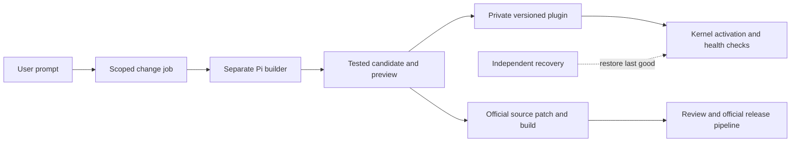

# Build Midnight Around Recoverable AI Changes

**Midnight should use a small dependable kernel, plugin-first product features, and a separate Pi coding builder that produces tested changes.** Support both destinations from the first prototype: private, versioned customization for each user, and reviewable improvements to the official app. Give them one extension interface and change-job protocol, with separate storage, activation and publishing authority. Keep the existing Pi coding-agent SDK plus Midnight journal initially; adopting Durable does not supply the missing build, deployment or recovery system. Make frequently changed features extensible, while keeping policy, receipts, activation and recovery dependable. The kernel remains improvable through the official source/build/release lane, so an extension API limitation never makes the app permanently unchangeable.

*Architecture investigation dated 13 October 2026, reconciled with the v0.6.0 checkout (`8d7b2e8`, version/release notes in `b05d911`). The design covers the full intended system; proposed contracts and stages are not a claim that every feature is delivered. The checkout implements chart/color plugins, exact-artifact dispatch, private activation and official proposals, a development-only app-source proposal lane, and independent damaged-cache recovery. The [implementation status](../docs/realtime-implementation.md) distinguishes implemented behavior from outstanding qualification.*

The confirmed initial model split is cloud reasoning/writing/building, local Whisper speech recognition and the existing local Gemma embeddings for retrieval. Native cloud audio/video is a later phase. The builder and precise-edit milestones do not depend on Gemma 4 serving or a native-media API account.

Use the configured cloud model for the builder and serving agent by default, and retain the existing Gemma embeddings locally for retrieval. Gemma 4 serving is optional. A private and an official chart change share the versioned package and change-job path: Settings → Changes stages either a private executable candidate or an official source patch with a synthetic preview and host-owned validation. Generated renderer code runs in a separate Chromium sandbox, while the separate Pi builder receives four scoped maintenance tools. Exact candidate review, activation, health checks, quarantine and recovery belong to Midnight. A native helper outside ASAR now archives damaged component caches, preserves private source/core receipts and permits actual packaged startup afterward. Shared shell/engine file leases and store identities fence live resets and old approvals. Wider contributions, general core repairs, installed upgrades/migrations and positive signed official-code recovery remain planned work.

## Midnight uses Pi inside a bounded change pipeline

The repository already integrates **Pi coding-agent SDK 1.0.1**. Its adapter controls session creation, supplies explicit tools and a broker gate, and disables ambient extensions, skills and context discovery. The serving agent currently has no arbitrary shell, source-patching, worktree, build or candidate-preview tools. The SDK can support a coding agent, but Midnight has deliberately not given those capabilities to its ordinary conversations. Ordinary missions can delegate through `builder_request`; maintenance powers remain in the separate builder. Charts and accent colors already use Midnight's plugin contract. General connectors, workflows, dependencies and migrations are still future extensions. ([Runtime adapter](../src/runtime/adapter.mjs), [Tool assembly](../src/tools/index.mjs))

The installed **app.asar must remain an immutable deployment base**. Packaging requires ASAR integrity and disables RunAsNode, NODE_OPTIONS and inspection; the packaged file set excludes the complete development checkout and tests. Repair therefore means generating a new plugin artifact or separately built official candidate, then selecting or installing that version. Editing the running archive is neither a source workflow nor a recovery strategy. Installed users need plugin source/templates plus a qualified builder toolchain, or an isolated hosted build service. ([Packaging fuses](../scripts/after-pack.cjs), [Packaged files](../package.json))

Pi's extensions add agent tools, commands, hooks and terminal UI; they do not define Midnight's Electron views, data migrations or app installation contract. Use Pi inside the builder and adapt plugin tools into Pi, while defining Midnight's own application interface. The SDK supplies explicit tools, resource loading and persistent sessions suitable for that builder. ([Pi extensions](https://pi.dev/docs/latest/extensions), [Pi SDK](https://pi.dev/docs/latest/sdk))

**Current upstream Pi is 1.2.0, released 12 October 2026; Midnight's recorded runtime comparison used 1.0.1 on 4 October.** That ADR reports duplicate external sends after recovery in both tested engines and selected SDK plus Midnight's journal. It is historical evidence, not a fresh Durable 1.2.0 evaluation. Durable remains experimental; 1.2.0 adds nested calls, codemode and tool search, alongside breaking changes. Requalify current policy hooks, MCP, storage, packaging and crash behavior before any migration. Self-improvement does not require that migration first. ([Pi changelog](https://pi.dev/changelog), [Recorded runtime ADR](../docs/adr/0001-runtime.md), [Durable README](https://raw.githubusercontent.com/earendil-works/pi/v1.2.0/packages/durable/README.md), [Durable changes](https://raw.githubusercontent.com/earendil-works/pi/v1.2.0/packages/durable/CHANGELOG.md))

## One plugin interface should serve two change destinations

| Approach | Useful property | Consequence for Midnight |
|---|---|---|
| Direct mutation of the running app | Few steps between prompt and changed code | Couples experimentation to startup, credentials and recovery; weak separation between personal and official changes |
| Everything dynamically replaceable | Very broad customization | Policy and recovery depend on the code they must supervise; introduces unnecessary lifecycle and dependency complexity |
| Small kernel plus feature plugins and official source changes | Broad customization with independent control and recovery | Recommended; requires explicit interfaces, immutable versions and a separate core-maintenance lane |

The kernel should own a narrow set of responsibilities, without first extracting every existing module into a separate package. A common contract must exist from the pilot; complete plugin conversion can follow demonstrated demand.

| Kernel retains authority | Features become extensible |
|---|---|
| Bootstrap, supervisor, repair UI, activation and last-good selection | Themes, settings, commands and supported UI slots |
| IPC validation, grants, approvals, stop and effect broker | Tools, formatters and domain capabilities through scoped RPC |
| Secrets, account selection and filesystem roots | Connectors and provider adapters through kernel services |
| Action journal, receipts, reconciliation and verification policy | Skills, recipes and workflows using brokered tools |
| Core storage ownership and migration rules | Namespaced plugin data and compatible private migrations |
| Update trust and official release authority | Bundled official features and private derived variants |

Use an **official base plus per-user overlays**, rather than a fork of the entire app per user. Reserve `midnight/<feature>` for official plugins and `user:<installation-id>/<feature>` for private versions. Keep each user's package source, configuration, state and active-version map separate. Modifying an official feature creates a derived private package recording its original version/hash. Supported bindings can select that user's chart renderer or theme; local plugins cannot replace the broker or recovery services. Official updates preserve compatible overlays and disable incompatible ones with an explanation, retaining their source.

The implementation now registers `midnight.chart` at `chart.render/bar` and `midnight.theme` at `ui.theme/colors`. The host catalog supplies schemas, validation version, activation binding, preview type and official source directory. Each supports bounded candidate files, personal activation and official source proposals. Color output is a constant six-token JSON map checked and frozen by the host, so normal painting does not execute generated code. A chart-only profile gains the official color binding without losing its private chart; scoped quarantine preserves an unrelated accepted component. General connectors/workflows, dependencies and migrations remain pending. Development app-source proposals exist; installed source/toolchain delivery, Windows candidate builds, previews and complete official-code repair remain pending. ([Actual process qualification](checks/plugin-components.json))



A minimal proposed manifest describes identity/version, host API compatibility, contribution schemas, entry point, requested capabilities, dependencies and state compatibility. The installer assigns origin and namespace; declarations request authority rather than grant it.

```json
{
  "id": "user:installation-123/charts",
  "version": "0.1.0",
  "api": "^1.0.0",
  "kind": "tool",
  "entry": "chart.mjs",
  "contributes": { "tools": ["chart.render"] },
  "capabilities": [],
  "dependencies": {},
  "stateSchema": 1,
  "derivedFrom": "midnight/charts@<artifact-digest>"
}
```

Keep tool input/output schemas with contributions; the host validates them and stages chart output through its existing effect boundary. Store package hashes and resolved dependency hashes in an immutable activation generation. Pin every running mission and stored effect to **the exact plugin artifact, tool schema/implementation and generation**. This is implemented for chart work: the mission retains its renderer contract and activation generation, classification binds the canonical request to that pin, and stored dispatch checks the recorded implementation digest and approved request hash before execution. Rendering loads the exact pinned artifact rather than the current active customization. Regression tests cover activation after approval and missing/changed artifacts. Future executable contribution types must preserve the same boundary; they do not inherit it merely by registering a tool name. ([Stored dispatch](../src/policy/broker.mjs), [Chart pinning](../src/tools/work.mjs), [Artifact runtime](../src/plugins/runtime.mjs), [Regression tests](../test/plugins.test.mjs))

## The builder produces candidates; the kernel activates them

An ordinary mission delegates a `builder_request` with user or official scope. It receives status, logs and a preview, while a separate supervised Pi session gets maintenance-specific tools. Start with the SDK in that worker, explicit resources and a persistent session identified by change-job ID; reopen that exact session after interruption. Source access, patching, fixed Git operations, builds, tests and staging require honest effect classes and bounded execution policies. Do not disguise arbitrary execution as deterministic calculation. ([Pi SDK](https://pi.dev/docs/latest/sdk), [Session examples](https://raw.githubusercontent.com/earendil-works/pi/v1.2.0/packages/coding-agent/examples/sdk/11-sessions.ts))

Diagnosis records the request, reproduction, expected behavior, scope, installed base commit, active generation and redacted diagnostics. Try reset or disabling a broken customization when the evidence supports it. Resolve source matching the exact installed artifact, then prepare a separate worktree or plugin workspace. Preserve unrelated developer changes. A Git worktree keeps candidate files separate; it does not confine code to that directory. ([Git worktrees](https://git-scm.com/docs/git-worktree))

The builder edits only its candidate. Host-controlled validation runs targeted behavior checks, extension conformance and relevant existing policy/architecture guards, followed by preview in a disposable profile. Keep critical validation rules outside agent-writable source. Build without production data, accounts, scheduling or publishing keys; initially avoid adding executable dependencies. Record the diff, immutable package/build digest, actual check results, capability changes and visible preview. Existing smoke tooling already separates user-data and credential directories, providing a useful starting seam. ([Disposable smoke profile](../scripts/smoke.mjs))

User scope yields a **private plugin version**, activated under the user's established policy without an official app release. Official scope yields a **reviewable source proposal**; publication belongs to the authorized maintainer and release stage. Plugin proposals include checked component source and a synthetic preview. The development app-source lane produces exact patches and frozen Node-suite validation, but a Windows candidate build and app preview remain pending. A user can propose a shared repair without becoming a publisher. Private settings, prompts and mission data are excluded from an official proposal unless intentionally supplied. The current release workflow creates draft releases; this investigation authorizes no installation, deployment or publication. ([Release workflow](../.github/workflows/release.yml))

Keep durable state compact and app-owned:

| Record | Essential contents |
|---|---|
| Change job | Request ID, scope/owner, exact base/source digest, workspace, Pi session, status, candidate digest, checks and error |
| Activation generation | Official base, API/data schema, exact plugin/dependency hashes, supported bindings, previous generation and health state |
| Activation intent | Deterministic operation ID, expected old generation, candidate digest, authorization and observed result |

Job states can be `requested → diagnosing → patching → validating → preview-ready`, then either `proposed` for official review or `activating → observing → accepted` locally. Failure outcomes include `failed`, `cancelled`, `reconcile-required` and `rolled-back`. Persist the activation intent before switching; drain affected missions, reconcile uncertain effects, back up relevant state and compare-and-swap the active generation. Stale bases require revalidation. After a crash, inspect the pointer/hash before retrying. Health checks cover startup, engine readiness, plugin handshake, representative output and renderer errors. During probation, suppress external effects; an unhealthy candidate is quarantined and the previous generation restored without executing its cleanup hook.

## Recovery and confinement remain independent of generated code

**A Node worker or Electron utility process provides crash containment, not a hostile-code sandbox.** Same-user arbitrary code can bypass a scoped RPC API and access files, credentials or networking directly. Node's permission documentation also disclaims protection against malicious code. Begin with declarative contributions, sandboxed UI, or explicitly owner-trusted local backend code. Shared builds need a genuinely restricted, secretless execution environment with controlled networking; qualify the actual Windows arrangement before promising confinement. ([Electron utilityProcess](https://www.electronjs.org/docs/latest/api/utility-process), [Node permissions](https://nodejs.org/api/permissions.html), [Pi security](https://pi.dev/docs/latest/security))

Prefer host-rendered UI schemas and theme tokens. Rich plugin panels can follow Midnight's existing isolated guest-view pattern: no Node integration, sandbox and context isolation, separate sessions, restricted navigation and a narrow host-owned bridge. Validate frame/origin and bind requests to the active artifact. Do not hand a guest the trusted shell's preload or load generated code into the policy-owning engine. ([Existing guest views](../src/desktop/app-workspace.mjs), [Electron sandbox](https://www.electronjs.org/docs/latest/tutorial/sandbox))

Recovery must work when normal chat, renderer or engine is broken. The checkout now has tray restoration, `MIDNIGHT_SAFE_MODE=1`, immutable activation history and a standalone native helper outside ASAR that archives damaged component caches while preserving private source and core receipts. These paths do not require model generation. They do not yet prove repair of damaged official app code, compatible state migrations or positive signed-installer recovery. The updater's normal backup callback still depends on the engine; complete official-code recovery needs separate qualification. ([Supervisor](../src/desktop/supervisor.mjs), [Updater integration](../src/main.mjs))

**Persistent jobs are neither rollback nor exactly-once arbitrary effects.** Durable atomically commits internal state, while external effects occur outside that transaction; replay controls do not prevent a model requesting the same semantic action again. Retain Midnight's action identities, receipts and unknown-outcome reconciliation regardless of harness. Rolling code back does not undo an email or upload. ([Durable specification](https://raw.githubusercontent.com/earendil-works/pi/v1.2.0/packages/durable/docs/spec.md), [Replay implementation](https://github.com/earendil-works/pi/blob/v1.2.0/packages/durable/src/harness/tool.ts#L147))

Prefer additive plugin-private migrations with previous-version read compatibility. A previous binary cannot automatically use newer state: Midnight already opens newer core schemas read-only. Restoring an old whole database after live use can lose user work and effect receipts, enabling duplicate actions. Reject incompatible activation without a restore strategy; after accepted live use, forward repair and reconciliation often suit the data better. ([Schema handling and backups](../src/storage/db.mjs))

## Both-scope pilot: implemented boundary and remaining rollout

The chart renderer has already been extracted into [`src/plugins/builtin/chart/renderer.js`](../src/plugins/builtin/chart/renderer.js), with host-owned validation in [`src/plugins/chart-validation.mjs`](../src/plugins/chart-validation.mjs). [`chart_create`](../src/tools/work.mjs) retains classification, exact mission binding and artifact staging. Charts and declarative accent colors both support private customization and official source proposals. Do not repeat this extraction; expand the interface only for a demonstrated new contribution.

**Stage 1: chart/color destinations and recovery — implemented pilot.** Scoped jobs, the shared catalog, separate builder, candidate preview and activation metadata are present. Recorded fixtures cover private restart/profile isolation and restoration, official proposals without publishing, and malformed/stale candidate refusal. See [component qualification](checks/plugin-components.json) and [packaged real-cloud builder qualification](checks/builder-cloud-packaged.json); each retains its historical build scope.

**Stage 2: chart extraction and failure handling — implemented pilot.** Exact artifact pinning, changed-data refusal, quarantine and interrupted activation recovery have regression coverage in [plugin tests](../test/plugins.test.mjs) and [theme tests](../test/theme-plugin.test.mjs). Process fixtures exercise hung-renderer cleanup and cancellation. These checks do not certify arbitrary hostile executable packages or every future contribution type.

**Stage 3: qualify installed-user building and official repair.** Supply exact source capsules/toolchains or isolated remote builds, and finish the independent official recovery path. Acceptance: an installed user customizes without editing ASAR; a broken-engine fixture can be repaired from the external path; official upgrades preserve compatible overlays and clearly disable incompatible ones. Exercise migration failure and retained receipts. Signed release operations require separate qualification; the current README describes unsigned builds. ([Current release limitation](../README.md))

## Conclusion

The first milestone should prove that Midnight can survive a bad change and still complete a good one through either destination. Once that loop works, extension coverage can grow with actual customization requests. The lasting advantage comes from separating generation, authority and recovery, while preserving a tested official route for improving the kernel itself.
