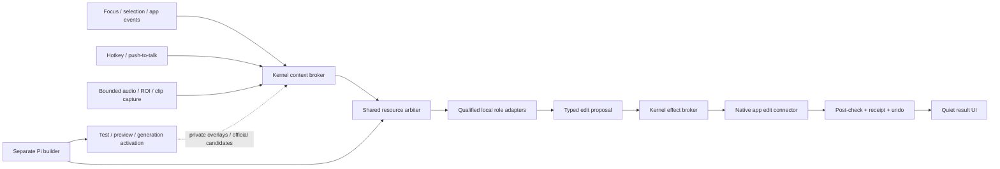
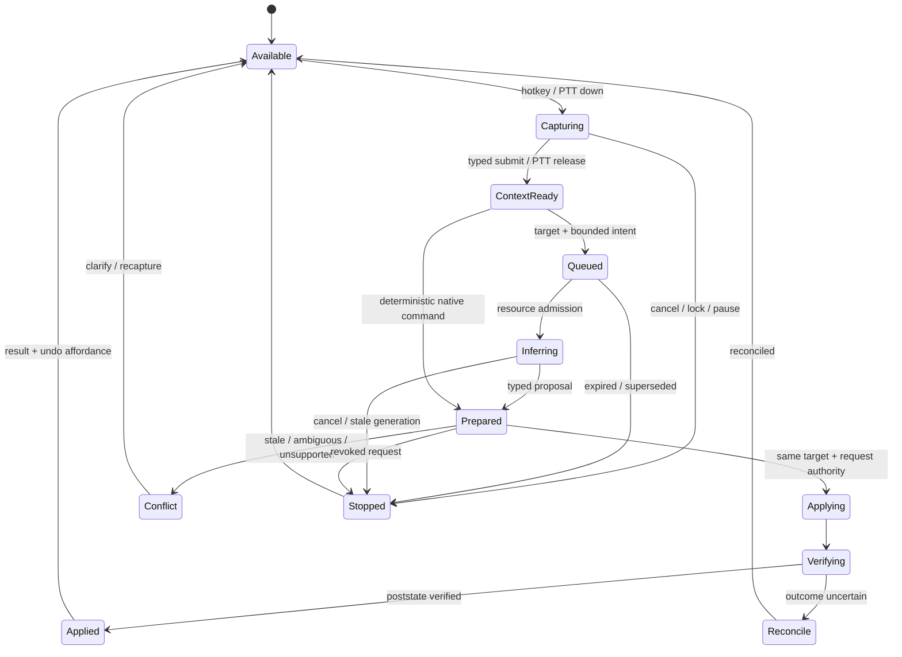

# Efficient background assistance and recoverable self-improvement

> **Historical research — 13 October 2026, before the realtime implementation.** The missing-feature descriptions and proposed module names below are not the current backlog. Bounded scheduling, shared inference admission, selection assistance, PTT and the two-component builder are now implemented. Use the [reconciled plan](../../reports/Midnight%20realtime%20assistance%20plan.md) and [current implementation status](../../docs/realtime-implementation.md) for remaining work. Repository links navigate to current files; obsolete source line numbers have been removed.

Research date: 13 October 2026. Scope: runtime/product architecture and delivery plan. Source reads only; no product code, model installation, Office operation, or deployment performed. Platform and model inventory comes from the coordinator/model researcher and must be integrated with that researcher's exact evidence. All designs and numerical budgets below are proposals for qualification, not measured capabilities.

## What exists today, and where must the runtime extend?

### Takeaway

Midnight already has a strong shell/engine boundary, quiet watches, an action ledger, power profiles and cancellation primitives. It does not yet have an external-app semantic selection broker, a shared scheduler covering all local inference, nonintrusive global push-to-talk, or live multimodal perception; these are extensions to current seams rather than a complete runtime replacement.

### Cited Findings

- The shell starts quietly in the tray, creates a hidden capsule, hides on close/minimize, and uses `backgroundThrottling: true`; the current global summon explicitly calls `capsule.focus()`. Background availability therefore exists, but summon is a focus-taking launcher flow. [Shell setup](../../src/main.mjs), [Summon](../../src/main.mjs), [Quiet startup](../../src/main.mjs).
- The supervisor forks one Electron utility-process engine, rejects pending requests after a crash, cancels platform calls, restarts with bounded backoff, and eventually reports `down`. It provides restart containment and a responsive independent tray; it is not the independent plugin/core rollback helper proposed earlier. [Supervisor](../../src/desktop/supervisor.mjs), [Prior architecture](../../reports/Midnight%20self%20improvement%20architecture.md).
- Engine assembly owns SQLite store/journal, ledger, approvals, budgets, roots, stop control, broker, tools, Pi runtime and queue; speech is instantiated separately from the mission queue. This is the central seam for introducing a shared inference/resource arbiter. [Host assembly](../../src/runtime/host.mjs), [Separate speech service](../../src/runtime/host.mjs), [Voice request](../../src/runtime/host.mjs).
- Current queue defaults allow two network missions and one local-inference mission, prioritize direct user work, and age waiting work upward. `waiting` is an uncapped array; started work is not preempted; there are no deadlines or stale-selection expiry rules. Embedding and speech requests are not inference missions in this queue. [Queue](../../src/scheduler/queue.mjs), [Coordinator queue choice](../../src/missions/coordinator.mjs).
- Resources provides Quiet/Balanced/Focused/Burst profiles, pauses lower-priority background work on battery and blocks new work on suspend. It records `locked: true` but its gate does not check `locked`. Main revokes desktop input leases on lock/suspend; this is not yet a rule stopping microphones, new observations or all background inference. [Resources](../../src/resources/profiles.mjs), [Gate](../../src/resources/profiles.mjs), [Signals](../../src/main.mjs).
- Current main subscribes suspend/resume, AC/battery, lock/unlock. Current Electron documentation exposes temperature-state changes only on macOS, and CPU `speed-limit-change` on macOS/Windows. The latter reports an OS CPU-speed-limit signal rather than a Windows temperature reading; it requires qualification against Midnight's pinned Electron 44.4.5 and the actual host. [Current handlers](../../src/main.mjs), [Pinned Electron](../../package.json), [Electron powerMonitor](https://www.electronjs.org/docs/latest/api/power-monitor).
- Local/offline missions are kept on the configured local endpoint; a weak local model does not automatically escalate to cloud. Current routing chooses one user-selected model for a mission and advertises text or image input using a configured vision flag; the existing `benchmarkLocal` tests only a tiny tool-call fixture. Native audio/video and role-specific model routing are not present in this interface. [Model routing](../../src/runtime/models.mjs), [Endpoint registration](../../src/runtime/models.mjs), [Benchmark](../../src/runtime/models.mjs).
- Voice currently records in the launcher using `MediaRecorder`, collects chunks, sends audio after stop, then inserts final text into Ask and focuses its textbox. Whisper runs locally on CPU, forces `language: en`, and unloads after 120 seconds. This is batch dictation, not background global push-to-talk, streaming recognition, or general native hearing. [Dictation UI](../../src/ui/app.js), [Batch finish](../../src/ui/app.js), [Speech lifecycle](../../src/voice/runtime.mjs), [Transcription](../../src/voice/runtime.mjs), [CPU worker](../../src/voice/speech-worker.mjs).
- Microphone access is currently allowed only to the trusted capsule, only for audio, only with voice input enabled. Guest apps do not automatically inherit access. A background capture service will need an explicit extension of this permission boundary. [Microphone policy](../../src/main.mjs).
- Embedding worker requests serialize, worker unload is 60 seconds, and text/image/audio/video modalities are used for local retrieval. Video retrieval samples frames and audio windows; the context service explicitly states it never generates answers. Multimodal similarity/search must not be presented as an agent that understands and acts on a live stream. [Embedding runtime](../../src/search/runtime.mjs), [Serialized requests](../../src/search/runtime.mjs), [Media segments](../../src/search/runtime.mjs), [Context contract](../../src/context/service.mjs).
- Current embedding worker sets a maximum of four CPU threads. Speech has no matching explicit thread cap in its source. ONNX Runtime documents per-session intra-op pools and thread spinning as sources of CPU/power use; runtime flags supported by the actual Transformers.js/ONNX Node stack must be verified before claiming an applied cap or no-spinning policy. [Embedding threads](../../src/search/embed-worker.mjs), [Speech worker](../../src/voice/speech-worker.mjs), [ONNX thread management](https://onnxruntime.ai/docs/performance/tune-performance/threading.html).
- Existing context retrieval adds relevant memories, past tasks, selected file excerpts and workflows, bounded to 10,000 context characters; preflight calls it for ordinary missions except browser page-assistant scope. That useful general assistant behavior must be bypassed by default in a quick selected-object edit. [Context preparation](../../src/context/service.mjs), [Coordinator preflight](../../src/missions/coordinator.mjs).
- The built-in web-app workspace can capture selected text or page text, capped at 18,000 characters, with app/profile/URL/title/time metadata. That is a web-view seam, not external Word integration. Its UI explicitly states selected/page text is saved to task history. [Capture](../../src/desktop/app-workspace.mjs), [Page script](../../src/apps/page-context.mjs), [Sharing note](../../src/ui/apps.js).
- External desktop helper currently reads `TextPattern.DocumentRange.GetText(max)` or value/name; generic `read_text` returns a window's text capped at 30,000 characters. There is no selected-range operation or selection-event subscription in that code. UI Automation has `GetSelection()` and selection/text-change events where an application exposes the necessary provider. Event support and empty/caret ranges are application-specific and need probes. [Current helper](../../src/tools/input-helper.ps1), [Tool](../../src/tools/computer.mjs), [Microsoft GetSelection](https://learn.microsoft.com/en-us/dotnet/api/system.windows.automation.textpattern.getselection?view=windowsdesktop-9.0), [Microsoft selection event](https://learn.microsoft.com/en-us/dotnet/api/system.windows.automation.textpattern.textselectionchangedevent?view=windowsdesktop-9.0).
- Screen input is fenced by a lease epoch, one owner at a time, expires after 20 seconds, and is revoked on takeover. Background requests cannot acquire it while the user has been active within five seconds. A native app-object edit broker should preserve separate target/document fences rather than pretending an app API mutation is ordinary screen input. [Screen lease](../../src/windows/lease.mjs).
- Watches use deterministic fingerprints and one nearest-deadline timer; unchanged checks make no model call. Attention notifications are deduplicated, cooled down by topic, held during quiet hours and never expand/focus the capsule. Extend these mechanisms to work assistance rather than adding unsolicited pop-ups for every selection change. [Watches](../../src/scheduler/watches.mjs), [Attention](../../src/scheduler/attention.mjs).
- Recorded 4 October shell baseline, with no model signed in and isolated profile, was 0.03% of one CPU core median, 243 MB private memory median, and zero idle model calls after the decorative dot rests. It did not measure model work, long soak, battery drain, or leaks; it cannot establish the cost of continuous listening/seeing. [Performance baseline](../../docs/performance.md).
- Existing ledger stores a tool-version field and canonical action args/authority; stored dispatch resolves the current tool by name. Executable plugin activation needs exact artifact/schema/generation binding on both mission and stored action before it can be safe across updates. [Ledger](../../src/policy/ledger.mjs), [Stored dispatch](../../src/policy/broker.mjs), [Previous proposal](../../reports/Midnight%20self%20improvement%20architecture.md).

### Inferences

- Preserve Pi serving plus Midnight journal for the first release. Add fast bounded command/edit services alongside ordinary missions; do not require a Durable migration to make background assistance work.
- Build on the tray, stop, IPC, evidence, attention and profiles. Highest-priority corrections are an actual lock/suspend observation gate and a single arbiter covering chat, ASR, embedding, visual/AV inference and builder workloads.
- Live Word paragraph improvement and Office chart-type conversion are distinct from the existing `chart_create` artifact generator. Do not use successful plugin chart rendering as evidence the Office edit bridge works.

### Gaps

- No current real-time sensor/inference traces, paragraph-quality results, battery soak, active Office edit tests, or verified hostile-plugin containment exist in this investigation.
- Model-research notes contain actual sibling assets and text-only bakeoff; merge those sources rather than treating repository configured names or found model files as proof of native AV readiness.

## How should efficient, precise real-time assistance work?

### Takeaway

Keep a lightweight always-available control plane and invoke expensive perception only on a scoped request or an opted-in, meaningful change. Capture a frozen semantic target before the hotkey/push-to-talk UI changes focus; infer a tiny structured edit, revalidate that exact target, apply through the app API, verify, and preserve undo/receipts.

### Cited Findings

- The earlier proposal establishes a dependable kernel, official base plus user overlays, exact immutable plugin generations, a separate Pi coding builder, and independent rollback/repair; all remain relevant to this larger design. Utility processes contain crashes but are not hostile-code sandboxes. [Prior architecture](../../reports/Midnight%20self%20improvement%20architecture.md), [Electron utility process](https://www.electronjs.org/docs/latest/api/utility-process), [Node permission limitations](https://nodejs.org/api/permissions.html).
- Source APIs expose a useful hierarchy: browser semantic selection, Windows UI Automation semantic text/control reads, and screen/ROI images. Current external desktop observations are tool calls rather than a passive event sensor. [Browser capture](../../src/desktop/app-workspace.mjs), [UI Automation helper](../../src/tools/input-helper.ps1), [Screen/ROI](../../src/tools/computer.mjs).
- Current core treats `desktop.input` as irreversible and auto-authorizes only read/compute/stage effects in standard modes; native targeted-edit authorization needs a new host-owned operation definition, not a model description pretending the operation is compute. [Effect classes and modes](../../src/contracts/domain.mjs), [Canonical broker intent](../../src/policy/broker.mjs).

### Inferences

Everything in this subsection is proposed, to be implemented and qualified.

#### Product behavior

1. **Default: hotkey and push-to-talk first.** Midnight remains in the tray, microphone closed, no screen stream and no generative calls in idle standby. Lightweight foreground/selection metadata subscriptions can be enabled for supported apps, but read content on invocation. A separate quick-command hotkey freezes the foreground target before opening a small command surface. PTT captures without summoning/focusing the existing capsule.
2. **Paragraph:** select one paragraph, hold PTT, say “make this clearer,” release. Snapshot selected text and metadata, optionally one adjacent sentence/paragraph only if necessary. Small text model returns a replacement for that range. Supported native edit mode can apply the user-requested change directly with a discreet result/undo affordance; a preview mode is also available. Do not repeatedly reconfirm an already scoped user request. Conflicting edits, ambiguous targets, broader scope or changed authority require clarification/preview.
3. **Chart:** select an editable native chart, type or say “change this bar chart to a pie chart.” A constrained intent parser routes to `chart.setType`; connector reads only target type plus required eligibility/data summary and changes the native chart property. No document-generation model, chart screenshot recreation or whole-document ingestion is required. Validate preservation of chart data and qualify incompatible chart/series cases with the Office agent's rules.
4. **Show tiny clear states:** Available, Listening, Working on selected paragraph/chart, Applied with Undo, Stopped, and Needs clarification/conflict. No focus-stealing progress window, auto-typing chat reply, spoken result or notification storm. Highlight the target only if helpful and noninteractive. Retain a one-click open-to-details result rather than embedding technical adapter names in normal user flows.
5. **Ambient mode later, explicit opt-in:** separate microphone, screen/window, and app subscriptions; visible tray/OS listening/capture indicator; excluded apps and sensitive fields; short local RAM buffers; immediately close capture on pause/lock/suspend. VAD detects speech activity, not instructions, intention, or permission. Wake-word/intent qualification and false-activation tests come before voice-only ambient command execution. Background suggestions prepare/read by default; no spontaneous paragraph rewriting.

#### Proposed data path and process layout



- **Trusted main/kernel:** IPC validation, hotkey capture ordering, capture grants/indicators, emergency stop, resource admission and kill handles, secrets, durable effect log, activation map and repair UI. User/plugin/model cannot grant itself more capture access or remove stop/repair.
- **Serving engine:** Pi conversations, mission/quick-task coordination, context selection, model-independent typed proposal handling. A short deterministic native chart command can bypass Pi's general conversational turn while entering the same effect broker.
- **Inference services:** reusable host-owned adapters for text, ASR, embeddings and AV, each exposing load/residency/cancel/dispose. Plugins call shared services; each plugin must not launch a separate copy of all models. Separate workers/processes only where needed for crash/fault isolation; process separation does not by itself share weights or KV state. Budget actual memory of weight buffers, KV cache, projector/encoder, decoded frames, processes and runtime overhead.
- **Windows app broker:** narrow validated RPC to user-session native connector; Word COM needs a separate STA broker (Office researcher), rather than expanding arbitrary PowerShell screen automation. Per-app object scopes and epochs remain independent of model reasoning. Host plugin worker RPC plus OS restrictions if claiming untrusted executable confinement; owner-trusted backend code is the initial supported option.
- **Builder:** separate process/session/profile and maintenance tools, secretless candidate workspace and previews; shares resource admission with serving but never consumes the interactive slot while the user needs help.
- **Recovery:** activation pointer/log outside plugin-owned state and routine schema changes; independent safe-start controls and cached last-good packages. If shell itself fails, external verified repair path, offline and without a model.

#### Contracts to freeze early

Proposed illustrative fields, not an implemented API:

```ts
type ContextCapsule = {
  id: string; requestId: string; capturedAt: number; expiresAt: number;
  invocation: 'typed' | 'pushToTalk' | 'ambientAccepted';
  app: { connectorId: string; processId: number; windowId: string;
         documentInstanceId: string; documentVersion?: string };
  target: { kind: 'textRange' | 'chart' | 'control' | 'region';
            locator: object; handleToken?: string; beforeHash: string;
            revisionFence?: string; selectionEpoch: number };
  parts: Array<{ modality: 'text' | 'image' | 'audio' | 'video';
                 contentRef: string; t0?: number; t1?: number;
                 source: string; purpose: string; maxTokens?: number }>;
  allowedOps: string[]; privacy: 'local' | 'offline' | 'cloudExplicit';
  activationGeneration: string; connectorArtifactDigest: string;
};
type EditProposal = {
  contextId: string; requestId: string; targetHash: string;
  operation: 'text.replaceRange' | 'chart.setType';
  patch: object; needsContext?: object; explanation?: string;
};
type EffectReceipt = {
  operationId: string; requestId: string; contextId: string;
  connectorArtifactDigest: string; schemaDigest: string;
  targetIdentity: object; beforeHash: string; afterHash?: string;
  result: 'verified' | 'conflict' | 'failed' | 'unknown';
  undo?: { kind: 'native' | 'compensation'; token: string; expiresAt?: number };
};
type InferenceJob = {
  id: string; taskId: string; contextId?: string; generation: number;
  role: 'intent' | 'rewrite' | 'asr' | 'retrieval' | 'vision' | 'nativeAV' | 'builder';
  priority: number; createdAt: number; deadline: number; staleKey?: string;
  maxInputTokens: number; maxOutputTokens: number;
  cpuThreadBudget: number; ramReservation: number; acceleratorReservation?: number;
  signal: AbortSignal;
};
```

Required app connector methods: `capabilities`, `captureTarget`, `readTargetPart`, `prepareEdit`, `applyEdit`, `verifyEdit`, `reconcileEdit`, `undoEdit`, `releaseTarget`. Exact names can change; these semantics must not.

Required model adapter: stable model/runtime/projector artifact digests, verified modalities, languages, input limits, structured-output/tool capability results, measured cold/warm latencies and RAM; `load`, `infer`, `cancel`, `unload`, `status`. Native audio/video requires both the proper model artifacts and a transport/runtime path accepting those inputs. ASR/embeddings cannot be re-labelled as general native AV reasoning.

#### Minimal context and target correctness

- At hotkey/PTT-down, freeze foreground app/document/selection before the launcher changes focus. Maintain both original target and current attention; a new selection while speaking does not silently redirect “this.” On release, show original target/interpretation if ambiguity exists. On initial no selection, connector may identify the caret paragraph; make this clear in the quick UI and qualify before enabling default direct edits.
- Prefer native app-object context, then accessibility semantics, then DOM, then bounded screenshot ROI/OCR and temporal frames as supporting evidence. Native typed chart API uses chart data/type, not visual guesswork. Screenshot-only target receives a preview/screen plan unless reliable API mutation exists.
- Start quick-task context with instruction + selected target + narrow metadata/style constraints; illustrative input budget 1,500–2,500 tokens, output 256–512, lower for chart intent. Expansion is progressive, bounded and attributed: neighbor paragraph, referenced table, style setting, or relevant explicit preference. A request needing a whole document becomes an explicit larger task rather than silently turning a paragraph edit into one.
- Add `contextProfile: 'selectedTarget' | 'conversation' | 'research'` to coordination. `selectedTarget` suppresses default memory/history/file search and long prior conversational history; only explicit related preferences are permitted. Reuse current broad retrieval for research/conversation.
- Temporal parts carry monotonic timestamps, common clock, time span and source revision. One ROI at invocation is sufficient for many commands. Motion/audio requests require short ordered windows with sync; native video can process ordered sampled frames/clip where qualified. A continuous 30fps capture feed into a large model is not a prerequisite for real-time editing.
- App API mutation must recheck same document-instance, resolved native range/object identity, before text/data hash and request authority immediately before applying. A range handle can move with surrounding edits; it does not create atomic compare-and-swap. Do not fuzzily find a repeated paragraph and replace the first match. Reject/re-capture stale or conflicting targets, then postcheck and produce a receipt. App-specific atomicity/undo limitations come from the Office research.
- Input/selection observations expire; draft budgets and handles release after a short TTL (proposal 30–60s, longer only while the user deliberately previews). After restart, rehydrate intended task/effects but re-capture transient targets; never replay queued live-window clicks/range edits merely because a durable turn resumed.
- Raw ambient audio/screenshots/frame history remain ephemeral bounded RAM and are discarded on expiry/lock/pause. Separate this from intentionally submitted target text/replacement and effect receipts needed for undo/reconciliation; those can require persisted, user-owned records under explicit retention settings. Do not promise that durable mutation recovery stores no document content when canonical edits inherently contain it. Persistent preference memory requires user intent, not ambient accumulation.

#### Scheduling and residency

- Priority order: emergency stop and capture closure; active explicit native edit/PTT/voice finalization; other direct user work; opted-in background assistance; indexing/embedding; plugin build/validation. Aging applies within background classes and must not promote an old speculative frame above a current user request.
- One heavyweight CPU inference slot on this i7/16GB/UHD620 host as initial profile; bounded lightweight VAD/capture and native app broker may run alongside. Pause indexing/build-heavy work during explicit assistance. Start with 1–2 background CPU threads and benchmark 2–4 active inference threads rather than inheriting a seven-thread sibling launcher. Use aggregate reservations across all adapters, not a cap per process that sums beyond the host.
- Bounded queues by count/memory and deadlines; retain newest observation for each app/target/stale key, coalesce rapid events, discard expired selections/frames, never backlog hours of analysis. Explicit tasks remain durable user tasks; stale observation jobs do not.
- On new interactive work, cancel/yield background inference at a supported boundary. Fence result delivery and edit dispatch by job generation even if native computation cannot be immediately interrupted. Soft cancel per request first; if a qualified exclusive worker is unresponsive, terminate that inference process without killing the kernel/ledger/app broker. Cancellation acknowledgment and resource release must be tested, not inferred from Promise rejection.
- Residency states: **available** (installed metadata, no heavy model); **warm standby** (one recently used small model only, RAM permit, AC power); **active** (admitted request); **battery/constrained** (no speculative heavy AV/build, unload heavy idle models); **paused/locked** (capture closed, transient buffers cleared). Keep current ONNX idle unloading as defaults until traces justify reuse; avoid swapping E2B/E4B/ASR/embedding on every event. Warm resident models should make no inference calls while idle.
- Reserve memory for Office/user apps and avoid swap thrash; proposal retain at least ~4GB or a measured fraction of free system RAM, then select unload/less context/queue instead of load. This is admission policy to tune, not a guarantee that E4B+encoder+KV fits concurrently. GPU models consume shared system RAM on integrated graphics; Vulkan must beat CPU in actual tests before defaulting to it.
- On lock/suspend close capture and reject new observe/edit jobs; stop result delivery requiring live targets; revoke native edit epoch as well as screen lease. On battery pause background inference/build and shorten warm TTL. Add OS `speed-limit-change` handling if actual pinned Windows runtime emits it; use that to lower thread/admission budgets, and describe unavailable temperature honestly.

#### State machine



Do not model `Applying` cancellation as guaranteed rollback: in-flight app mutation can complete, fail or become unknown and require poststate reconciliation.

#### Plugin integration and both self-change scopes

- Official base plus per-user overlays, shared interfaces for app connectors, permitted sensors, model adapters, workflows, UI slots, charts and themes. Kernel owns permission/resource/secret/effect/recovery services. The official source/build lane can improve the kernel; plugins cannot privately override its authority.
- Extend manifest with typed contributions (`appConnector`, `sensor`, `modelAdapter`, `workflow`, `ui`), requested modalities/capture scopes, model resource limits, exact adapter/runtime hashes and state compatibility. Declared budgets are admission requests, not authority. Capability changes go through kernel installation policy; no free microphone/screen access from a generated manifest.
- `changeJob.scope = 'user' | 'official'` from the first chart-plugin prototype. User creates private versioned customization persisted in own overlay; official yields reviewable source diff/tested candidate, publishing by authorized maintainer. Same diagnostics/build/check/preview job, different destination and activation authority.
- Builder is preemptible lowest-priority work by default, resumes exact session/workspace/check state, and cannot install its output directly or rewrite ASAR. Qualify SDK/Durable separately later; replay is not deployment/rollback or exactly-once external mutation.
- Pin exact connector/plugin/schema/generation in captured target, prepared edit and ledger; retained actions either use recorded implementation or enter reconciliation/block if unavailable. Activation drains affected app handles/missions and prevents a new connector from executing an old approved edit.
- Host-controlled validation plus disposable app preview; immutable candidate hashes; compare-and-swap activation pointer; probation; independent last-good restore. Reverting code does not undo live document writes or external effects. Preserve ledger receipts through rollback, and reject incompatible data migrations without a forward/recovery strategy.

### Gaps

- Current Windows provider supports some UIA semantics, but stable external-app target identity and native edit correctness still require app-specific connector tests.
- Host cannot claim GPU memory, Windows temperature telemetry, interruption of native ONNX mid-op, or a malicious-code sandbox from current process boundaries. Each requires qualification or an explicit narrower trust promise.
- Model quality, native AV latency, language behavior and temporal perception remain model-research gates. Basic targeted editing does not depend on them.

## What should we implement, measure and accept first?

### Takeaway

Run two related lanes: a useful Word/native-edit assistance path and a recoverable plugin-builder path supporting personal and official changes from its first prototype. Qualify local models and scheduler early; add voice before ambient, and native AV after semantic editing is reliable rather than blocking the first useful release on missing AV components.

### Cited Findings

- The prior prototype intentionally uses Midnight's own deterministic `barChartSvg`/`chart_create` renderer and validation to prove private and official plugin changes. It does not modify existing live charts in Word. [Bundled renderer](../../src/tools/work.mjs), [Chart tool](../../src/tools/work.mjs), [Prior stages](../../reports/Midnight%20self%20improvement%20architecture.md).
- Current baseline omits workload/long-run power/resource measurements, and current local benchmark is only a micro tool call. Broad benchmarks and resource telemetry are necessary before a real-time product claim. [Performance gaps](../../docs/performance.md), [Microbenchmark](../../src/runtime/models.mjs).

### Inferences

#### Module seams / proposed files

| Existing seam | Proposed extension | Why |
|---|---|---|
| `src/main.mjs`, `desktop/hotkey.mjs`, `contracts/ipc.mjs` | quick invocation events, capture-before-focus, independent status/cancel path | preserve foreground target and avoid launcher focus stealing |
| `desktop/platform.mjs`, `tools/input-helper.ps1` | `desktop/context-sensors.mjs`, user-session native sensor/app-broker bridge | event subscriptions and selected-object context rather than whole-window reads |
| `context/service.mjs`, `missions/coordinator.mjs` | `context/active-target.mjs`, `context/capsules.mjs`, `contextProfile` | separate quick edit scope from broad recall |
| `voice/runtime.mjs`, `ui/app.js` | `voice/capture.mjs`, `voice/stream.mjs`, PTT transport and timestamped segments | capture while capsule hidden and avoid only-after-stop dictation architecture |
| `runtime/models.mjs`, `search/runtime.mjs`, `voice/runtime.mjs` | `inference/registry.mjs`, `inference/arbiter.mjs`, owned adapters | unified role/capability/residency/cancel/resource contract |
| `resources/profiles.mjs`, `scheduler/queue.mjs` | process-aware reservations, priority/preemption, bounded/stale queues, lock gates | current mission slots do not cover all local work |
| `tools/work.mjs`, `policy/broker.mjs` | app-specific typed effects/receipts + deterministic chart command | exact native changes with retained authority/verification |
| `desktop/supervisor.mjs`, `storage/journal.mjs` | supervised inference/builder workers, independent activation log/repair | failure containment and recoverable changes |
| Existing tools/skills/apps connectors | `plugins/manifest`, registry/bindings/activation, builder jobs | both overlay and official scope from initial contract |

Do not require immediate extraction of every legacy module. Introduce narrow interfaces at seams and extract features as actual customization demands appear.

#### Proposed phases with dependency gates

| Phase | Work | Exit/acceptance evidence |
|---|---|---|
| 0: inventory + bench + foundations | qualify exact local asset/runtime capabilities, add shared arbiter telemetry, close lock gate, target/context/job schemas; decide supported Word build/edition | actual model/runtime digests; CPU vs Vulkan results; cold/warm+RAM metrics; all local roles counted; no capture after lock; background job yields or waits when interactive arrives |
| 1A: typed selected-target assist | read-only target preview then scoped paragraph rewrite and native Word chart type change; app broker + receipts/undo | only selected paragraph/object changes; formatting/data preserved per contract; concurrent edits/switch-app/stale target blocked; native chart remains editable; same content repeatedly does not misroute; no whole-doc model input |
| 1B: plugin builder both scopes | own chart renderer/theme pilot, immutable manifests, exact version dispatch, isolated builder, preview and activation recovery | personal overlay survives restart/undo; independent second profile unchanged; official produces source diff+tested candidate, no publication; bad candidate quarantines and shell repairs without model; chart plugin proof separately named from Office chart proof |
| 2: PTT/ASR fast path | global no-focus PTT, timestamped audio, original target freeze, finalized intent, cancel/resource lifecycle; multilingual gates from model researcher | user continues typing elsewhere; command edits original intended target or asks if stale; held mic indicator; local audio never leaves local/offline route; streaming or short batch latency measured; no execution from partial transcript |
| 3: event-triggered seeing + native AV qualification | ROI snapshots/ordered clips on request, missing projector + verified transport only after approved installation workflow; semantic fallback; per-language AV tests | qualified image/audio/video facts rather than embeddings; temporal order/audio alignment tests; native audio limits obeyed; CPU/RAM/cancel within budget; missing AV leaves typed/native editing useful |
| 4: opt-in ambient + installed-user building | pause/lock/exclusion/privacy indicators, false-activation/quiet suggestion gates, long soak; exact source capsules/toolchain or isolated build route and external recovery | no unwanted edits; safe stop while inference hung; battery/24h/leak measures; incompatible overlays disable with explanation; installed ASAR unchanged; recovery works with engine unavailable |

Lanes 1A and 1B may develop concurrently once schemas/authority fences are shared; voice and AV build on the same target broker. Official/native connector fixes and per-user workflow/model/UI customizations use the same self-change pipeline.

#### Acceptance matrix and proposed experimental budgets

| Test class | Required outcome / measurement |
|---|---|
| Narrow context | packet logs show target content and bounded requested neighbors only; no whole-document read or broad history by default; zero unrelated paragraphs sent |
| Nonintrusion | no app focus change from PTT/progress/result; optional typed prompt returns focus predictably; native input latency measured while inference runs |
| Correctness | only intended target mutated; repeated paragraphs, multiple documents/windows, shapes/charts, rich text, unsaved docs and typing during request covered; connector receipts verified |
| Native chart | type changes through chart object API; exact source data/series preserved; unsupported/multi-series/invalid pie inputs handled with app-specific rule; unrelated charts unchanged |
| Authority | explicit scoped user command executes without redundant approval; suggestion cannot mutate; capture/model/plugin requests cannot widen scopes; risky external effects retain existing broker policy |
| Cancellation | stop closes capture immediately, fences dispatch/results, releases or terminates owned heavy worker; in-flight mutation reconciles; stale partial voice outputs cannot edit |
| Resource | aggregate model threads, RAM/KV/encoder reservations; builder/indexing never starve active help; offline policy never silently switches cloud; memory reclaimed after TTL |
| Durability | crash before/after app mutation resolves observed outcome; no blind redispatch; stale active targets re-captured after restart; old connector/artifact required for pending action |
| Self-change | both scopes demonstrable from outset, immutable candidates and exact-version bindings, two-user overlays isolated, retained receipts through rollback, independent repair |
| Privacy | microphone closed/zero generated inference idle default; opt-in indicators, excluded app/password content, RAM buffers erased on lock/pause; intentional target/patched content retention documented |
| Soak | 8h interactive workload + 24h idle/watch and battery runs; CPU median/p95, private/RSS/PSS where available, storage growth, per-hour inference calls, capture duty cycle, battery drain and user-input latency traced |

Proposed starting qualification objectives (not promises):

- Preserve settled idle shell median below 0.5% total-machine CPU, p95 below 2%, and zero generative calls with no task; target unloaded base footprint around current 250MB-class baseline, allow documented increases for new native helpers and compare full-tree private memory. Separate unloaded baseline from warm-model memory.
- Acknowledge an invocation and show appropriate listening/working status within 100–150ms; freeze target within a measured budget (initial goal <300ms for a warm simple connector, retain longer measured fallback for Office cold attach). Do not depend on model completion for responsiveness.
- Native deterministic chart operation aims for <1s after finalized instruction under compatible, warm app conditions; measure Office broker startup separately. Generative paragraph rewriting aims for useful warm results in a few seconds, with a first-release p95 goal around 10s for a short range if quality meets threshold; actual model fixtures decide routing/timeouts. Cold starts need explicit working status and measured deadline.
- For a truly streaming voice route, require real-time factor comfortably below 1 under the shared CPU budget (proposed <=0.5 reserve), and tail finalization around <=1s for short commands; if current ASR misses that gate, ship bounded PTT batch with honest measured response time and retain local voice option. VAD alone does not satisfy this gate.
- Initially admit at most one heavyweight inference, one active target capture/edit, and a latest-only observation job per app; proposal cap queued background captures at 4 and explicit quick requests at 8, rejecting/coalescing beyond caps with a plain status. Tune from traces.
- Instant cancel UI/gate acknowledgment target <=100ms; compute reclamation <=1s is a separate qualification target and may require an owned inference process. Do not claim app mutation cancellation is rollback.
- Single event-driven ROI snapshot by default; visual burst proposals <=1fps for a short bounded request and only on meaningful change. Capture frame rate and reasoning update rate are different quantities. Native AV temporal ability and continuous streaming remain capability gates.

#### Risks and decisions to keep visible

- Local small models may parse simple commands well yet write weaker prose or miss visual/temporal facts. Exact native commands, text rewrite and AV receive separate fixtures and fallbacks; no “all models can do everything” route.
- Old integrated-GPU host has limited shared RAM/power. Judge E2B/E4B/tool/parser/ASR choices with actual concurrent Office workload and warm/cold tradeoffs. Static file size and synthetic tool-turn timings do not establish paragraph or AV performance.
- Office context/undo APIs are not universally atomic; preserve user edits and use conflict/unknown states. Font/runs/tracked changes/source-data preservation must be tested with real fixtures.
- Ambient recording can capture bystanders/sensitive work; permission indicators, app exclusion, short local buffer policy and no raw ambient persistence are product requirements. Implementing microphone access is distinct from authorizing an inferred edit.
- Privately generated executable sensor/connectors need trust/confinement qualification. Start with declarative contributions and owner-trusted backend code; remote/shared builder workers need genuine secretless OS/container restrictions.
- Plugin generations, schema/data migrations, privacy routing and external-effect receipts cannot be repaired by merely swapping JavaScript. Preserve dependable kernel/recovery and exact implementation identity.

### Gaps

- Numerical goals need a repeatable benchmark harness, representative Word fixtures and the user's exact active Office version. This plan defines gates; it does not establish them.
- No schedule estimates are reliable until native connector and model integration spikes quantify unknowns. Work packages and acceptance gates are more useful than a calendar commitment at this stage.
